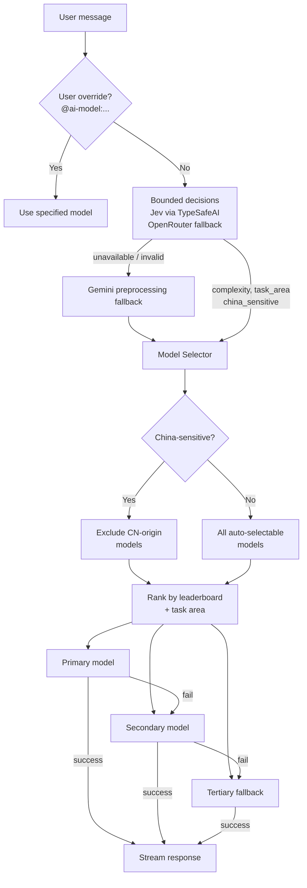

# AI Model Selection

> Jev selects the request's reasoning depth. Saved model choices take precedence over fixed automatic profiles, with sensitivity filters and ranked fallback models.

## Why This Exists

A single model cannot optimally serve all request types. Simple factual questions waste money on premium models; complex coding tasks need top-tier reasoning. The selection system matches request characteristics to model strengths while filtering out models that may be censored on sensitive topics.

For OpenAI and Anthropic, the composer and AI settings show the curated current
models first. A collapsed **Show old models** section contains supported chat
models still available via API that were released within the preceding twelve
calendar months, including the boundary date. Older entries carry
`legacy_model: true` and `allow_auto_select: false` in provider YAML. Release dates
use the public launch date rather than a date embedded in an API snapshot ID.
Confirmed API shutdowns use `api_retirement_date`; a provider's “not sooner than”
commitment is not a shutdown date. The web picker, mentions, CLI, and backend
availability checks apply this policy while retaining raw pricing for historical
billing. For example, Claude Opus 4.8 (released May 28, 2026) is selectable in the
older section on October 8, 2026.

## How It Works

### Configuration

Model selection is configured in [`backend/apps/ai/app.yml`](../../backend/apps/ai/app.yml) under `skill_config`:

- **`enable_auto_model_selection`**: When `true` (current default), uses intelligent leaderboard-based selection. When `false`, falls back to hardcoded `default_llms`.
- **`default_llms`**: Hardcoded model IDs for preprocessing, simple requests, complex requests, and content sanitization.
- **Current defaults**: Jev (`typesafe/jev-1.14`) handles bounded decisions. Only decision paths that already permit generative recovery use native Mercury 3 LOW, then Gemini 3.5 Flash-Lite (`google/gemini-3.5-flash-lite`); healthy Jev and its Unsure contracts are unchanged. Generative postprocessing retains Flash-Lite. Automatic answer profiles live in `backend/apps/ai/processing/model_routing.py`:

| Request complexity | Automatic model | Thinking | Saved preference bucket |
| --- | --- | --- | --- |
| low | Mercury 3 (direct Inception) | LOW | Simple |
| medium | Gemini 3.8 Flash | MEDIUM | Complex |
| high | Gemini 3.8 Flash | HIGH | Complex |
| max | Gemini 4 Argon | HIGH | Most demanding |

Eligible low-complexity text uses native Mercury 3 LOW. Gemini 3.8 Flash LOW
handles unavailable credentials/models, disabled model/server restrictions,
unsupported modalities and provider outages, or a five-second deadline before
the first substantive output. A stream that has already published useful output
is not silently replayed through another model. Exact chat choices and saved
preferences retain precedence over this automatic default.

Ordinary transcript correction separately uses Mercury LOW with a five-second
deadline including credential lookup, then Gemini 3.8 Flash LOW. Workflow
authoring allows at most three actual calls: Mercury INSTANT, Mercury LOW repair,
then Gemini 3.8 Flash LOW repair. Accepted steps remain immutable; exhausted
recovery retains a validated disabled partial with an explanation. Jev remains
the workflow decision model. See the [rollout record](../../plans/mercury-fast-inference/rollout-addendum.md).

Low covers ordinary Q&A, retrieval and transformations; medium covers bounded
multi-step reasoning and synthesis; high covers intricate debugging, proofs and
interacting constraints. Max is rare and requires sustained interdependent
reasoning with exceptional correctness constraints. Length, importance, tools,
attachments and dissatisfaction alone do not qualify. High-versus-max uncertainty
chooses high; malformed classification falls back to medium. Legacy classifier
labels simple, complex and most_demanding map to low, medium and max.

The three persisted preference fields and settings controls remain compatible.
An exact chat/API model wins over the matching saved preference, which wins over
the automatic profile. Automatic thinking levels apply only to the matching
automatically selected model; explicit choices keep their own configuration.
Request complexity, catalog capability and provider thinking are separate values.

### Provider YAML Structure

Each LLM provider has a YAML config in [`backend/providers/`](../../backend/providers/). Models define:

- **`country_origin`**: ISO 3166-1 alpha-2 code (used for China-sensitive filtering)
- **`allow_auto_select`**: Whether the model participates in leaderboard fallback selection; pinned request profiles are resolved separately. Argon is pinned only for max and excluded from general leaderboard picks.
- **`external_ids`**: Cross-platform ID mappings (LMArena, OpenRouter)
- **`default_server`** and **`servers`**: Provider routing (e.g., AWS Bedrock primary, direct API fallback)
- **`servers[].model_id`** and **`reasoning_effort`**: Provider-specific upstream IDs and reasoning controls for catalog variants such as Sol Max
- **`pricing`/`costs`**: Token pricing for billing

### Selection Flow

1. **User override check**: If the message contains `@ai-model:{model_id}`, that model is used directly, bypassing all selection logic. Other overrides: `@mate:{name}`, `@skill:{app}:{id}`, `@focus:{app}:{id}`.

2. **Preprocessing decision analysis**: The preprocessor ([`preprocessor.py`](../../backend/apps/ai/processing/preprocessor.py)) first calls Jev's decision endpoint for bounded fields. Jev returns typed Choice, Noul, and Score answers rather than text. It supplies:
   - `complexity` (low/medium/high/max), using the same four-level policy in the generative fallback
   - `task_area` (code, math, creative, instruction, general)
   - `user_unhappy` (boolean)
   - `china_model_sensitive` (boolean, detected by LLM -- replaces old hardcoded keyword approach)
   - topic/language/safety scores and bounded skill, focus, memory, preview, and icon selections

   A fresh client-authorized chat summary may accompany the bounded recent-message projection as a separate typed state field. It is sanitized, capped at 4,000 characters, and labeled conversation data rather than instructions. If Jev is unavailable, malformed, oversized, or below a required confidence threshold, the existing Gemini structured-output preprocessing path runs with its own provider fallbacks. Jev is never selected as the main answer model. See [TypeSafe Jev decision API](../../apis/typesafe-jev.md).

3. **Model selection** ([`model_selector.py`](../../backend/apps/ai/utils/model_selector.py)):
   - Filters to models with `allow_auto_select: true`
   - Excludes CN-origin models if `china_model_sensitive` is true
   - Uses the eligible pinned profile for the classified request complexity
   - If that profile is excluded or unavailable, low requests prefer economical ranked models; medium, high and max prefer premium ranked models
   - Dissatisfaction can affect ranked fallback selection without automatically promoting the request to max
   - Returns the eligible tier default and the ordered, current recovery models; rankings never add a premium model to failure handling

4. **Main processing with fallback** ([`main_processor.py`](../../backend/apps/ai/processing/main_processor.py)):
   - Tries primary model first
   - On failure: tries secondary, then fallback
   - Each model may have multiple server providers (e.g., AWS Bedrock then direct API)
   - Derives the usable history budget from that model's configured context window after subtracting the actual system/tool estimate, expected output, and a safety reserve
   - Recomputes the budget before each tool iteration and provider fallback because prompts, tool results, and model context limits can change

### Independent long-chat budgets

Preprocessing and answer generation deliberately have different context boundaries. Jev sees only its bounded routing projection; the generative preprocessing fallback retains its own 120k safety guard. Chat compression runs after preprocessing has selected and billing has validated the actual main model. Its trigger is derived from that model's configured context window, expected output, and safety reserve, so a 32k Jev request never causes a 200k or 1M answer model to forget the rest of the chat.

Compression summaries preserve exact artifact references. A separate Vault-encrypted, content-free artifact ledger retains only `embed_ref -> embed_id` metadata for the lifetime of the AI chat cache. It restores tool resolution after the source message has left active context, stores no pixels, file bytes, OCR text, transcripts, or skill output, and is invalidated with message/chat deletion. Missing cache or Vault access is non-fatal and falls back to references resolved in the current request.

### Prompt caching and temporary provider replay

Ordinary authenticated chats on an active, eligible direct-provider tariff can use provider-reported prompt cache reads. Direct OpenAI Responses and supported Claude 5.5 models keep a stable system prefix and replay the selected baseline function tools, prior provider output, and tool results. Later turns append current instructions and selected-tool changes; OpenAI restricts callable names with an allowlist when tools are removed. The native replay route is limited to the explicitly supported direct models in `llm_utils.py`; other hosts and chat scopes use their existing request path. [OpenAI's prompt caching guide](https://developers.openai.com/api/docs/guides/prompt-caching) describes explicit boundaries and preserved history; [Claude's prompt caching guide](https://platform.claude.com/docs/en/build-with-claude/prompt-caching) describes its cache controls and usage counters.

Replay is temporary private context. The completed provider transcript is sealed with the user's Vault key in the existing AI cache, subject to that cache's TTL, LRU, and byte limits. The task queue carries ciphertext only; the worker decrypts it when a later authorized request needs it. Neither Directus nor client messages receive a permanent replay field. A missing cache entry, changed history, model or host fallback, unavailable Vault access, unsupported provider artifact, or unsafe replay size starts a cold segment. The visible chat remains the source of truth.

Google and Mistral use their providers' implicit cache behavior and bill reads only from reported counters. Mistral's `prompt_tokens_details.cached_tokens` is inclusive within prompt tokens, as its [prompt caching guide](https://docs.mistral.ai/studio/conversations/advanced/prompt-caching) specifies. For direct OpenAI models with separately priced writes, missing write counters do not imply zero writes: customer billing uses the full ordinary input rate for that attempt. Claude requires its reported write and retention categories for separate-write billing; unavailable categories likewise use the ordinary input fallback. Receipts retain the frozen attempt rates and reported categories.

Temporary provider rates are resolved for the attempt's host, region, service tier and UTC start time, then frozen for supplier accounting and customer billing. Mistral Large 4's current half-price offer has no published end date, so its scheduled sale remains active until updated; expired dated offers automatically return to the regular tariff. See the [October 14 pricing audit](provider-pricing-audit-2026-10-14.md). Credit-pack purchase prices are unchanged.

GLM 5.3 remains a Z.ai catalog model (`zai/zai-glm-5.3`) and defaults to Mistral's EU API host (`zai-glm-5-3`). Its [published Mistral rates](https://docs.mistral.ai/models/zai-glm-5-3), checked 2026-10-10, are $1.40 input, $0.14 cached input, and $4.40 output per million tokens. OpenMates charges one credit per 238 uncached input, 2380 cached input, or 75 output tokens, including reasoning. Cache writes are included in ordinary input; the discount applies only to provider-reported reads on the Mistral host. Requests carry the existing opaque chat-scoped cache key and the logical catalog identity for GLM's `high` reasoning configuration. Existing exact GLM 5.2 and 4.7 routes retain their own catalogs and pricing; Mistral recommends 5.3 because its hosted 5.2 model is deprecated.

### China-Sensitive Content Handling

Chinese-origin models (Qwen, DeepSeek) may exhibit censorship on politically sensitive topics. The preprocessing LLM detects this via the `china_model_sensitive` field in [`base_instructions.yml`](../../backend/apps/ai/base_instructions.yml). When true, models with `country_origin: CN` are excluded from selection. Users can still explicitly request CN models via `@ai-model:` override.

### Leaderboard System

Daily scripts fetch rankings from external sources:

- [`fetch_lmarena_rankings.py`](../../backend/scripts/fetch_lmarena_rankings.py): ELO scores by category (coding, math, creative writing, etc.)
- [`fetch_openrouter_rankings.py`](../../backend/scripts/fetch_openrouter_rankings.py): Usage data, pricing, speed (TPS)

Rankings are aggregated into a leaderboard file loaded to cache on server startup. The `ModelSelector` class uses these rankings to determine the best model per task area.

### Fallback Strategy

Automatic recovery uses current models with a bounded cost:

| Tier | Source | Example |
|------|--------|---------|
| Primary | Configured request-tier profile | Mercury 3 LOW, Gemini 3.8 Flash MEDIUM/HIGH, or Gemini 4 Argon HIGH |
| Secondary | Current compatible Gemini recovery, when different from primary | `google/gemini-3.8-flash` |
| Last resort | Inexpensive text-only recovery, when different from primary | `inception/mercury-3` LOW |

Each model tries its configured servers in order (e.g., Bedrock then direct API) before moving to the next tier.

Duplicates are omitted. Disabled models, providers and servers remain excluded;
images and documents never lose their content to fit Mercury's text-only input.
Gemini 3.7 and premium Anthropic/OpenAI models are not automatic recovery routes.
Exact user selections and saved tier preferences retain their precedence.

When a model emits internal tool-result protocol instead of a final answer, the
guard suppresses it and first retries the same model with clean evidence and
tools disabled. That retry removes tool-selection and dispatch instructions
while retaining safety, supported citations and the already-published answer.
Only a failed retry advances to the next permitted model in order; provider
diversity cannot reorder this list. Two answer-only attempts bound recovery.

Foreground decision processing has a separate availability boundary: Jev runs primarily through TypeSafeAI, with OpenRouter as a transport fallback, while Gemini preprocessing remains an independently hosted fallback. Request safety similarly falls back to Mistral, and ambiguous prompt-injection decisions fall back to GPT-OSS Safeguard for exact-span redaction.

## Edge Cases

- **All providers fail**: The `AllServersFailedError` exception propagates a standardized user-facing error message.
- **No auto-selectable models**: Falls back to `default_llms` from `app.yml`.
- **User override with invalid model**: Logs a warning and falls back to auto-selection.
- **Leaderboard data missing**: Uses hardcoded model rankings as fallback.

## Related Docs

- [Message Processing](../messaging/message-processing.md) -- full request pipeline
- [Preprocessing Model Comparison](./preprocessing-model-comparison.md) -- benchmark data for preprocessing model choice
- [Thinking Models](./thinking-models.md) -- reasoning model support
