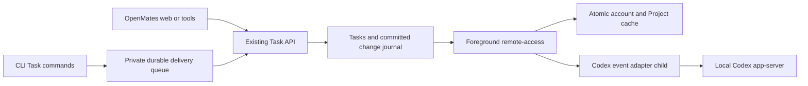

# OpenMates CLI: Codex Task adapter

OpenMates Tasks is authoritative. The foreground `openmates remote-access`
process owns Project synchronization and queued Task transport. For users who
run OpenAI Codex as their coding agent, the CLI can additionally start a local
event adapter (`scripts/codex_task_adapter.py`) that links Codex chats to Tasks,
delivers dependency/CI events and records chat deletion. This is product
support in the CLI; the OpenMates engineering team itself works with Claude Code
(see `docs/contributing/guides/agent-workflow-quickstart.md`).



Run remote access in a terminal that stays open:

```sh
openmates remote-access --personal --path <repository> \
  --task-cache ~/.openmates/project-task-cache
```

For an unbound folder, startup lists existing Projects by quoted title and ID.
Choose a number to reuse a Project; choose `new` only to create one. Saved
associations are reused. One outbound WebSocket serves file access and Task sync.
Nothing installs an OS service or starts automatically after reboot.

The cache path contains hashes separating API/account/workspace and Project.
`snapshot.json` is the atomic data/cursor boundary; `tasks.txt` is a derived
readable view. Files are private to the local user. A disconnected cache stays
readable and is labelled stale; revoked access clears its data. Replay includes
updates, deletion and Project removal; an expired cursor requests a replacement
snapshot. The guarantee covers all Tasks in the configured Project snapshots.

## Configuration

`scripts/codex_cached_context.py configure` writes the repository entry in
`~/.openmates/codex-adapter.json` (or `$OPENMATES_STATE_DIR`). The CLI reads that
file and starts the configured runtime script; Project data can never select or
execute code.

```sh
python3 scripts/codex_cached_context.py configure --repository <repository> \
  --thread <codex-chat-id> --snapshot <private-project-directory>/snapshot.json \
  --events --runtime <checkout>/scripts/codex_task_adapter.py
```

- `--project <project-id>` selects the default Project when several snapshots
  are configured; it must be one of them.
- `--all-threads` covers every Codex chat in the repository, including new ones.
  Event execution still requires an explicit execution-host registration.
- `--auto-wake` (requires `--events`) enables automatic continuation.
- `--session <id>` marks an existing `logs/codex-orchestration/<id>` registry as
  migrated to the adapter.

`configure --events` first runs the same check as `doctor`:

```sh
python3 scripts/codex_cached_context.py doctor --repository <repository> --thread <id>
# {"status":"ready","missing_hooks":[],"hooks_needing_review":[],"resolution":null}
```

This is one local Codex daemon request (`codex` must be on PATH), not a model run
or Task API request. It refuses activation when the repository's Codex hooks are
missing or need review; review and trust them with Codex `/hooks`, never bypass
trust. Restart foreground remote-access after configuration; it launches the
adapter as a child process. No separate service or model polling is installed.

```sh
python3 scripts/codex_task_adapter.py status --repository <repository>
python3 scripts/codex_task_adapter.py pause --repository <repository> --thread <id>
python3 scripts/codex_task_adapter.py resume --repository <repository> --thread <id>
```

## Ownership and commands

Ordinary CLI creation is unlinked. Within a Codex chat, create and link in one
mutation:

```sh
openmates tasks create --title "Repair landing header navigation" \
  --external-chat "codex:$CODEX_THREAD_ID" --project <project-id> --json
openmates tasks connect <task-id> --thread "$CODEX_THREAD_ID" --json
openmates tasks release <task-id> --json
```

The CLI checks that a Codex link mutation targets its current chat and resolves
the title from the local Codex daemon. The authenticated Task API and database
prevent replacement of an existing conversation link. This is a workflow guard,
not cryptographic attestation of arbitrary programs running as the same user.
A competing claim names the owning chat and requires an explicit release first.

Release keeps the Task and its readable keys. An interrupted Task returns to
Todo; Done stays Done and independent blockers remain. Native chat deletion
performs Task/Plan unlinking in the deletion transaction. External Codex
deletion needs confirmed runtime events; missing listings, offline devices and
archiving are not deletion evidence.

## Delivery during an outage

Codex create, edit, connect, release, done and activity-add commands select
durable delivery automatically. An explicit stable SHA-256 `--delivery-id` can
be supplied for a known operation; retain the returned ID and let foreground
delivery retry it. Uncertain responses use the original ID and a scoped read
before any retry. A newer conflicting version requires review. Pending JSON:

```json
{"delivery":{"status":"pending","delivery_id":"<stable-id>","retry_at":1788959000000,"persistent":false}}
```

If the executable itself is unavailable, the owning chat can still write an intent:

```sh
python3 scripts/codex_task_queue.py --snapshot <snapshot.json> \
  --id header-review-finished \
  --operation '{"kind":"activity","task_id":"<task-id>","message":"Review finished."}'
python3 scripts/codex_task_queue.py --snapshot <snapshot.json> --status
```

The writer performs no network request. Supported intents are `create`, `edit`,
`activity` and `complete`. The running foreground CLI encrypts and delivers
them; transient failures use delayed retries and Retry-After, and permanent
ownership, authentication and validation conflicts stay visible. Pending work is
not an acknowledged claim or completion. Team-scoped create/complete/delete
intents reject explicitly rather than acting in personal scope.

## Event adapter behavior

Durable start intent is written before `turn/start`. Lost replies trigger
bounded paginated reconciliation by the original delivery identity; failure to
find it retains the event for review and never starts work twice. An interrupted
turn pauses automatic continuation. Dependency and source-bound CI events go to
their eligible owner; routine activity never wakes a chat. CI success is
evidence, never automatic completion. Registration records the execution host;
seeing the same Project on a second device does not register its chats there.

The adapter attaches through `thread/resume` with metadata-only output; it does
not start inference or change a chat's model, permissions or instructions. The
daemon's deletion notification has no verified replay cursor: deletion during a
connection gap cannot yet be guaranteed, and a missing thread stays unresolved
instead of silently unlinking its Tasks. It also maintains a bounded,
metadata-only presence inventory (`presence_enabled`) of same-Project chats.

## Verification

Use the existing `sessions.py ci-source` and `ci_coordinator.py` pipeline.
`project-task-sync.spec.ts` and `tasks-flow.spec.ts` provision a runner-local
Codex fixture (`scripts/ci_codex_fixture.mjs`, CI mode `codex`) without starting
inference and check real web edits against the foreground CLI cache, claims,
dependency readiness, lost-response reconciliation, restart replay and deletion
on the isolated GitHub stack. They do not prove live Codex deletion
notifications. The CLI build and focused unit checks
(`scripts/tests/test_codex_task_adapter.py`, `test_codex_cached_context.py`,
`test_codex_chat_presence.py`, `test_codex_task_queue.py`) are necessary but not
sufficient integration proof.
