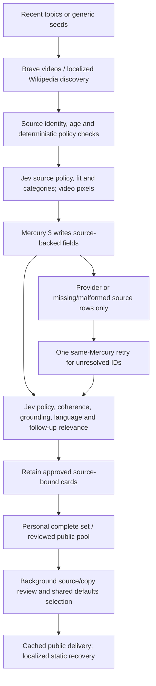

# Daily Inspiration

> Delivers a daily 10-card mixed inspiration set: 3 videos, 3 Wikipedia article prompts, and 4 OpenMates feature tips, with zero LLM latency at display time.

## Why This Exists

Provides curiosity-driven content from independent educators, journalists, documentary makers, and Wikipedia articles, plus static OpenMates feature tips. Content inspirations include a phrase, pre-written assistant response, and follow-up suggestions so users can start a chat instantly. Logged-out product feature cards use concise editorial headlines from `product_features.yml`; authenticated feature tips can deep-link to settings instead of creating chats.

## How It Works

### Generation Pipeline

Runs in `app-ai-worker` Celery container:

1. **Topic filtering** -- deterministic shared content-policy filters remove prohibited/promotional interests.
2. **Brave Video Search** -- localized YouTube discovery, strict SafeSearch, up to 20 candidates per video slot.
3. **Source enrichment** -- retain descriptions, publication dates and audience metadata; reject made-for-kids and over-age videos.
4. **Jev editorial decisions** -- pinned Jev 1.14 screens eligibility, ranks educational relevance and assigns categories. Conspiracy promotion, misleading clickbait and instruction injection are prohibited. Evidence-based debunking and honest curiosity are allowed. Uncertain or failed decisions withhold new candidates.
5. **Video writing** -- Mercury 3 is the sole LLM and writes the exact preselected sources. Provider failures or malformed/missing rows may retry that same model once, requesting only unresolved identities. Editorial rejections are terminal. Approved source-bound objects are retained; no cross-model fallback or separate LLM review is permitted.
6. **Wikipedia discovery and writing** -- search real localized article titles, validate them and fetch summaries/Wikidata before Jev selection. The writer paraphrases only the selected public summaries; it cannot invent article targets.
7. **Final review** -- Jev alone checks policy, semantic subject coherence, field grounding/language and each follow-up’s source relevance across locales. Source-preserving paraphrases and unspaced Japanese do not require word overlap. Failed/uncertain checks withhold a draft. Video admission also requires actual bounded JPEG thumbnail pixels, with no text-only visual fallback.
8. **Feature tips** -- four static feature cards, no inference.
9. **Delivery** -- shuffle once per user/UTC day; only complete 3-video/3-wiki/4-feature sets replace personalized delivery. Reviewed partial stock may enter the pool; clients retain existing recovery when a complete new set is unavailable.
10. **Public selection** -- existing shared-pool external cards are reviewed before defaults selection, including legacy rows. Public video descriptions are retained for later source review. Static feature auth/guest checks remain deterministic.

The production writer is fixed to `inception/mercury-3`: one generation stage,
at most two same-model attempts for provider/schema failures, a 30-second timeout
per attempt, LOW reasoning, temperature 0.5 and no facade fallbacks or nested retries. Jev is
the only decision provider. Gemini and Flash-Lite remain historical diagnostic
models only. This does not change account settings or ordinary assistant routing.

### Generation Triggers

| Trigger | When | Count | File |
|---------|------|-------|------|
| First active request | Post-processing with recent tracked request and no completed-first-run flag | 10 | `daily_inspiration_tasks.py` |
| Scheduled daily | 06:00 UTC Celery Beat | 10 for paid activity in the last 24h and viewed_count > 0 | `daily_inspiration_tasks.py` |
| Default selection | 06:30 UTC Celery Beat | Mixed top 10 per language | `default_inspiration_tasks.py` |

### Delivery

**Authenticated users:** Generated -> stored in Redis (7-day TTL) -> broadcast via WebSocket if online -> delivered on login if offline. Cross-device persistence via encrypted Directus `user_daily_inspirations` table.

**Unauthenticated web users:** The ordinary new-chat screen immediately shows a locale-aware, guest-safe Daily Inspirations fallback. A complete public 3-video, 3-wiki, 4-feature set can replace it through the public defaults endpoint; authenticated-only or promotional cards are rejected. Guests retain interest selection and the full example-chat catalog, independently of the selected inspiration. Marketing content belongs to the separate scrolling website. Guest data remains isolated from authenticated Daily Inspirations; the internal `guest-onboarding` source marker lets login recover the account-specific source.

**Guest fallback content:** The built-in authenticated fallback retains its chat-export feature. For guests, that authenticated-only card is replaced with a public Events search inspiration while the other nine cards remain the same.

**Public and authenticated fallback clients:** At 06:30 UTC, pool entries are scored per language (`interaction_count / (age_hours + 1)`) and a 3-video, 3-wiki, 4-feature target is written to `daily_inspiration_defaults`. `GET /v1/default-inspirations?lang={code}` exposes the credit-free public fallback with a 1-hour cache. Authenticated clients use it only when personalized IndexedDB, Phase 1, live WebSocket, and account API recovery provide no usable records.

### Frontend

- `DailyInspirationBanner.svelte` -- carousel of up to 10 cards
- `dailyInspirationStore.ts` -- Svelte store for state/navigation and explicit guest/personalized/public/fallback source priority
- `dailyInspirationDB.ts` -- IndexedDB with AES-GCM encryption, 72h TTL
- `product_features.yml` -- fallback product-feature headline registry
- Chat creation: `handleStartChatFromInspiration()` in `ActiveChat.svelte`

## Data Structures

### Pydantic Models (`schemas.py`)

- `DailyInspirationVideo` -- youtube_id, title, thumbnail_url, channel_name, view_count, duration_seconds, published_at
- `DailyInspirationWiki` -- title, wiki_title, source_language (source edition, independent of card language), description, thumbnail_url, wikidata_id, extract
- `DailyInspirationFeature` -- feature_id, icon, title, description, settings_path
- `DailyInspiration` -- inspiration_id, phrase, title, assistant_response, category, content_type, video, wiki, feature, generated_at, follow_up_suggestions

### Directus Tables

| Table | Purpose |
|-------|---------|
| `daily_inspiration_pool` | Shared cleartext public-source pool, capped at 500 |
| `daily_inspiration_defaults` | Up to 10 reviewed public defaults per language per day |
| `user_daily_inspirations` | Per-user encrypted records |

### Cache Keys (Redis via `cache_inspiration_mixin.py`)

| Key | TTL | Purpose |
|-----|-----|---------|
| Topic suggestions | 72h | 3-day rolling window of user interests |
| Paid request tracking | 48h | Eligibility for next-day generation |
| Pending delivery | 7 days | Offline user inspiration queue |
| Sync cache | 10 min | Deduplication during multi-device sync |

## Edge Cases

- **Editorial decision failure:** Withhold new external candidates; preserve existing feed recovery instead of publishing unreviewed cards
- **Video output budget:** targets three generated videos; each writing batch has at most three provider attempts, independent of source/thumbnail decision calls
- **Wiki cost:** one initial writing call with up to two bounded repair calls, source/final Jev decisions and Wikimedia API traffic; do not conflate supplier usage with measured total infrastructure cost
- **Feature cost:** static/no external API calls

## Related Docs

- [Message Processing](../messaging/message-processing.md) -- topic extraction via post-processing
- E2E test: `frontend/apps/web_app/tests/daily-inspiration-chat-flow.spec.ts`

### Multilingual and visual editorial admission

Jev 1.14 checks source policy, educational fit/category, semantic subject
coherence, field grounding/language and follow-up source relevance. Mercury 3
writes the copy; no LLM is called to review it. Negative/uncertain Jev admission
is terminal for that draft and cannot trigger another writer call.
Both generators use one consistent source-whitelisted request and cleaned schema.
Jev's language questions explicitly name the requested language and allow short
headings and fragments; English is valid when English is requested. Criteria and
confidence thresholds remain unchanged.
Semantic checks accept translations and unspaced Japanese; lexical overlap is not an
admission rule. Every follow-up must use an explicit source concept. A merely related
scenario, such as wind for a source mentioning only bridge compression/tension, is rejected.

Video candidates also require a direct TypeSafe image decision over bounded decoded
YouTube thumbnail pixels. Downloads use a validated video ID and a fixed YouTube image
host, no arbitrary caller URL or redirects. Missing, rejected, uncertain or unavailable
visual decisions withhold the candidate. Ordinary curiosity, faces and arrows alone
are allowed; deceptive claims, conspiracy/miracle bait and material source mismatch are
not. Image support is experimental; this is a daily metadata/image screen, not verification
of watched video content or a guarantee against a thumbnail changing after review.

Daily public selection re-reviews legacy pool rows, then stores a versioned hash binding
approved video/wiki copy, language, source metadata and thumbnail identity. Wiki proof additionally binds the actual canonical article, retrieval edition and complete fetched metadata; missing evidence is withheld. The anonymous
endpoint verifies this hash and never invokes a paid model. Modified/unreviewed rows
use static recovery. Semantic uncertainty does not delete historical pool data.

All fifteen backend static cards share the frontend fallback translation YAML catalog,
compiled into a backend-only JSON artifact for offline use. All twenty feed languages
are covered (plus Hebrew in the UI catalog). Missing native-language stock uses localized
static cards instead of relabeled English pool rows. Static Wikipedia cards retain English
canonical article IDs and explicitly mark their source edition as English; generated
Wikipedia cards carry their actual retrieval edition. The card copy remains localized.

### Granular recovery and cost accounting (2026-10-21)

The review proof is versioned `daily-editorial-v9`; public cache keys use `v18`.
Older video/wiki approvals cannot satisfy the stronger gate. Jev confidence remains an
abstention heuristic at the existing threshold, not a calibrated correctness
probability. Field-level repair codes contain no arbitrary provider prose and
are never part of the public response. Repairs bind to source IDs rather than
array positions, so a single pending video can be repaired safely.

The retry arrow is bounded to two same-model writing attempts. Editorial
rejections do not enter the retry path. No fresh generation occurs on anonymous page loads. Shared
background review cost depends on actual eligible pool rows, whereas personal
generation depends on eligible users/first-run events. Twenty display languages
do not imply twenty new daily generation jobs.

The original pre-Jev/Mercury baseline is commit
`c94ebe85a14f87aa3223eacfe129aa85ec93d939`: normal successful personal generation
used three Mistral channel-classification calls, one video writer, three video
validators and one wiki writer; static tips and public pool selection required
no inference. Original validation failed open on errors and wiki copy preceded
source-summary fetching. The new source, grounding and image checks add work as
well as changing writer prices. Cost comparisons must therefore include actual
source selection, all retries, visual review and shared revalidation, not just
compare one Mercury call with one historical Mistral call.

See the historical baseline and qualification receipts in
`docs/plans/daily-inspiration-jev/`. Historical production spend is unmeasured;
opt-in native replay uses exact historical application sources with explicitly
recorded current provider wrappers/tariffs. Supplier estimates precede provider
credits and omit unmeasured infrastructure/third-party charges. Generation yield
is reported separately from accepted-copy quality and ten-card fallback delivery.

The scoped English/German release and corrected live measurements are documented
in [the single-LLM release overview](../../plans/daily-inspiration-jev/single-llm-release-2026-10-21.md).
Scheduled personalization requires request activity within 24 hours and at least
one recorded inspiration view; first-run seeds require recent tracked activity
but no prior views. Missing or unavailable activity skips first-run generation.
The completion guard lasts seven days. Login/signup/public reads do not generate
new personal sets; background shared-pool Jev review is independent of activity.
