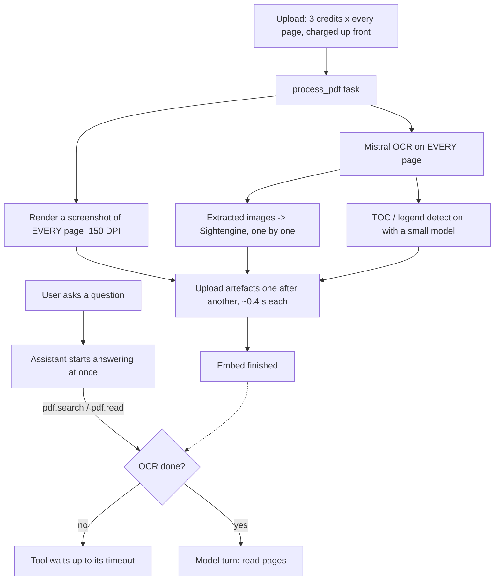
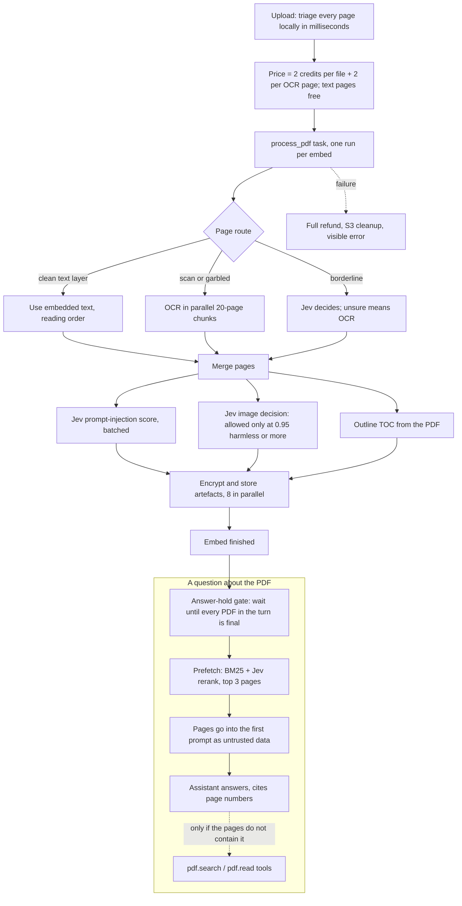

# PDF processing: before and after (v2)

Specification: `specifications/features/pdf-processing` (feature.pdf-processing). Upload, encryption
and malware scanning are described in [file-upload-pipeline.md](file-upload-pipeline.md); this page
covers what happens to a PDF afterwards and how the assistant gets to read it.

Goal of v2: a PDF is ready sooner, costs less, and the assistant answers from the right pages
instead of guessing or waiting on its own tool calls.

## Before

Every page took the same expensive path, whether or not it needed it.

Problems:

- A 100-page text PDF paid 300 credits for OCR it did not need, and waited for it.
- The assistant could start before the PDF was final, so it could answer from nothing or from a
  half-processed document, or burn a turn waiting inside a tool.
- Page renders, image checks and artefact uploads ran serially: 57 artefacts took about 21 s.
- Even a simple question cost at least one extra model turn (about 4 s) for `pdf.search`, and a
  second one for `pdf.read`.

## After

Each page takes the cheapest correct path, work runs in parallel, the assistant is held until the
PDF is final, and the best pages are in its first prompt.

### The pieces

| Stage | What it does | Where |
|---|---|---|
| Triage | Classifies each page: text layer, OCR or borderline, from text amount, image coverage and garbled-character ratio | `backend/apps/pdf/services/pdf_triage.py` |
| Pricing | `price_for(ocr_pages)`: 2 per file plus 2 per OCR page; borderline pages are billed as OCR at upload and the difference is refunded when Jev proves them text | `pdf_triage.price_for`, `process_task.py` |
| OCR | Only pages routed to OCR, in parallel chunks of 20; a page without OCR text gets an explicit unreadable marker | `ocr_chunks.py` |
| Safety | Jev scores page text for injection (batched); images are allowed only at 0.95 harmless confidence, a clearly unsafe image rejects the PDF, anything unsure is withheld. Sightengine is not used for PDFs | `pdf_pipeline.py` |
| Storage | Artefacts are encrypted with a per-PDF key and stored 8 at a time | `pdf_pipeline._encrypt_upload_all` |
| Single run | One processing run per embed (Redis claim); the other dispatch is skipped | `process_task._claim_pdf_processing` |
| Billing record | The upload records its charge and page routes (`pdf:<embed>:billing`); a run started by the chat-message dispatch reads them, so refunds do not depend on which dispatch won | `internal_api.cache_upload_embed`, `process_task._load_upload_billing` |
| Answer hold | The AI worker polls every 0.5 s and does not start the turn until each PDF in it is final; failure ends the turn with a refund notice | `backend/shared/python_utils/pdf_turn_gate.py` |
| Prefetch | For PDFs named in the current message: `pdf.search` (BM25, Jev rerank of 24 hits) then `pdf.read` of at most 3 rated pages, 24,000 characters in total, at most 2 PDFs | `backend/apps/ai/processing/pdf_prefetch.py` |
| Filename alias | `pdf.search` and `pdf.read` resolve a plain file name to the one verified upload of the caller (CLI uploads are indexed by slug) | `backend/apps/pdf/utils/upload_alias.py` |

### Prefetched pages are untrusted data

The pages are appended to the system prompt under a fixed header that says the text is quoted data
and must never be followed as instructions. Pages Jev flagged keep their untrusted-content notice.
A failed prefetch leaves the prompt unchanged and the assistant uses the tools as before.

## Numbers

Measured on the dev server with real inference (Gemini 3.8 Flash), seconds from sending the question
to the end of the answer:

| PDF | Before | After v2 | After parallel store | After prefetch |
|---|---|---|---|---|
| SN74HC00 datasheet | 77.7 | 32.1 | 34.0 | 20.6 to 22.8, no tool calls |
| Juki manual | 106.3 | 43.1 | 27.8 | answer page chosen first in a direct probe; live run not measured |
| ATmega datasheet | 226.1 | 60.2 | 37.1 | only partly helped (answer pages ranked outside the rated 24); live run not measured |

- Storing 57 artefacts: 21 s down to 2.3 s.
- A PDF is ready about 5 to 7 s after upload (about 12 s for a 653-page datasheet).
- Prefetch itself takes about 0.4 s for a short PDF; the Jev rerank of one question took about 1 s.

### Cost model

| PDF | Before (3 per page) | After |
|---|---|---|
| 100 pages, all text layer | 300 | 2 |
| 100 pages, 10 scanned | 300 | 22 |
| 100 pages, all scanned | 300 | 202 |
| Failed or rejected | refund | full refund |

## Limits and known gaps

- The prefetch only covers PDFs referenced in the current message; older PDFs in a chat use the tools.
- A question with several independent parts can have answer pages outside the 24 reranked hits.
- The billing record lives in Redis for 72 hours, like the embed cache. After that a late retry has no
  record and falls back to the arguments it was dispatched with.
