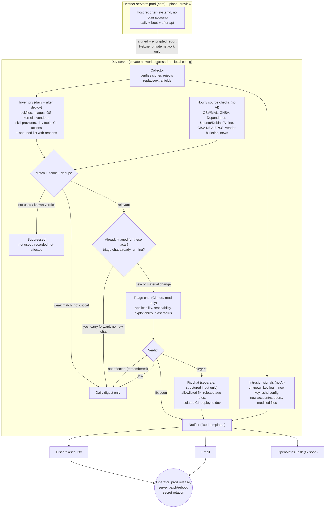

# Automated security monitoring

Contract: `specifications/architecture/security-monitoring` (approved).
Plan: `docs/plans/security-monitoring/plan.yml`.

The system watches for security advisories, exploitation signals and vendor
incidents that affect what OpenMates actually runs, judges real impact with a
read-only AI triage, applies guarded fixes to dev only, and tells the operator
what is left to do.

## Rules in short

- **No false alarms for things we don't run.** The not-used list carries a
  reason for each entry, and anything installed on a host is never "not used".
- **One chat per change.** An advisory is triaged once per material change
  (new version or environment, severity up, first known exploitation, public
  exploit, advisory changed or withdrawn). Unread or unhandled notifications
  never start another chat. Only one triage chat runs at a time.
- **Read-only triage, separate fix.** Advisory and web text is untrusted. The
  fix chat only sees validated verdict fields and cannot touch agent config, CI
  workflows, deployment templates, secrets or this system's code.
- **Release age.** Routine updates wait 7 days. Security fixes use the oldest
  fixing version. At 72h or older it applies immediately. Younger versions apply
  only for reachable, exposed or exploited issues after integrity checks pass.
  Otherwise the fix chat mitigates first.
- **Dev only.** Production deploys, server patching, reboots and secret rotation
  stay manual and appear as a checklist in each notification.
- **Never silent.** Source failures, triage failures, failed or reverted fixes,
  stale host reports and a stopped watcher alert immediately. The daily digest
  proves liveness.
