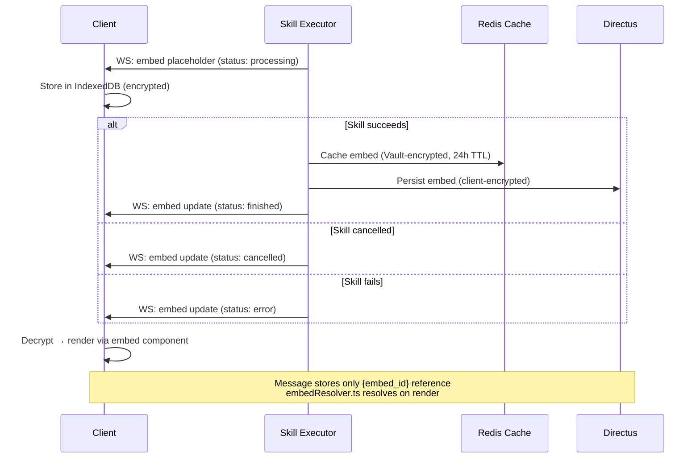

# Embeds Architecture

> Embeds are first-class entities stored independently from messages, enabling independent updates, cross-chat references, and zero-knowledge encryption per embed.

## Why This Exists

- Messages shouldn't contain heavy structured data inline → separate entity
- Long-running tasks (image gen, web search) need to update results without touching the message
- Embeds need independent sharing (share a code snippet without sharing the whole chat)
- Zero-knowledge requires encryption at the embed level, not just chat level
- Server needs fast cached access for AI context without breaking zero-knowledge for permanent storage

## How It Works

- User sends message → server dispatches skills via [skill_executor.py](../../backend/apps/ai/processing/skill_executor.py)
- Skill creates embed placeholder (status: `processing`) → sent to client via WebSocket
- Client stores in [EmbedStore](../../frontend/packages/ui/src/services/embedStore.ts) (IndexedDB, encrypted)
- Skill completes → updates embed (status: `finished`) → persisted to Directus (encrypted)
- Client receives update → decrypts → renders via embed preview component
- Message markdown has lightweight JSON reference block with `embed_id`
- On render, [embedResolver.ts](../../frontend/packages/ui/src/services/embedResolver.ts) resolves references to actual content

### Assistant response presentation

Web assistant messages retain canonical source order: adjacent app-skill placeholders form one activity group, prose between groups remains between them, and later calls render below that prose. This changes presentation without creating a new durable event log or moving encrypted embed references.

Active groups expose their real previews. A skill group completes when every real child embed has a terminal stored status (`finished`, `error` or `cancelled`), even if the assistant continues processing; missing or unknown status keeps the group active. Automatic collapse respects a user's explicit disclosure choice. Completed groups show an expandable summary with circular, partially overlapping app icons; actual visible model thinking adds the AI app icon once. The current thinking stream is response-wide, so it is disclosed once with response-wide wording rather than attributed to individual tool cycles. Unmeasured thinking durations are not invented. Shared preview information bars appear above their detail content.

The connected assistant bubble contains a soft animated bottom rainbow while active, moving left to right with a static reduced-motion fallback. Its centered translated state is Thinking before tools/while thinking, Researching for retrieval skills, and Working for action skills or authored answer streaming. Mixed action/retrieval groups use Working. A translated `Using {model}` label and known region flag are centered below while active; completed responses show left-aligned `generated by {model}` attribution and completion actions. The separate external flow and composer typing indicator are removed.

Web mic correction inserts editable composer text and creates no new recording embed or permanent audio upload. Existing audio embeds and explicit audio-file uploads continue to use the embed architecture described here.

## Encryption

- **Directus (permanent):** client-encrypted with `embed_key` — zero-knowledge
- **Redis cache:** vault-encrypted — server can decrypt for AI, 24h TTL
- **IndexedDB:** client-encrypted with master key — decrypted on-demand
- **Sharing:** embed key in URL fragment (never sent to server)
- Key wrapping in `embed_keys` collection — master wrapper + per-chat wrapper for offline sharing
- See [security.md](../core/security.md) for encryption tier details

## Edge Cases

- **Compressed source message:** the AI worker merges the current `embed_ref -> embed_id` index into a bounded Vault-encrypted artifact ledger before compression. Later turns can resolve the exact reference even after the raw source message leaves active AI context. The ledger contains identifiers only, follows the AI-cache TTL, is cleared on message/chat deletion, and never contains file bytes, extracted text, transcripts, pixels, or tool results.
- **Skill cancellation:** individual skill cancel without stopping AI → `SkillCancelledException` in [skill_executor.py](../../backend/apps/ai/processing/skill_executor.py) → embed status `cancelled`
- **Cache miss:** [embedResolver.ts](../../frontend/packages/ui/src/services/embedResolver.ts) fetches from Directus on miss — never terminal error
- **Composite embeds:** `app_skill_use` contains `embed_ids` → child embeds loaded via `_load_and_cache_embeds_for_chats()` in [user_cache_tasks.py](../../backend/core/api/app/tasks/user_cache_tasks.py)
- **Web and news images:** preview strips and article fullscreen share the image-field selector in `searchPreviewImages.ts`, including nested and flattened `thumbnail.src` and `thumbnail.original` fields. Current parent image metadata avoids child reads. A visible legacy web or news preview without image metadata may resolve at most ten unique children through the existing embed cache; offscreen previews do not hydrate, and obsolete results are discarded on teardown.
- **Cross-chat access:** owner uses master key wrapper; recipient uses chat key wrapper from share link
- **Public examples:** converted fixtures can retain the same embed UUID as their private source. Fixture resolution therefore requires the owning example chat or subchat context and does not populate the private embed cache. A private decryption error cannot suppress a valid public fixture, and private or background lookups cannot substitute fixture content.
- **Stale vault keys:** cache decryption fails → request from client → re-cache (same pattern as [message-processing.md](./message-processing.md))
- **Duplicate detection:** `content_hash` (SHA256) used for code/file/sheet/document embeds — [embed_service.py](../../backend/core/api/app/services/embed_service.py)

## Data Structures

### `embeds` Collection (Directus)

| Field | Type | Purpose |
|-------|------|---------|
| `embed_id` | string | Client-generated UUID v4 |
| `hashed_chat_id` | string | SHA256(chat_id) — privacy: server can't link to chat |
| `hashed_message_id` | string | SHA256(message_id) — nullable for multi-message embeds |
| `hashed_task_id` | string | SHA256(task_id) — for long-running task updates |
| `encrypted_type` | string | Embed type, encrypted client-side |
| `status` | string | `processing` / `finished` / `error` / `cancelled` |
| `encrypted_content` | text | TOON/JSON content, encrypted |
| `encrypted_text_preview` | text | Lightweight preview for fast rendering |
| `content_hash` | string | SHA256 for dedup (code, file, sheet, document) |
| `text_length_chars` | int | Char count for LLM compression decisions |
| `share_mode` | string | `private` / `shared_with_user` / `public` |
| `embed_ids` | json | Child embed IDs for composite `app_skill_use` embeds |

Full schema: [app_metadata_schemas.py](../../backend/shared/python_schemas/app_metadata_schemas.py)

### Completion receipts and immutable versions

An acknowledged typed recovery output identifies one encrypted embed version and
its canonical ciphertext digest. A later legacy `store_embed` retry must preserve
that ciphertext at the acknowledged version. Byte-identical retries remain
idempotent; a content edit uses the versioned editing transaction and preserves
the previous encrypted version. Receipt acknowledgement and head writes share
the embed advisory lock, so their ordering cannot leave a terminal receipt
pointing at overwritten ciphertext.

Legacy missing or null head versions mean logical version 1 at every read,
availability, recovery, and write boundary; malformed versions fail closed. New
initial heads explicitly write version 1. Explicitly version-probed availability returns a canonical
revision descriptor (logical version, ciphertext SHA256, and mutable/immutable
write policy). Missing policy means unknown, never permission to replace a head.
Ordinary client writes carry an absence or version/digest precondition, compared
inside the existing embed transaction lock. A racing acknowledgement or writer
therefore cannot invalidate a preflight decision by overwriting protected bytes.

Fullscreen preview enrichment is a bounded, memory-only display projection tied
to its source content and revision. It never replaces canonical ciphertext,
rewraps a key, queues a write, or persists decrypted data. Projections expire on
source changes and key-cache clearing. Intentional durable edits continue through
the versioned editing transaction with preserved history.

The browser's durable embed queue distinguishes waiting operations from terminal
conflicts and access denials. Terminal operations retain their original encrypted
payloads and wrappers for resolution and do not automatically replay on reconnect.
The sender exposes persisted/adopted/waiting/conflict/denied outcomes; correlated
protocol responses belong to their requesting operation instead of generating
one global error notification per retry. Unmatched errors remain visible.

The CLI performs a fresh metadata read after persisting recovered outputs. Within
one sync operation it remembers only successfully verified record identities,
avoiding repeated recovery of the same acknowledged output across refreshes.
Changed identities and unverifiable canonical digests still fail verification;
continuously arriving new outputs have a bounded refresh count. Unrelated saved
chat browsing can continue while an unverified recovery record remains pending.

### Embed Types (`encrypted_type` values)

`app_skill_use` · `website` · `place` · `event` · `code` · `application` · `file` · `sheet` · `document` · `image` · `video` · `audio` · `pdf`

### Application Embeds

Application embeds are Code app parent embeds for generated multi-file web apps.
The parent embed stores only a project manifest: app name, framework/runtime,
entrypoints, and `file_refs` / `asset_refs` that map logical sandbox paths to
child `code-code`, image, or file embeds. The durable source of truth remains the
encrypted parent manifest plus encrypted child embeds; OpenMates does not store a
full rendered DOM snapshot.

Application creation can start one bounded owner screenshot capture under the
existing preview billing contract. A missing-thumbnail card fallback reuses the
creator's attempt and sends no shared-client context; public examples, shared
recipients and unknown local chats never start that capture automatically.
Screenshot enrichment writes a new encrypted embed version so an acknowledged
previous version remains immutable.

Opening an interactive live preview requires an explicit user action. The backend creates a
viewer-scoped E2B sandbox session, writes the selected generated files/assets into
that sandbox, and returns a short-lived preview URL under the configured
`APPLICATION_PREVIEW_ORIGIN` user-content site. Clients load that URL in an
iframe or WKWebView; generated application JavaScript never runs on the OpenMates
app/API origin and never receives OpenMates auth cookies, vault keys, provider
API keys, or raw E2B traffic tokens.

Each preview session belongs to exactly one authenticated viewer. Shared-chat
recipients start their own isolated sandbox and are billed for their own preview
runtime; they do not attach to, reuse, or charge the creator's sandbox session.
The gateway stores only a hash of the path token, redacts `/p/<session>/<token>/`
URLs from logs, and proxies sandbox traffic server-side so raw E2B URLs remain
server-only.

### Code Run Artifact Embeds

Code Run keeps terminal output on the parent `code-code` embed and materializes
generated files as child code, image, or generic file embeds. Children reuse the
parent embed key and inherit its exact `hashed_chat_id`, `hashed_message_id`, and
`hashed_user_id`. After child persistence succeeds, `EmbedStore.updateChildEmbedIds()`
updates the encrypted parent row and returns the complete versioned persistence
payload so sync can publish the parent-child relationship without dropping indexes.

### `embed_keys` Collection

| key_type | wrapping | use case |
|----------|----------|----------|
| `master` | `AES(embed_key, master_key)` | Owner cross-chat access |
| `chat` | `AES(embed_key, chat_key)` | Shared chat recipient access |

### TOON Format

- Token-Oriented Object Notation — 30-60% smaller than JSON
- Conversion in [main_processor.py](../../backend/apps/ai/processing/main_processor.py) — skills only return JSON
- Stored as-is; decoded on-demand for rendering or AI context

<!-- TODO: screenshot (1000x400) — embed in processing, finished, and error states side by side -->

## Improvement Opportunities

> **Improvement opportunity:** Batch query child embeds by `embed_id` array instead of individual queries per composite embed
> **Implemented:** Embed content versioning via diff-based editing — see [Embed Diff-Based Editing](./embed-diff-editing.md)

## Related Docs

- [Message Processing](./message-processing.md) — embed resolution during AI inference
- [Embed Diff-Based Editing](./embed-diff-editing.md) — unified diff patching and version timeline
- [App Skills](../apps/app-skills.md) — skill execution that produces embeds
- [Security](../core/security.md) — encryption tiers and key wrapping
- [Sync](../data/sync.md) — embed sync across devices during login
- [Message Previews & Grouping](./message-previews-grouping.md) — embed preview rendering

### Bounded composite recovery persistence

Ordinary saved-chat composite results share a task-scoped preparation batch: fresh Project classification and recovery pin, bounded existing-receipt lookup, randomized sealing only for absent records, and bounded atomic inline persistence. All required child and parent records seal before finished cache writes and ordered WebSocket delivery. Transactions preserve per-record current authority, deletion, stable identity and content commitments. Requests cap at 32 outputs/512 KiB; a failure rolls back that transaction and preserves previously committed chunks for retry. The existing large-S3 protocol and registered/volatile producer lifecycles remain authoritative for their outputs.

Retries of one prepared ordinary composite retain its child IDs and fallback references under the existing parent identity, and reuse the first sealed envelope. Reexecuting the ordinary builder allocates new UUIDv4 children and cannot replace an already sealed parent with changed references. Registered producers retain their existing deterministic identities. The public embed delivery and canonical client-encryption/acknowledgement contracts are unchanged. See `docs/plans/chat-processing-next-stage/implemented-flow.md` for the full processing flow and measured-evidence boundaries.
