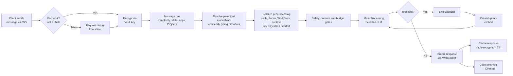

# Message Processing Architecture

> Three-stage pipeline (pre-processing → main → post-processing) with client-side encrypted permanent storage and a short-lived server-readable cache of the last 3 chats for fast follow-ups.

## Why This Exists

- Fast AI responses without re-sending full chat history every message
- Permanent storage is client-side encrypted — the persistence tier holds only ciphertext — so a server-readable cache is needed for AI follow-ups
- Different messages need different LLMs — pre-processing selects optimal model
- Growing skill count (35+ apps) requires intelligent tool filtering

## How It Works

- Web Send immediately clears the ordinary composer and displays one provisional history row. Preparation and authenticated submission use its stable ID → [sendersChatMessages.ts](../../../frontend/packages/ui/src/services/sendersChatMessages.ts).
- Server receives in [message_received_handler.py `handle_message_received()`](../../backend/core/api/app/routes/handlers/websocket_handlers/message_received_handler.py)
- Check cache for chat history (last 3 chats, vault-encrypted)
  - Cache hit → decrypt with `decrypt_with_user_key()` in [encryption.py](../../backend/core/api/app/utils/encryption.py)
  - Cache miss → send `request_chat_history` to client → client responds with decrypted history + embeds
- **Pre-processing stage one** → Jev selects complexity, Mate topic, relevant apps and Projects, and evaluates the independent required safety, language and presentation decisions. Application code resolves the permitted model/Mate and publishes early typing metadata.
- **Pre-processing stage two** → choose specific skills, app Focus modes, Project Focus modes, Workflows and requested private context. Model resolution does not wait for this stage. Complete public decisions are reused; a confirmed empty catalogue requires no additional Jev request. Missing decisions or uncertain discovery retain the detailed call and existing safety gate.
- **Main processing** → send to LLM with tools and context
- LLM calls skills → each creates/updates embeds
- Response streamed via [stream_consumer.py](../../backend/apps/ai/tasks/stream_consumer.py)
- Server caches assistant response via `_save_to_cache_and_publish()` in [stream_consumer.py](../../backend/apps/ai/tasks/stream_consumer.py)
- Client encrypts response → stores in Directus (ciphertext at rest; plaintext never written server-side)

## Dual-Cache Architecture

Two caches, different encryption, different purposes:

| Cache | Key pattern | Encryption | TTL | Purpose |
|-------|-------------|------------|-----|---------|
| **AI Inference** | `user:{id}:chat:{id}:messages:ai` | Vault (server can decrypt) | 72h | AI context for follow-ups |
| **Sync** | `user:{id}:chat:{id}:messages:sync` | Client-encrypted | 1h | Login sync (phases 1-3) |

- Why separate? AI cache needs server-readable encryption (Vault-wrapped, transient in RAM); sync cache holds client-encrypted blobs the server can only relay, not read. Mixing → decryption failures
- Implementation: [cache_chat_mixin.py](../../backend/core/api/app/services/cache_chat_mixin.py) — `add_ai_message_to_history()`, `get_ai_messages_history()`, `set_sync_messages_history()`
- Embeds cached separately: `embed:{embed_id}` — vault-encrypted, 24h TTL, global
- App settings/memories: `chat:{chat_id}:app_settings_memories:{app_id}:{item_key}` — auto-evicted with chat

### Cache Fallback Flow

- `get_chat_messages_history()` in [cache_chat_mixin.py](../../backend/core/api/app/services/cache_chat_mixin.py) → cache miss or decryption failure detected
- Server sends `request_chat_history` WebSocket event
- Client handles in `handleRequestChatHistoryImpl()` in [chatSyncServiceHandlersAI.ts](../../frontend/packages/ui/src/services/chatSyncServiceHandlersAI.ts) → loads from IndexedDB, sends decrypted
- Server re-encrypts with current vault key and caches for future

## Pre-Processing

- **Model:** configured preprocessing model and its permitted utility-model fallbacks. See [preprocessing model comparison](../ai/preprocessing-model-comparison.md) for historical evaluation.
- **Implementation:** [preprocessor.py](../../backend/apps/ai/processing/preprocessor.py)
- **Config:** [base_instructions.yml](../../backend/apps/ai/base_instructions.yml)
- **Outputs:**
  - `language_code` — language of last user message
  - `selected_model` + `selection_reason` — optimal LLM
  - `relevant_app_skills` — preselected tools
  - `relevant_app_focus_modes` — preselected focus modes
  - `relevant_app_settings_and_memories` — data to request from client
  - `prompt_injection_chance` — safety score
  - `title`, `icon_names`, `category` — chat metadata (first message only, skipped if title exists)
  - `tags` — max 10 for similar past chat lookup

### Early routing and Workflow discovery

The first Jev stage owns complexity and Mate topic as well as app/Project routing. Explicit user model/Mate overrides and existing Project, credit and policy constraints retain precedence. The resolved model is available before detailed tool/context selection; stage two cannot silently replace it. Early typing metadata describes progress and does not authorize execution. Rejection, a gate or a terminal failure closes that state.

Workflow routing selects at most 20 candidates before summary hydration, batches routing-blob reads and Vault decryption, and caches bounded metadata encrypted with the user's Vault key. Authenticated discovery and warm hits renew two-hour retention. Owner/Team/Vault-key scoping and persistent mutation generations prevent an expired generation from making an older snapshot reachable again; discovery that crosses a mutation does not publish into the new generation. Selected Workflow graphs are reauthorized fresh.

The web composer sends the authenticated, rate-limited `chat_metadata_warmup` hint on focus, without draft text or inference. The legacy `workflow_metadata_warmup` name remains accepted. The TUI sends the hint on its existing activity socket after startup admission, after later login or Team changes, and on reconnect; ordinary saved CLI sends use their existing request socket. Warm-up is optional and never delays optimistic submission or changes a human-only Team send into an AI request. User profile metadata keeps its existing shared-cache policy.

Web focus also prepares the exact Project and Task inventory queries in their existing bounded tab-local caches. This is distinct from Dragonfly Workflow discovery. Server Project/Task/Plan lists do not gain a broad two-hour cache: Project changes have transactional writers, and accepted Plan approval remains an authoritative fresh read. During Send, independent routing metadata and context collectors start concurrently and share one initial focus lookup only within that send's account, Team epoch and chat. Later activation, revision and private-body checks remain fresh. Typing-time inference is excluded.

An authenticated personal Send can overlap a connected-account directory lookup with local message persistence. Only an empty result from the same authenticated workspace and unchanged local mutation epoch avoids a repeated lookup; nonempty, failed or stale results use the existing fresh directory and token preparation. Optional preparation timing records contain phase names and monotonic times, without chat IDs, text or secrets.

A personal chat whose ID is newly minted inside the SDK skips initial and final active-Focus reads and the accepted-Plan read: no saved chat can exist under that ID before this call. Saved chats, caller-supplied new IDs (including TUI IDs), and explicit Project requests retain those reads. Fresh Project and Task discovery and authorization still run, and caller-provided private Project documents or Plans are discarded when no authorized Project is selected.

Personal memory preparation may hand its validated authentication result to one send using that exact returned snapshot, for at most five seconds. The SDK checks session/API identity, owner, master key, Team context, token and complete cookies again under its existing cross-process refresh lock. Arbitrary or stale snapshots, other WebSocket uses and Team sends follow normal refresh. The server still validates the socket handshake; the receipt is never persisted. Opt-in CLI diagnostics record only durations for memory, privacy and connection preparation.

Related-chat discovery enumerates the API's existing bounded, memory-only index of encrypted transient summaries rather than first scanning the owner's chat IDs in the worker. Cached membership grants no access: the internal endpoint checks the active turn and live owner/Team access before and after decryption, checks source revision and expiry, and fills the 24-result limit after authorization. Same-Project preference retains cross-Project candidates. Explicit-ID internal callers remain compatible; a cold summary cache remains a miss. Discovery does not extend summary lifetime or create a persistent plaintext cache.

After early typing has published its chat key, final preprocessing metadata does not repeat that key lookup or construct an unused late typing payload. The fallback still prepares the full payload when early publication did not occur. Main prompts omit tool-call guidance only for tools that are not actually forwarded. The later AF4 predicate also distinguishes generated app-skill tools, `start_sub_chats` and other system tools: a personal CLI capital request that forwards only `task_create` keeps applicable Task-tool guidance while omitting app-skill-only guidance. Independent interactive-question, safety, language, Mate and Focus instructions remain present. The predicate was published in `9bd2039`; the live AF4 cohort did not isolate its latency contribution.

The October 11 AF3 ordinary-chat retest on deployed `d59e93d` and pinned CLI `0.27.0-alpha.61` completed six CLI and six web requests. Capital first-authored-answer medians were 7.208 seconds CLI and 8.344 seconds web, still above the 2–3-second target; Berlin event-search medians were 31.009 and 21.435 seconds. A bounded web capital trace showed a 2.333-second message-to-API-handler gap. A sequential queued batch query occupied 1.786 seconds immediately before the handler; attribution to the current chat is inferred from source order because the sanitized batch payload omits its chat ID. The remaining time has no established cause. The same-chat uncertain queued-snapshot deferral was published later, so AF3 did not measure it. Provider cache-read token counts were unreported, and these three-trial-per-cell concurrent local captures do not establish a population latency guarantee.

AF4 on deployed `9bd2039`, with the same pinned CLI version, completed another six CLI and six web requests. Capital first-authored medians regressed to 17.836 seconds CLI and 15.201 seconds web; Berlin medians rose to 41.392 and 33.452 seconds. The 2–3-second target remains unmet. Actual provider first-chunk timeouts and 10–12-second first-chunk waits explain several individual turns. A web capital turn also had a 1.741-second sequential API batch interval before its handler and a 3.526-second task-announced-to-`task_prerun` interval; the preceding owned turn ended 32 milliseconds before that hook. The two-child worker's retained log has no consumer receipt, second active task, child PID or child initialization/recycle record in the gap, so its cause is unresolved. A separate CLI capital turn ran concurrently with a web Berlin task, confirming overlapping execution. The passive wire record found no `uncertain: true` snapshot for an active-send chat before first text, so it provides no latency proof for the new deferral. The server batch log still omits chat IDs, and a browser batch-to-server batch match is inferred rather than verified. Cache-read token fields were null for capitals; one Berlin usage bucket reported a cache read. With three trials per cell and partly different local capture overlap, these results are descriptive. The shared backend routing applies to Apple, but AF4 did not verify native Apple presentation. See the [report](../../plans/chat-latency-improvements/report.md) for bounded phase evidence.

### Queued follow-ups and steering

An already active assistant causes a normal follow-up to be admitted as an encrypted durable queued turn, with a stable message ID, revision and synchronized Queued state. Edits compare-and-swap that revision across durable history and the encrypted inference payload. Unchanged edits do not mutate the queue. Ordinary handoff dispatches one immutable turn at a time after the predecessor completes.

When a queued snapshot is uncertain during an active same-chat, same-socket Send, the web client defers full-history reconciliation until the user frame is queued. It then refreshes queued state; a failed or unsent frame retains full-history reconciliation. Chat, workspace, Team and socket epochs fence this optimization. Other-chat snapshots and unrelated batch reads keep their existing path. AF4 published this behavior but did not observe the qualifying uncertain snapshot on its active sends.

Steer instead keeps the current assistant run and completed results. It consumes an exact queued revision only after a complete tool cycle or safe agent boundary and fresh safety, credit, consent and context checks. Explicit model/Mate changes, new gated context and incompatible Focus/Project state defer to an ordinary follow-up. A running tool is not cancelled and completed side effects are not replayed. Claimed revisions are fenced against concurrent edits; unrecoverable context or a failed consumed steer has a truthful saved paused state.

The web, authenticated CLI and Apple share backend routing improvements. Web owns the new queue editor and response presentation; native Apple controls/recording and the independently implemented TUI presentation have separate client scope. See the [implementation report](../../plans/chat-latency-improvements/report.md) and [queue Plan](../../plans/chat-queued-followups/plan.yml) for evidence and rollout state.

### Tool Preselection

- Pre-processing filters skills to only relevant ones
- Auto-excludes: uninstalled apps, skills needing unconnected accounts (`requires_account`)
- Validation in [apps.py `is_skill_available()`](../../backend/core/api/app/routes/apps.py)
- See [function-calling.md](../apps/function-calling.md) for scalability details

## Main Processing

- **Model:** selected by pre-processing (varies per request)
- **System prompt:** focus instruction + ethics + mate instruction + apps instruction
- **Implementation:** [main_processor.py](../../backend/apps/ai/processing/main_processor.py)
- Skills execute via [skill_executor.py](../../backend/apps/ai/processing/skill_executor.py) → results as embeds

## Post-Processing

- Follow-up suggestions generated after response completes
- The final answer marker follows awaited billing, encrypted recovery preparation and AI cache persistence. The worker then handles queue ownership and awaits postprocessing in the same task; postprocessing is not a detached worker job.
- Authenticated CLI completion is later than first answer text: it can wait up to 12 seconds for the postprocessing event after the final frame, followed by encrypted recovery and metadata persistence acknowledgements. Measure these boundaries separately when comparing chat speed.
- See [followup-suggestions.md](../ai/followup-suggestions.md)

## Edge Cases

- **Stale vault keys:** decryption failure detected in [message_received_handler.py](../../backend/core/api/app/routes/handlers/websocket_handlers/message_received_handler.py) → falls back to requesting fresh history from client → re-caches
- **Skill cancellation:** individual skill cancel via `cancel_skill` WebSocket → `SkillCancelledException` in [skill_executor.py](../../backend/apps/ai/processing/skill_executor.py) → embed set to `cancelled`, AI continues
- **Chat history too large:** split into 70k token blocks, processed in parallel in [preprocessor.py](../../backend/apps/ai/processing/preprocessor.py)
- **First message metadata:** pre-processing generates title/icon/category — skipped for follow-ups (checks `current_chat_title` field)
- **Embed resolution during inference:** embed placeholders in cached messages resolved on-demand when building AI context, not at cache time
- **App settings not yet confirmed:** WebSocket notification sent to client (`request_app_settings_memories`), processing continues without waiting — user can confirm hours later

<!-- TODO: screenshot (1000x400) — message processing timeline showing pre/main/post stages -->

## Improvement Opportunities

> **Improvement opportunity:** PII pseudonymization before LLM — see [sensitive-data-redaction.md](../privacy/sensitive-data-redaction.md) for implementation options
> **Improvement opportunity:** Similar past chats feature — tags output used for frontend lookup, not yet fully implemented

## Related Docs

- [Embeds](./embeds.md) — skill results stored as embeds
- [App Skills](../apps/app-skills.md) — skill execution and cancellation
- [AI Model Selection](../ai/ai-model-selection.md) — model choice logic
- [Security](../core/security.md) — encryption tiers (vault vs. client)
- [Sync](../data/sync.md) — sync cache usage during login
- [Sensitive Data Redaction](../privacy/sensitive-data-redaction.md) — PII protection before LLM

## Reserved compact routing and prepared admission

The approved chat-latency increment uses a one-frame durable admission and a reserved `app_ai_routing` worker before long main/tool processing. See [the implemented request and cache diagrams](../../plans/chat-latency-improvements/implemented-flow.md) for stage inputs, conditional detail hydration, main-generated composer metadata and retention boundaries. Existing conversation history, Team human-only behavior, consent, billing and recovery remain authoritative.

Fresh routing eligibility rechecks only the first 40 supplied candidate IDs with an owner/Team-scoped, unarchived, identity-only query, then checks their current selection settings. It preserves candidate order and the existing fresh Team-role gate; cached or client-supplied IDs do not grant access.

First ordinary Personal CLI admission uses a fresh one-use same-socket Memory snapshot for privacy before Send and discovers Projects alongside admission. The capability-negotiated batched routing directory replaces list-plus-per-Project-settings calls with one freshly authenticated owner-scoped ciphertext request; older, saved, Team and explicitly Project-bound paths keep their established preparation. A bounded exact-context receive lane handles context-ready or failure frames while post-ACK dispatch finishes; unrelated messages remain ordered. Only the authoritative plain-text atomic first-message projection reuses sanitized AI history after the encrypted cache write.

After fresh current-turn and durable routing checks, the routing worker joins valid routing context before credit resolution, top-up or Jev. The current authoritative wallet check retains its post-context order, including the main worker's separate later check. Cached discovery never supplies permission or balance authority. Warm-up keeps encrypted discovery for two sliding hours with fresh revision/access checks; private bodies load only when selected.

Routing-admission diagnostics emit only fixed numeric transaction phase timings after internal authentication. The lock-inclusive group contains account/chat locks and the account fence read; it does not claim measured PostgreSQL lock-wait time. No SQL, parameters, request identifiers, bodies or raw errors are logged. Timing/logger failure cannot change authorization or the response, and `CHAT_RECOVERY_ADMISSION_TIMING_ENABLED=false` disables this record.
