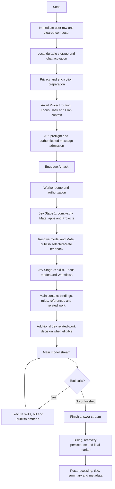
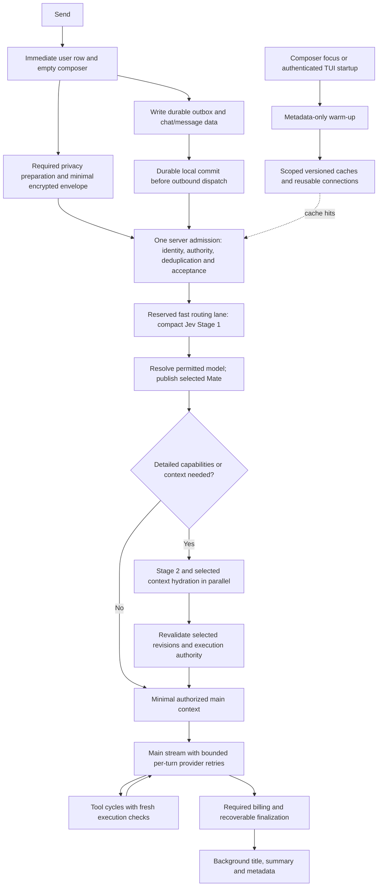

# Ordinary chat critical path and proposed architecture

This report separates measured behavior from the recommended architecture. The
measurements come from the retained October 11, 2026, 16:30–16:43 UTC run against
`9bd203923b684f7e7606026840ed6a07239a2d40`, with CLI alpha.61. These are not new
October 12 measurements. All times start at the actual web Send click or CLI
accepted-command marker, not benchmark harness setup. Private traces and account
identifiers remain outside the repository.

The targets are selected-Mate feedback within 1,500 ms, preferably below 1,000 ms,
and first authored streaming within 2–3 seconds for a simple no-skill request.
Neither target is established by the retained timings.

## Measured ordinary request

The fastest retained web “What’s the capital of Spain?” request took 7.245 seconds
to first authored text. It used no app skills and selected no Project. Its account
had two eligible Project catalogue entries; no active Project does not mean an
empty catalogue.

| Time after Send | Observed phase | Elapsed |
| --- | --- | ---: |
| 0–2.100 s | Client preparation through API preflight arrival | 2.100 s |
| 2.100–3.043 s | API preflight and admission through worker start | 0.943 s |
| 3.043–3.476 s | Worker setup | 0.433 s |
| 3.476–4.488 s | Preprocessing | 1.012 s |
| 4.488–4.661 s | Handoff to main processing | 0.173 s |
| 4.661–5.662 s | Main context and provider-wrapper setup | 1.001 s |
| 5.662–7.207 s | Provider request through first chunk | 1.545 s |
| 7.207–7.245 s | Authored publication and browser presentation | 0.038 s |

These nonoverlapping intervals total 7.245 seconds. Nested spans below are already
included and must not be added again:

- Local durable message setup: 803.6 ms. It includes serial chat creation,
  encrypted message storage and readback, but lacks operation-level child spans.
- Chat activation: another 228.6 ms, measured separately from that storage span.
- Client Focus/Plan collection: parallel requests with a longest span of about
  731 ms. The two Plan reads use different filters, rather than being identical
  duplicate requests. The Focus read takes about 598 ms concurrently.
- Stage one: 673.6 ms, including a 339 ms Jev request. Stage one finishes at
  +4.268 seconds. This is the earliest measured routing boundary for showing the
  selected Mate; it is not a measurement of the exact browser paint.
- Stage two: 135.0 ms.
- Main related-work collection and selection: 819.4 ms, including 548.9 ms of
  related-chat discovery and an additional Jev decision after preprocessing.
  The request start of that additional Jev call was not logged, so its exact
  inference duration cannot be isolated from the remaining context work.

The main request contains 7,078 input tokens even for this ordinary factual
question. A prompt audit should attribute those tokens before removing any
required privacy, safety, question or output instructions.

## Other delays and limits of attribution

| Retained request | Important observed intervals | First authored text |
| --- | --- | ---: |
| Web capital, trial 2 | 4.496 s before provider; 10.350 s to its first chunk; 0.355 s to authored presentation | 15.201 s |
| CLI capital, trial 1 | 4.889 s before provider; failed primary waits 15.016 s; fallback starts 10 ms later and returns a first chunk in 1.970 s; publication takes 0.227 s | 22.112 s |
| Web Berlin events, trial 1 | 6.195 s before provider; about 9.716 s to tool emission; 11.906 s skill path; another model iteration returns its first chunk in 1.560 s | 30.222 s |
| CLI Berlin events, trial 1 | Three first-chunk timeouts total 45.035 s across iterations/recovery; the skill path takes 10.293 s; five provider attempts overall | 69.466 s |

The events skill intervals include skill orchestration, external provider work,
billing and embed publication, not solely the external events API. The CLI
events tool executed once; the slow recovery did not replay it. The failed
primary route was attempted again during answer-only recovery, which is a
concrete opportunity for bounded per-turn route failure tracking.

The provider “connected” log accepts a lazy stream iterator. The actual HTTP
stream starts on iteration. Consequently these first-chunk waits include HTTP
and connection setup, provider processing and first output. They are not proof
that all time was remote inference, a quota issue or a TCP delay. HTTP phase
instrumentation is needed to separate those causes.

One capital request also has a 3.693-second broker-publication-to-task-body gap.
Redis LPUSH itself takes 0.324 ms and apply_async takes 1.918 ms. The two prefork
children were not demonstrably both occupied: saturation, recycling or global
serialization cannot be assigned from the retained worker logs. A preceding
sequential WebSocket handler spent 1.741 seconds on a batch for other chats.

CLI launch-to-preflight is 2.503–4.230 seconds in the three capital samples. Those
captures lack preparation child spans, so assigning exact shares to authentication,
privacy, encryption, connection and recovery would be speculation. One-shot CLI
startup must be measured separately from an already warm TUI.

All four AF4 first-answer medians regress relative to AF3: capital CLI 17.836 s,
capital web 15.201 s, Berlin CLI 41.392 s and Berlin web 33.452 s. There are only
three samples per prompt/client. Browser launch failed before inference and its
later retry changed overlap with CLI traffic. This does not establish which
code change caused the regression.

## Current implemented flow

Context collectors already run partly in parallel. Parallelism alone does not
make them free: their longest required operation still blocks the next stage.

## Recommended architecture

The main change is a small admission and routing path followed by conditional
enrichment. Move all avoidable discovery out of the path to selected-Mate
feedback. Retain the specified two-stage routing semantics and approved model
defaults. This section describes a proposal, not a deployed timing improvement.

The diagram preserves durable offline intent. A minimal encrypted outbox and
privacy preparation can run concurrently, but dispatch must not race ahead of
the durability point or privacy policy. Chat UI bookkeeping and optional
projections need not hold dispatch once the canonical outbox contract permits it.
Changing that contract requires explicit crash/reconnect/idempotency verification.

### Client path

1. Paint the submitted user message and clear the submitted composer snapshot in
   the current event turn. Preserve any newly typed draft. This feedback is already
   implemented and must not wait for network or IndexedDB.
2. Build the smallest request envelope: stable message/chat IDs, encrypted
   message, selected overrides, attachment references and context revision hints.
   Hints grant no authority. Avoid sending all Project, Task and Plan content.
3. Batch fresh-chat and message persistence where possible. Audit the measured
   duplicate-content index scan for a genuinely new first message; retain exact-ID
   deduplication, recovery journaling, encryption and durable commits. Add child
   spans before choosing which storage operation to remove.
4. Move user-facing chat activation, list projections and nonessential metadata
   updates off the dispatch dependency. Overlap necessary privacy preparation,
   local persistence and connection recovery where their inputs allow.
5. Replace separate client Focus/Plan/Project authorization reads with a server
   admission snapshot. The server should resolve the authoritative current
   binding once per request. The UI may keep its existing projection caches.
6. Reuse the open WebSocket in the web app/TUI. One-shot CLI preparation should
   use reusable HTTP clients and compact admission, while cold startup remains a
   separate metric. Avoid duplicate auth/context round trips.

### Metadata-only warm-up

Start on the first meaningful composer focus, authenticated TUI startup, later
login, scope change or reconnect. Coalesce concurrent calls, debounce repeated
focus, and renew useful retention on real requests. Send identity/scope and
version information only, with no draft text and no inference.

| Data | Preparation/cache policy | Still required on Send/use |
| --- | --- | --- |
| Global Mate/model/app metadata and prompt templates | Process cache by configuration revision; warm provider/Vault/client initialization and connection pools | Current permitted model and policy resolution |
| User routing preferences and permitted catalogue metadata | Owner/Team scoped, bounded cache; revision/generation invalidation | Current authenticated scope and changed-policy checks |
| Encrypted Workflow discovery metadata | Existing two-hour sliding Dragonfly retention; owner/Team keys and invalidation generations | Reload/revalidate the selected Workflow before execution |
| Project discovery index | Names, short descriptions and references only, bounded and revision keyed | Current Project binding and access; selected document revisions |
| Chat summary and small routing context | Existing encrypted bounded recovery/summary cache with revision checks | Correct chat/turn ownership and sufficient context for followups |
| Active Focus and accepted Plan references | Warm a hint/projection, not a permission grant | One current authoritative admission snapshot; selected Plan/Focus validation |
| Connected-account capability metadata | Scope/version keyed; coalesce repeated lookups | Current consent and execution permission when selected |

Warm-up is best effort. Send never waits for the warm-up request to finish; a
cache miss hydrates the necessary data on demand. A two-hour metadata TTL is not
a two-hour session, Project-access or approval validity period. Cached failures
must not turn temporary auth/cache trouble into hours of denial or stale access.

### Backend path and conditional work

- **Admission:** resolve identity and authority once, decrypt/validate the
  minimum required request, enforce deduplication, recoverable acceptance and
  any required account gate. Pass a bounded request-scoped authority snapshot
  internally rather than repeating identical reads. Recheck changed scope or
  authority at selected-resource/execution boundaries.
- **Stage one:** provide the current request, explicit overrides, a compact Mate
  catalogue, app descriptions, Project discovery metadata if potentially relevant,
  and minimal context needed to understand references. Select complexity, Mate,
  apps and Projects in one compact Jev request. Full skills, Project documents,
  all Tasks, all Plans and unrelated chat summaries are not inputs by default.
- **Model/Mate feedback:** immediately resolve the permitted default/override and
  publish the selected Mate and model. The client creates Thinking only here;
  no generic Assistant Thinking before selection. Do not wait for stage two or
  main-task capacity to publish this event.
- **Fast routing capacity:** keep routing off workers that remain occupied for
  long main-model/tool cycles. A reserved bounded routing lane, reusable clients
  and nonblocking I/O isolate early feedback. Measure consumer receipt, worker
  availability and queue wait separately; do not assume adding workers fixes the
  unassigned retained queue gap.
- **Stage two:** run only when stage one, an explicit override, an active
  authoritative binding or conversation reference requires detailed selection.
  Select app skills, Focus modes, Project Focus modes and Workflows. Fetch
  independent selected metadata concurrently. Reuse decisions only when complete
  and valid; uncertainty takes the full path.
- **Related work:** stop discovering and running an extra Jev selector for every
  ordinary personal request merely because related items exist. Include bounded
  candidates in the required detailed pass when the task references prior work or
  requires it. Do not replace semantic reference handling with a keyword-only
  guess. Ordinary factual requests can have no related-work dependency.
- **Main request:** assemble only selected authorized context and exposed
  capabilities. Required safety/privacy/output rules remain. Reuse templates and
  provider clients; do not silently change the approved Gemini 3.8 Flash LOW
  default to meet a number.
- **Provider resilience:** instrument HTTP creation/headers/first byte/first
  authored output. Use a per-turn deadline and failed-route memory so answer-only
  recovery does not repeat a route that already stalled in the same turn, while
  preserving tool-history compatibility, thought signatures and exact billing.
  Do not blindly hedge charged inference on focus or every request.

### What must be sequential

Authentication and current authority precede private server-data access. Required
privacy preparation precedes transmitting governed content. A durable local
intent precedes sending, and server deduplication/recoverable acceptance precedes
execution. Stage-one selection precedes default model resolution and detailed
capability selection. Required stage-two context precedes the main model using
it. Selected-resource/consent/approval checks precede actions. Tool results
precede the next model cycle that consumes them. A steer message is admitted at
the agreed safe agent/tool boundary; it must not mutate an in-flight action.

The rest should be cached, coalesced, overlapped or conditional. Warm-up cannot
know message complexity, Mate choice or requested skills without the message and
must not run AI while typing.

### Proposed timing budgets

These are engineering budgets for warm ordinary requests, not measured promises:

| Path to selected Mate | Budget |
| --- | ---: |
| Client durable intent + privacy + minimal dispatch, overlapped | 150–250 ms |
| Transport and one admission | 100–200 ms |
| Reserved routing setup/cache reads | 50–100 ms |
| Compact Stage-one Jev | 300–500 ms |
| Permitted model resolution + event delivery/paint | 50–100 ms |
| Total | 650–1,150 ms |

A 1,500 ms upper target leaves headroom for ordinary variance. The observed
339 ms Jev call supports attempting this budget, but does not establish a
percentile guarantee. Cold cache, reconnect, attachments or abnormal provider
latency need distinct traces and honest delayed feedback.

For first authored output, budget roughly 0.1–0.3 seconds for conditional-free
main setup after routing and 1–1.5 seconds for healthy provider output. This
places the ordinary warm path near 2–3 seconds. The measured 10–15-second waits
also require a provider-routing fix; prewarming alone cannot meet the target.

## Completion and error-report findings

The fast capital request finishes its main stream at +7.703 seconds, but publishes
the final marker at +13.424 seconds, after consumer aggregation and a 3.318-second
billing HTTP interval. The UI ends processing at +14.105 seconds; postprocessing
and worker completion arrive around +17.1 seconds. These are separate from first
authored output and need their own optimization and lifecycle metrics.

The Berlin web probe incorrectly declared completion at its first text
(+30.222 seconds). The stream continued, and the actual final marker was
+44.623 seconds. Retained frames show completed attribution while the composer
still shows Stop. The active-turn rendering fix and benchmark completion
condition must be corrected before using those probe completion figures.

The reported Project/activity 503s share session verification before the route
body. A capped 24-hour sample clusters around token refresh; sampled upstream
security-state reads returned HTTP 200. This supports investigating the refresh
successor-publication race, not declaring a Directus outage or Project data
failure. The four AF4 Project-item 503s do not overlap the fast capital request or
the capital queue gap. They can disrupt affected context reads, but they do not
explain the observed long provider waits. Profile-image, embed and chat-window
404s require their own request context and cannot be assigned global latency from
aggregate counts.

## Next verification

Record spans from Send through durable intent, dispatch, admission, broker
publication/receipt, routing, selected-Mate browser paint, provider HTTP phases,
first authored output, final marker and postprocessing. Compare warm and cold
web, warm TUI and cold one-shot CLI separately. Include factual no-skill, events
search, Project-bound, context-dependent followup, offline recovery and concurrent
send/steer cases. Preserve failures and retries. Provider-independent product
checks belong in isolated CI; matched real-inference measurements use the
authorized dev exception and an explicit runtime/coordinator lease.
