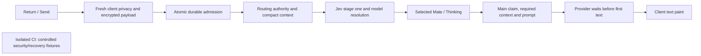

# Ordinary chat timing on October 13

Real TUI measurements preceded web measurements on deployed revision `a9e3e575af713a96c5c7446aea7a1763857a1e42`. Each request used Google AI Studio Gemini 3.8 Flash, LOW thinking, with no model override. These are single warm samples; provider variation and a post-restart cold database path limit before/after comparisons. Latency acceptance remains open.

For the Spain TUI request, the sent row appeared and the composer cleared at 29 ms. The following spans account for first authored text at 5,682 ms. Client transport instrumentation did not capture the actual socket, so the first server span's start is inferred from its measured duration; it is not a measured client dispatch timestamp.

| Cumulative time after Return | Processing | Span |
| --- | --- | ---: |
| 0–328 ms | Fresh client snapshot, privacy and encrypted admission preparation; aggregate inferred | 328 ms |
| 328–804 ms | Atomic durable Personal admission | 476 ms |
| 804–995 ms | Context binding, ACK, history construction and routing dispatch | 191 ms |
| 995–1,326 ms | Fresh routing authority, context/catalogue and credit/Project eligibility | 331 ms |
| 1,326–1,842 ms | Jev stage one, model resolution and selected-Mate publication | 516 ms |
| 1,842–1,976 ms | Sealed routing handoff and main-worker receipt | 134 ms |
| 1,976–2,683 ms | Main setup, required context, fresh claim/credits and prompt preparation | 707 ms |
| 2,683–5,646 ms | Google HTTP headers to first authored provider text | 2,963 ms |
| 5,646–5,682 ms | Delivery and TUI paint | 36 ms |

Within these spans, Jev's 63-question stage one took about 335 ms. Main setup includes fresh routing verification (82.6 ms), durable claim (55.6 ms), configuration reads (17.5 ms), fresh credit admission (about 166 ms), and active-summary preparation (299.8 ms). Credit, summary, embed and preprocessing work overlap; their durations must not be added as serial steps. Stage two was skipped only after authoritative empty-context proof. Main received 3,818 input tokens, produced 64 output tokens and used no tools. Retained logs do not expose a numeric thought count; missing reasoning usage must not be presented as zero.

Berlin's TUI request showed Sophia at 1,836 ms and tool progress at 6,664 ms. Main started its first provider call at 4,378 ms; the Events tool call arrived at 6,597 ms. Search completed at 9,429 ms, but billing and child/parent embed persistence continued to 14,394 ms. The second provider call started at 14,979 ms and yielded authored text at 17,589 ms; TUI paint followed at 17,818 ms. The server final stream marker arrived at 26,070 ms, while the SDK kept the TUI busy until 58,167 ms. The final-to-idle tail measures durable client completion, not model generation. SDK phase telemetry is needed to attribute its awaited operations.

For web, Spain's outbound frame was dispatched at 647 ms, selected Mate painted at 2,401 ms and text at 4,520 ms. Berlin dispatched at 759 ms, showed its Mate at 2,506 ms and text at 15,850 ms. Server Mate publication to paint took 66–67 ms. Server first text to paint took 72 ms for Spain and 339 ms for Berlin.

Both web sends put `delete_draft` ahead of routing context on the same socket. Its handler took 325 ms for Spain and 394 ms for Berlin. The server awaits handlers sequentially, so that earlier cleanup prevented handling of the later routing frame while stage one waited for it. Deferring remote cleanup has a concrete causal basis; its recoverable end-to-end time still requires measurement.

The atomic admission also held an exclusive global protocol lock through the complete transaction. That structurally serialized different users. A scoped candidate uses a shared protocol read lock while retaining exclusive pause/cutover writers, atomic admission and all owner/chat/key/deletion guards. A PostgreSQL primitive diagnostic on synthetic advisory keys completed in 393 ms: two exclusive readers took 242 ms; shared readers took 108 ms; a queued writer waited for readers and a later reader observed the writer. It accessed no product tables and is not a product latency result.

CI preparation time is separate. The previous preparation spent 492 seconds creating/verifying the schema carrier, 156 seconds building web, and 64 seconds restoring images. API/setup/upload image inputs remain unchanged; the critical send-path candidate changes UI and CMS execution inputs, while the CLI completion optimization is held. The coordinator splits selected E2E files into separate jobs. Bypassing the separate prepared-build stage still creates a cold database: the completed web check spent 547 seconds starting its backend, 156 seconds building web, 34 seconds building the current extension, and 30 seconds restoring compatible images; its two test cases took 41 seconds. This does not meet the warm 2–3-minute diagnostic target. The schema cache key includes request-only extension code, so a locking-only change invalidates the carrier despite unchanged schema definitions. Reuse must preserve producer/consumer provenance and current extension verification. No live inference or latency acceptance is claimed from CI.
