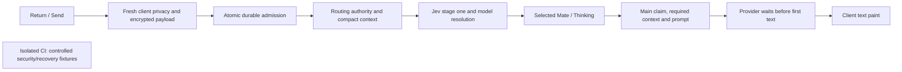

# Ordinary chat timing on October 13

Real TUI measurements preceded web measurements on deployed revision `a9e3e575af713a96c5c7446aea7a1763857a1e42`. Each request used Google AI Studio Gemini 3.8 Flash, LOW thinking, with no model override. These are single warm samples; provider variation and a post-restart cold database path limit before/after comparisons. Latency acceptance remains open.

For the Spain TUI request, the sent row appeared and the composer cleared at 29 ms. The following spans account for first authored text at 5,682 ms. Client transport instrumentation did not capture the actual socket, so the first server span's start is inferred from its measured duration; it is not a measured client dispatch timestamp.

| Cumulative time after Return | Processing | Span |
| --- | --- | ---: |
| 0–328 ms | Fresh client snapshot, privacy and encrypted admission preparation; aggregate inferred | 328 ms |
| 328–804 ms | Atomic durable Personal admission | 476 ms |
| 804–995 ms | Context binding, ACK, history construction and routing dispatch | 191 ms |
| 995–1,326 ms | Fresh routing authority, context/catalogue and credit/Project eligibility | 331 ms |
| 1,326–1,842 ms | Jev stage one, model resolution and selected-Mate publication | 516 ms |
| 1,842–1,976 ms | Sealed routing handoff and main-worker receipt | 134 ms |
| 1,976–2,683 ms | Main setup, required context, fresh claim/credits and prompt preparation | 707 ms |
| 2,683–5,646 ms | Google HTTP headers to first authored provider text | 2,963 ms |
| 5,646–5,682 ms | Delivery and TUI paint | 36 ms |

Within these spans, Jev's 63-question stage one took about 335 ms. Main setup includes fresh routing verification (82.6 ms), durable claim (55.6 ms), configuration reads (17.5 ms), fresh credit admission (about 166 ms), and active-summary preparation (299.8 ms). Credit, summary, embed and preprocessing work overlap; their durations must not be added as serial steps. Stage two was skipped only after authoritative empty-context proof. Main received 3,818 input tokens, produced 64 output tokens and used no tools. Retained logs do not expose a numeric thought count; missing reasoning usage must not be presented as zero.

Berlin's TUI request showed Sophia at 1,836 ms and tool progress at 6,664 ms. Main started its first provider call at 4,378 ms; the Events tool call arrived at 6,597 ms. Search completed at 9,429 ms, but billing and child/parent embed persistence continued to 14,394 ms. The second provider call started at 14,979 ms and yielded authored text at 17,589 ms; TUI paint followed at 17,818 ms. The server final stream marker arrived at 26,070 ms, while the SDK kept the TUI busy until 58,167 ms. The final-to-idle tail measures durable client completion, not model generation. SDK phase telemetry is needed to attribute its awaited operations.

For web, Spain's outbound frame was dispatched at 647 ms, selected Mate painted at 2,401 ms and text at 4,520 ms. Berlin dispatched at 759 ms, showed its Mate at 2,506 ms and text at 15,850 ms. Server Mate publication to paint took 66–67 ms. Server first text to paint took 72 ms for Spain and 339 ms for Berlin.

Both web sends put `delete_draft` ahead of routing context on the same socket. Its handler took 325 ms for Spain and 394 ms for Berlin. The server awaits handlers sequentially, so that earlier cleanup prevented handling of the later routing frame while stage one waited for it. Deferring remote cleanup has a concrete causal basis; its recoverable end-to-end time still requires measurement.

The atomic admission also held an exclusive global protocol lock through the complete transaction. That structurally serialized different users. A scoped candidate uses a shared protocol read lock while retaining exclusive pause/cutover writers, atomic admission and all owner/chat/key/deletion guards. A PostgreSQL primitive diagnostic on synthetic advisory keys completed in 393 ms: two exclusive readers took 242 ms; shared readers took 108 ms; a queued writer waited for readers and a later reader observed the writer. It accessed no product tables and is not a product latency result.

CI preparation time is separate. The previous preparation spent 492 seconds creating/verifying the schema carrier, 156 seconds building web, and 64 seconds restoring images. API/setup/upload image inputs remain unchanged; the critical send-path candidate changes UI and CMS execution inputs, while the CLI completion optimization is held. The coordinator splits selected E2E files into separate jobs. Bypassing the separate prepared-build stage still creates a cold database: the completed web check spent 547 seconds starting its backend, 156 seconds building web, 34 seconds building the current extension, and 30 seconds restoring compatible images; its two test cases took 41 seconds. This does not meet the warm 2–3-minute diagnostic target. The schema cache key includes request-only extension code, so a locking-only change invalidates the carrier despite unchanged schema definitions. Reuse must preserve producer/consumer provenance and current extension verification. No live inference or latency acceptance is claimed from CI.

## Published send-path retest (`eb0af3a`)

The isolated correctness checks passed, then the exact send-path subset was deployed. These real inference observations were taken on development with healthy matching API, routing/main workers and CMS, followed by the matching web app deployment. TUI ran first. Each is one warm sample, not a median or a matched performance claim. All used Google AI Studio Gemini 3.8 Flash with LOW thinking.

| Client / ordinary request | Optimistic row | Selected Mate paint | First authored paint | Completion |
| --- | ---: | ---: | ---: | --- |
| TUI / Spain capital | 31 ms | 2,559 ms | 4,793 ms | Idle 23,566 ms |
| TUI / Berlin AI events | 29 ms | 1,559 ms | 12,505 ms | Idle 66,829 ms |
| Web / Spain capital | Local message ready 345 ms | 2,665 ms | 5,565 ms | Source final 8,091 ms |
| Web / Berlin AI events | Local message ready 1,131 ms | 3,420 ms | 15,820 ms | Source final 22,588 ms |

Spain used no skills or selected Projects. Berlin used one Events search. Every selected-Mate sample missed 1,500 ms; both Spain first-text samples missed 3,000 ms. Successful request completion is not latency acceptance. The TUI final-to-idle tails were 16,790 ms (Spain) and 47,607 ms (Berlin); their awaited SDK operations are not yet attributed.

The Spain TUI cumulative trace shows where the request spends time. The first admission start is inferred from its measured duration because the prior client preloader did not capture the actual TUI socket.

| Cumulative ms from Enter | Step | Interval / interpretation |
| --- | --- | --- |
| 0–549 | Client privacy, payload and socket preparation | Aggregate inferred; not solely network time |
| 549–1,273 | Durable first Personal admission | Measured duration 723.684 ms |
| 1,305 | API message handler | 32 ms after preflight end |
| 1,491 / 1,495 | Broker dispatch / routing worker receipt | 186 ms after handler entry |
| 1,703 / 1,750 | Fresh routing admission / context and catalogue | Authority and required context |
| 1,982 | Credit and Project eligibility complete | Independent reads overlap |
| 2,046–2,433 | Jev stage-one request / permitted model selection | 387 ms between these events |
| 2,525 / 2,559 | Selected Mate publication / TUI paint | 34 ms delivery and paint |
| 2,689 | Main worker receipt | Handoff after routing |
| 3,180 / 3,182 | Fresh main credits / no-Project routing reuse | Main repeats a live wallet check |
| 3,344 / 3,360 | Preprocessing complete / main started | Detailed selection skipped for complete empty context |
| 3,478 / 3,506 | Google request / HTTP request headers | Provider begins after setup |
| 4,757 / 4,760 / 4,761 | Response headers / decoded chunk / authored text | 1,282 ms request-to-chunk; no raw-byte timestamp |
| 4,793 | TUI authored paint | 32 ms after server authored text |
| 5,168 / 6,776 | Stream end / final marker | Generation and durable finalization separate |
| 23,566 | TUI idle | Includes later client persistence and metadata work |

The main Spain prompt contained 3,818 input tokens and produced 73 candidate tokens. Thought usage was unreported in TUI and 12 in the web sample; unreported does not mean zero. The observed transport was uncompressed `text/event-stream`, not buffered JSON.

Web Spain sent its admission frame at 601 ms and reached its API handler at 999 ms. Its routing frame was sent at 1,070 ms, but broker dispatch was at 1,439 ms. Web Berlin did not send its frame until 1,397 ms; its API handler was at 2,036 ms, broker dispatch at 2,235 ms, and Mate publication at 3,396 ms. Stage one awaits the routing phase only: private details were sent 96 ms after context readiness for Spain and 208 ms after context readiness for Berlin. These observations do not support attributing the first-stage delay to waiting for all private details.

Source confirms a remaining same-socket block: the receive loop awaits the full admission continuation after durable ACK, so it cannot process the client's already-sent context-ready frame until that handler returns. The first Personal handler also writes its freshly sanitized message to the encrypted AI cache and then rereads and decrypts that one-message history. CLI preparation synchronously includes Project discovery in its privacy snapshot, although only fresh Personal Memory is needed before admission. These are the next bounded optimizations; their speed benefit remains unmeasured until deployed.

## Core13 candidate boundaries

A newly SDK-minted Personal AI chat can use the fresh one-use Personal Memory snapshot before admission and discover Projects afterward, in parallel with durable server admission. Saved, Team, explicit-Project and legacy protocol paths keep their existing snapshot and authority gates. Caller-provided Project candidates cannot replace fresh owner-scoped discovery. Numeric client phase telemetry uses fixed labels and elapsed milliseconds only.

A context-only receive lane must open only after durable ACK and exact context binding. It can handle matching ready/failed phases while continuation runs, buffer at most one unrelated frame, and join continuation before handling a second admission. Disconnect and exceptions must join or cancel owned work without losing the durable recovery identities. An authoritative one-message plain-text first Personal projection can reuse already sanitized request content for model history while still writing the encrypted cache; attachments, embeds, supplied history and uncertain projection remain on the established path.

The published source already warms encrypted Project, Project Focus, Workflow and Team-Memory discovery with two sliding hours and fresh revision/access boundaries. That feature must be reused, not duplicated. The repeated main credit read remains authoritative; cached discovery and the stage-one balance cannot replace current spending authority.

## Core13 deployed observations and next decisive change

Revision `b57dadf12b1b084c0cbb6d6d291d9faa9d934591` passed the retained nine isolated recovery and warm-up cases before real inference on development. The following individual warm runs were measured in the interactive TUI first, then the matching web app. They do not establish percentiles. All requests completed; each selected-Mate timing still misses 1,500 ms, and Spain's first authored text still misses 3,000 ms.

| Client / prompt | User row | Selected Mate | First authored text | Completion boundary |
|---|---:|---:|---:|---:|
| TUI / Spain | 32 ms | 2,203 ms | 5,638 ms | TUI idle 15,842 ms |
| TUI / Berlin | 32 ms | 2,073 ms | 16,561 ms | TUI idle 63,343 ms |
| Web / Spain | measured separately | 2,092 ms | 4,806 ms | server final 6,740 ms |
| Web / Berlin | measured separately | 1,903 ms | 15,624 ms | server final 25,759 ms |

The exact TUI Spain trace verifies Google AI Studio Gemini 3.8 Flash, LOW thinking, zero tools and 3,818 input tokens. Its cumulative timeline is:

| Boundary from Enter | Time | Interpretation |
|---|---:|---|
| Admission frame | 201 ms | Fresh Memory privacy preparation precedes dispatch |
| Durable admission ACK | 770 ms | 569 ms after the frame |
| Routing context sent | 1,284 ms | Project discovery and context preparation continue after ACK |
| Broker dispatch / routing receipt | 909 / 913 ms | Dispatch no longer awaits context delivery |
| Fresh routing authority | 1,183 ms | Current durable turn and ownership checked |
| Routing context and catalogues ready | 1,390 ms | Stage one joins required routing metadata |
| Credits and Project eligibility ready | 1,626 ms | Fresh spending and owner-scoped Project checks |
| Jev stage-one request / model resolved | 1,690 / 2,064 ms | Exact routing decisions precede Mate feedback |
| Mate published / painted | 2,167 / 2,203 ms | No generic Assistant Thinking |
| Main receipt | 2,293 ms | Main setup remains before provider call |
| Preprocessing complete | 2,915 ms | Required public decisions reused; detailed stage skipped |
| Google request / request headers sent | 3,013 / 3,043 ms | Headers sent are an outbound event |
| Response headers / first authored chunk | 5,600 / 5,603 ms | Remote queue/compute/transport are not separately attributable |
| Final marker | 7,648 ms | Persistence and postprocessing are distinct from first authored text |

The first encrypted message remains cached but its sanitized one-message AI history is reused: the server reports 0.000 seconds for that reuse. Compared with the individual Core12 Spain sample, provider invocation begins 465 ms earlier, while the provider's first authored chunk arrives 1,308 ms later relative to invocation. This is provider variation, not proof that local setup is finished.

The next bounded change is a single freshly authenticated Personal Project routing-directory request using the existing owner-scoped batch service. The test account has two discoverable Projects even for Spain. Current CLI discovery lists Projects and then requests settings for each before publishing routing; those settings reads finish near routing readiness. Reusing a client WebSocket auth receipt cannot remove server authentication on these independent REST endpoints. The new request must retain fresh ownership, enabled-selection filtering, ciphertext-only transport, and legacy/Team fallback. A tested speculative raw-wallet overlap is held after review found that a concurrent debit could invalidate the earlier result; the existing post-context credit order remains. No access or balance permission is cached.

CI checks controlled correctness and recovery; these latency observations use real inference on development. The last prepared batch reused all four schema/runtime image inputs. Its remaining 163-second web build is separate from chat request processing. Full prepared E2E turnaround still exceeds the 2–3-minute diagnostic goal; focused local probes remain the first debugging step.
