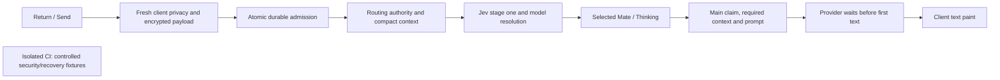

# Ordinary chat timing on October 13

Real TUI measurements preceded web measurements on deployed revision `a9e3e575af713a96c5c7446aea7a1763857a1e42`. Each request used Google AI Studio Gemini 3.8 Flash, LOW thinking, with no model override. These are single warm samples; provider variation and a post-restart cold database path limit before/after comparisons. Latency acceptance remains open.

For the Spain TUI request, the sent row appeared and the composer cleared at 29 ms. The following spans account for first authored text at 5,682 ms. Client transport instrumentation did not capture the actual socket, so the first server span's start is inferred from its measured duration; it is not a measured client dispatch timestamp.

| Cumulative time after Return | Processing | Span |
| --- | --- | ---: |
| 0–328 ms | Fresh client snapshot, privacy and encrypted admission preparation; aggregate inferred | 328 ms |
| 328–804 ms | Atomic durable Personal admission | 476 ms |
| 804–995 ms | Context binding, ACK, history construction and routing dispatch | 191 ms |
| 995–1,326 ms | Fresh routing authority, context/catalogue and credit/Project eligibility | 331 ms |
| 1,326–1,842 ms | Jev stage one, model resolution and selected-Mate publication | 516 ms |
| 1,842–1,976 ms | Sealed routing handoff and main-worker receipt | 134 ms |
| 1,976–2,683 ms | Main setup, required context, fresh claim/credits and prompt preparation | 707 ms |
| 2,683–5,646 ms | Google HTTP headers to first authored provider text | 2,963 ms |
| 5,646–5,682 ms | Delivery and TUI paint | 36 ms |

Within these spans, Jev's 63-question stage one took about 335 ms. Main setup includes fresh routing verification (82.6 ms), durable claim (55.6 ms), configuration reads (17.5 ms), fresh credit admission (about 166 ms), and active-summary preparation (299.8 ms). Credit, summary, embed and preprocessing work overlap; their durations must not be added as serial steps. Stage two was skipped only after authoritative empty-context proof. Main received 3,818 input tokens, produced 64 output tokens and used no tools. Retained logs do not expose a numeric thought count; missing reasoning usage must not be presented as zero.

Berlin's TUI request showed Sophia at 1,836 ms and tool progress at 6,664 ms. Main started its first provider call at 4,378 ms; the Events tool call arrived at 6,597 ms. Search completed at 9,429 ms, but billing and child/parent embed persistence continued to 14,394 ms. The second provider call started at 14,979 ms and yielded authored text at 17,589 ms; TUI paint followed at 17,818 ms. The server final stream marker arrived at 26,070 ms, while the SDK kept the TUI busy until 58,167 ms. The final-to-idle tail measures durable client completion, not model generation. SDK phase telemetry is needed to attribute its awaited operations.

For web, Spain's outbound frame was dispatched at 647 ms, selected Mate painted at 2,401 ms and text at 4,520 ms. Berlin dispatched at 759 ms, showed its Mate at 2,506 ms and text at 15,850 ms. Server Mate publication to paint took 66–67 ms. Server first text to paint took 72 ms for Spain and 339 ms for Berlin.

Both web sends put `delete_draft` ahead of routing context on the same socket. Its handler took 325 ms for Spain and 394 ms for Berlin. The server awaits handlers sequentially, so that earlier cleanup prevented handling of the later routing frame while stage one waited for it. Deferring remote cleanup has a concrete causal basis; its recoverable end-to-end time still requires measurement.

The atomic admission also held an exclusive global protocol lock through the complete transaction. That structurally serialized different users. A scoped candidate uses a shared protocol read lock while retaining exclusive pause/cutover writers, atomic admission and all owner/chat/key/deletion guards. A PostgreSQL primitive diagnostic on synthetic advisory keys completed in 393 ms: two exclusive readers took 242 ms; shared readers took 108 ms; a queued writer waited for readers and a later reader observed the writer. It accessed no product tables and is not a product latency result.

CI preparation time is separate. The previous preparation spent 492 seconds creating/verifying the schema carrier, 156 seconds building web, and 64 seconds restoring images. API/setup/upload image inputs remain unchanged; the critical send-path candidate changes UI and CMS execution inputs, while the CLI completion optimization is held. The coordinator splits selected E2E files into separate jobs. Bypassing the separate prepared-build stage still creates a cold database: the completed web check spent 547 seconds starting its backend, 156 seconds building web, 34 seconds building the current extension, and 30 seconds restoring compatible images; its two test cases took 41 seconds. This does not meet the warm 2–3-minute diagnostic target. The schema cache key includes request-only extension code, so a locking-only change invalidates the carrier despite unchanged schema definitions. Reuse must preserve producer/consumer provenance and current extension verification. No live inference or latency acceptance is claimed from CI.

## Published send-path retest (`eb0af3a`)

The isolated correctness checks passed, then the exact send-path subset was deployed. These real inference observations were taken on development with healthy matching API, routing/main workers and CMS, followed by the matching web app deployment. TUI ran first. Each is one warm sample, not a median or a matched performance claim. All used Google AI Studio Gemini 3.8 Flash with LOW thinking.

| Client / ordinary request | Optimistic row | Selected Mate paint | First authored paint | Completion |
| --- | ---: | ---: | ---: | --- |
| TUI / Spain capital | 31 ms | 2,559 ms | 4,793 ms | Idle 23,566 ms |
| TUI / Berlin AI events | 29 ms | 1,559 ms | 12,505 ms | Idle 66,829 ms |
| Web / Spain capital | Local message ready 345 ms | 2,665 ms | 5,565 ms | Source final 8,091 ms |
| Web / Berlin AI events | Local message ready 1,131 ms | 3,420 ms | 15,820 ms | Source final 22,588 ms |

Spain used no skills or selected Projects. Berlin used one Events search. Every selected-Mate sample missed 1,500 ms; both Spain first-text samples missed 3,000 ms. Successful request completion is not latency acceptance. The TUI final-to-idle tails were 16,790 ms (Spain) and 47,607 ms (Berlin); their awaited SDK operations are not yet attributed.

The Spain TUI cumulative trace shows where the request spends time. The first admission start is inferred from its measured duration because the prior client preloader did not capture the actual TUI socket.

| Cumulative ms from Enter | Step | Interval / interpretation |
| --- | --- | --- |
| 0–549 | Client privacy, payload and socket preparation | Aggregate inferred; not solely network time |
| 549–1,273 | Durable first Personal admission | Measured duration 723.684 ms |
| 1,305 | API message handler | 32 ms after preflight end |
| 1,491 / 1,495 | Broker dispatch / routing worker receipt | 186 ms after handler entry |
| 1,703 / 1,750 | Fresh routing admission / context and catalogue | Authority and required context |
| 1,982 | Credit and Project eligibility complete | Independent reads overlap |
| 2,046–2,433 | Jev stage-one request / permitted model selection | 387 ms between these events |
| 2,525 / 2,559 | Selected Mate publication / TUI paint | 34 ms delivery and paint |
| 2,689 | Main worker receipt | Handoff after routing |
| 3,180 / 3,182 | Fresh main credits / no-Project routing reuse | Main repeats a live wallet check |
| 3,344 / 3,360 | Preprocessing complete / main started | Detailed selection skipped for complete empty context |
| 3,478 / 3,506 | Google request / HTTP request headers | Provider begins after setup |
| 4,757 / 4,760 / 4,761 | Response headers / decoded chunk / authored text | 1,282 ms request-to-chunk; no raw-byte timestamp |
| 4,793 | TUI authored paint | 32 ms after server authored text |
| 5,168 / 6,776 | Stream end / final marker | Generation and durable finalization separate |
| 23,566 | TUI idle | Includes later client persistence and metadata work |

The main Spain prompt contained 3,818 input tokens and produced 73 candidate tokens. Thought usage was unreported in TUI and 12 in the web sample; unreported does not mean zero. The observed transport was uncompressed `text/event-stream`, not buffered JSON.

Web Spain sent its admission frame at 601 ms and reached its API handler at 999 ms. Its routing frame was sent at 1,070 ms, but broker dispatch was at 1,439 ms. Web Berlin did not send its frame until 1,397 ms; its API handler was at 2,036 ms, broker dispatch at 2,235 ms, and Mate publication at 3,396 ms. Stage one awaits the routing phase only: private details were sent 96 ms after context readiness for Spain and 208 ms after context readiness for Berlin. These observations do not support attributing the first-stage delay to waiting for all private details.

Source confirms a remaining same-socket block: the receive loop awaits the full admission continuation after durable ACK, so it cannot process the client's already-sent context-ready frame until that handler returns. The first Personal handler also writes its freshly sanitized message to the encrypted AI cache and then rereads and decrypts that one-message history. CLI preparation synchronously includes Project discovery in its privacy snapshot, although only fresh Personal Memory is needed before admission. These are the next bounded optimizations; their speed benefit remains unmeasured until deployed.

## Core13 candidate boundaries

A newly SDK-minted Personal AI chat can use the fresh one-use Personal Memory snapshot before admission and discover Projects afterward, in parallel with durable server admission. Saved, Team, explicit-Project and legacy protocol paths keep their existing snapshot and authority gates. Caller-provided Project candidates cannot replace fresh owner-scoped discovery. Numeric client phase telemetry uses fixed labels and elapsed milliseconds only.

A context-only receive lane must open only after durable ACK and exact context binding. It can handle matching ready/failed phases while continuation runs, buffer at most one unrelated frame, and join continuation before handling a second admission. Disconnect and exceptions must join or cancel owned work without losing the durable recovery identities. An authoritative one-message plain-text first Personal projection can reuse already sanitized request content for model history while still writing the encrypted cache; attachments, embeds, supplied history and uncertain projection remain on the established path.

The published source already warms encrypted Project, Project Focus, Workflow and Team-Memory discovery with two sliding hours and fresh revision/access boundaries. That feature must be reused, not duplicated. The repeated main credit read remains authoritative; cached discovery and the stage-one balance cannot replace current spending authority.

## Core13 deployed observations and next decisive change

Revision `b57dadf12b1b084c0cbb6d6d291d9faa9d934591` passed the retained nine isolated recovery and warm-up cases before real inference on development. The following individual warm runs were measured in the interactive TUI first, then the matching web app. They do not establish percentiles. All requests completed; each selected-Mate timing still misses 1,500 ms, and Spain's first authored text still misses 3,000 ms.

| Client / prompt | User row | Selected Mate | First authored text | Completion boundary |
|---|---:|---:|---:|---:|
| TUI / Spain | 32 ms | 2,203 ms | 5,638 ms | TUI idle 15,842 ms |
| TUI / Berlin | 32 ms | 2,073 ms | 16,561 ms | TUI idle 63,343 ms |
| Web / Spain | measured separately | 2,092 ms | 4,806 ms | server final 6,740 ms |
| Web / Berlin | measured separately | 1,903 ms | 15,624 ms | server final 25,759 ms |

The exact TUI Spain trace verifies Google AI Studio Gemini 3.8 Flash, LOW thinking, zero tools and 3,818 input tokens. Its cumulative timeline is:

| Boundary from Enter | Time | Interpretation |
|---|---:|---|
| Admission frame | 201 ms | Fresh Memory privacy preparation precedes dispatch |
| Durable admission ACK | 770 ms | 569 ms after the frame |
| Routing context sent | 1,284 ms | Project discovery and context preparation continue after ACK |
| Broker dispatch / routing receipt | 909 / 913 ms | Dispatch no longer awaits context delivery |
| Fresh routing authority | 1,183 ms | Current durable turn and ownership checked |
| Routing context and catalogues ready | 1,390 ms | Stage one joins required routing metadata |
| Credits and Project eligibility ready | 1,626 ms | Fresh spending and owner-scoped Project checks |
| Jev stage-one request / model resolved | 1,690 / 2,064 ms | Exact routing decisions precede Mate feedback |
| Mate published / painted | 2,167 / 2,203 ms | No generic Assistant Thinking |
| Main receipt | 2,293 ms | Main setup remains before provider call |
| Preprocessing complete | 2,915 ms | Required public decisions reused; detailed stage skipped |
| Google request / request headers sent | 3,013 / 3,043 ms | Headers sent are an outbound event |
| Response headers / first authored chunk | 5,600 / 5,603 ms | Remote queue/compute/transport are not separately attributable |
| Final marker | 7,648 ms | Persistence and postprocessing are distinct from first authored text |

The first encrypted message remains cached but its sanitized one-message AI history is reused: the server reports 0.000 seconds for that reuse. Compared with the individual Core12 Spain sample, provider invocation begins 465 ms earlier, while the provider's first authored chunk arrives 1,308 ms later relative to invocation. This is provider variation, not proof that local setup is finished.

The next bounded change is a single freshly authenticated Personal Project routing-directory request using the existing owner-scoped batch service. The test account has two discoverable Projects even for Spain. Current CLI discovery lists Projects and then requests settings for each before publishing routing; those settings reads finish near routing readiness. Reusing a client WebSocket auth receipt cannot remove server authentication on these independent REST endpoints. The new request must retain fresh ownership, enabled-selection filtering, ciphertext-only transport, and legacy/Team fallback. A tested speculative raw-wallet overlap is held after review found that a concurrent debit could invalidate the earlier result; the existing post-context credit order remains. No access or balance permission is cached.

CI checks controlled correctness and recovery; these latency observations use real inference on development. The last prepared batch reused all four schema/runtime image inputs. Its remaining 163-second web build is separate from chat request processing. Full prepared E2E turnaround still exceeds the 2–3-minute diagnostic goal; focused local probes remain the first debugging step.

## Core14 published observations (`0d7822d`)

The authenticated one-request Personal Project routing directory and its guarded CLI use were published at `0d7822dd0bbeb6a6cf50e98324b8f5a5e9c77aa0`. Seven exact-source recovery cases passed without retries. The proposed speculative wallet read was held: an earlier positive balance could become insufficient while required context loads. Fresh wallet authority retains its established ordering. These real-AI TUI observations are individual warm samples, not medians or a matched causal performance comparison. Both used Google AI Studio Gemini 3.8 Flash with LOW thinking.

| Ordinary TUI request | Optimistic user row | Selected Mate paint | First authored paint | Completion |
|---|---:|---:|---:|---|
| Spain capital | 30 ms | 2,271 ms | 4,571 ms | Server final 7,737 ms; TUI idle 21,823 ms |
| Berlin AI events | 29 ms | 1,751 ms | 18,456 ms | Server final 27,865 ms; no TUI idle within the 90-second capture budget |

Both Mate measurements miss 1,500 ms; Spain also misses 3,000 ms. Berlin called Events search and returned ten results. Its first tool progress was 5,864 ms. The longer client completion tail is separate from answer arrival and remains unattributed. A subsequent independent deployment advanced canonical source during the Berlin run; container provenance alone does not prove all source-mounted inputs remained isolated. Do not attribute a before/after improvement to Project batching from these samples.

The Spain trace supplies the following contiguous critical-path spans. Intermediate values include transport and scheduling unless a narrower server measurement is stated. Overlapping work is not added twice.

| Cumulative time from Enter | Work on the critical path | Elapsed |
|---|---|---:|
| 0–410 ms | Fresh Personal Memory/privacy preparation and admission-frame dispatch | 410 ms |
| 410–777 ms | Atomic admission and durable ACK delivery; server preflight itself took 334 ms | 367 ms |
| 777–1,367 ms | Project directory, routing-context delivery and fresh routing authority overlap; bound routing frame at 1,187 ms | 590 ms |
| 1,367–1,696 ms | Required fresh credit and Project eligibility join | 329 ms |
| 1,696–1,757 ms | Jev request preparation | 61 ms |
| 1,757–2,233 ms | Jev stage one, permitted model resolution and Mate publication | 476 ms |
| 2,233–2,405 ms | Sealed handoff and main-worker receipt | 172 ms |
| 2,405–3,178 ms | Main setup, execution authority, required context and preprocessing | 773 ms |
| 3,178–3,248 ms | Main prompt and provider setup | 70 ms |
| 3,248–4,535 ms | Provider call through first authored text; HTTP request headers at 3,271 ms | 1,287 ms |
| 4,535–4,571 ms | Stream delivery and TUI paint | 36 ms |

Mate publication-to-paint was 38 ms. Main's 773 ms includes about 36 ms service setup, 124 ms sealed handoff loading, 143 ms durable turn claiming, 53 ms context hydration, a 163 ms concurrent billing/embed interval, and about 127 ms preprocessing. The active-summary write runs concurrently for 381 ms but contributes only the final 92 ms join; it must not be counted as another full 381 ms sequential delay. An approximately 85 ms preprocessing subspan is not yet attributed. Stage two was authoritatively skipped for Spain; it cannot explain this factual request's delay.

For Berlin, Events search completed at 8,651 ms, while parent embed sealing did not complete until 15,300 ms. The next model request began at 15,859 ms and first authored server text arrived at 18,173 ms. The 6,649 ms search-result-to-parent-embed interval is a separate tool-result critical path. A later independent same-turn skill change must be evaluated on its own exact source.

Instrumented web diagnostics failed before any admission frame and yield no backend AI timing. A bounded follow-up retained fixed compiled source locations and failed-send preparation phases; it identified an observer defect: calling the app's ZoneAwarePromise prototype on a native WebCrypto promise throws before the original promise can be returned. Those failures are invalid for product assessment. The corrected private probe captures the intrinsic native Promise method before app scripts and contains observer failures; an actual Zone.js/WebCrypto identity smoke passes. It is a diagnostic tool correction, not a web product fix.

Bounded infrastructure probes found warm PostgreSQL statements around 0.9 ms and reused API-to-CMS ping requests at a median 8.1 ms. A paired pre-transaction internal-token/bearer probe did not support a large bearer-authentication penalty. These probes do not locate real operation lock, ORM or transaction time; detailed numeric operation spans are the next evidence.

All four runtime/schema carriers were reused for the Core14 correctness batch. Selected recovery tests took 221.5 seconds, but request-to-CI completion still took about 1,038 seconds because prepared builds and dispatch remained outside that test interval. The full warm E2E loop does not yet meet the 2–3-minute development target. CI is outside the product request path and runs controlled correctness/security/recovery fixtures; the real AI latency observations above run directly on development.

### Corrected bounded web dispatch diagnostic

With the observer correction and its Zone.js smoke in place, one ordinary Spain web dispatch diagnostic completed in 30.71 seconds, reusing the installed browser and existing isolated account. Admission was sent at 613 ms after the actual Send click. Local message readiness was at 349 ms; connected-account context was ready in the next millisecond. Optional `set_active_chat` completed at 540 ms while the independent message send proceeded. The remaining admission preparation took 264 ms. This diagnostic intentionally stops at admission and does not measure Mate paint, authored text, final completion or LOW usage; it is not a latency-acceptance run. No product UI change was required to repair the observer.

## Fast-routing integration regression (Core15 retest)

On published `ecb105de08cb1246bdcda640ac8435adbceb3b03`, both actual warm TUI requests left the reserved routing lane immediately after fresh routing admission. Spain showed the selected Mate at 2,418 ms and first authored text at 4,344 ms; Berlin showed the Mate at 2,878 ms and first authored text at 15,378 ms. Neither meets the accepted targets. These are individual observations, not medians.

The local routing test exposed the exact integration fault: the trusted private-context field list includes `same_turn_request`, while the public `AskSkillRequest` intentionally has no such field. Routing copied that descriptor onto the public schema, raising `ValueError` inside an exception group. Main then repeated preprocessing on the fallback path. The fix keeps that descriptor in the main worker's trusted checkpoint path and skips it during routing hydration, matching main's existing schema hydration. Context binding, fresh authority checks, publication rechecks and encrypted handoff remain required. A bounded fallback diagnostic records allowlisted leaf exception types and repository-relative source frames, without exception text or request data.

All 113 focused routing, handoff, private-context and same-turn barrier unit checks passed on the current integration base, including all four previously failing route variants. The narrow isolated routing check runs pytest with no browser, signup, web rebuild or inference. Prior recovery results remain evidence for their unchanged paths; a worker-registration health probe does not establish route hydration success. Real latency acceptance still requires deployed-source TUI measurements first, followed by web.

## Reserved routing restored (`62549591a0`)

The fast-routing fix passed 113 local current-source tests and the exact-source isolated routing file. That diagnostic completed in 164 seconds without signup, browser setup, web rebuilding, schema preparation or inference. The deployed runtime update reused the unchanged schema; its current CMS handler was rebuilt because independently published recovery code had changed. Actual inference then ran on development in TUI first, using Google AI Studio Gemini 3.8 Flash, LOW thinking and an uncompressed SSE stream. Reserved routing succeeded in both ordinary prompts; no grouped-exception fallback remained.

| Individual warm TUI observation | User row / clear | Selected Mate | First authored text | TUI idle |
|---|---:|---:|---:|---:|
| Spain, first after runtime update | 33 ms | 2,757 ms | 5,230 ms | 11,536 ms |
| Berlin AI events | 32 ms | 1,375 ms | 13,716 ms | 55,967 ms |
| Spain, later warm sample | 32 ms | 1,957 ms | 4,202 ms | 10,012 ms |

Berlin met the 1,500-ms Mate requirement in this observation. Both Spain observations missed Mate and factual first-text requirements. These are individual runs, not medians or percentiles. Additional Focus/remote-access scenarios and final latency acceptance remain pending; an earlier correctness pass does not satisfy the targets. The post-final-to-idle SDK tail remains a separate issue (Berlin 33,408 ms).

Spain's later sample accounts for the complete first-authored interval:

| Cumulative time after Return | Step | Interval |
|---|---|---:|
| 0–325 ms | Fresh same-socket privacy snapshot, sanitization and encrypted admission frame | 325 ms |
| 325–838 ms | Durable admission through client ACK | 513 ms |
| 838–1,086 ms | Bound context, first-history projection and broker dispatch | 248 ms |
| 1,086–1,439 ms | Routing authority, catalogue and fresh credit/Project reads | 353 ms |
| 1,439–1,926 ms | Stage-one preparation, Jev, model resolution and selected-Mate publication | 487 ms |
| 1,926–2,065 ms | Encrypted handoff and main receipt | 139 ms |
| 2,065–2,736 ms | Main claim, required setup and prompt preparation | 671 ms |
| 2,736–4,172 ms | Google SDK request to first authored text | 1,436 ms |
| 4,172–4,202 ms | Delivery and TUI paint | 30 ms |

The Memory snapshot itself took 209 ms. API durable preflight was 472 ms, including a 422-ms atomic CMS admission request; the later routing verification was only 43 ms over HTTP. These are different operations. Main setup included stage-one loading (79 ms), durable claim (63 ms), configuration (33 ms), embed-index preparation (176 ms), a fresh wallet read (163 ms plus decryption), and active-summary preparation (313 ms). Embed, billing and summary work overlap and must not be summed. The first-text metadata barrier was zero. With the observed 1,436-ms provider span, the SDK call would have to start by 1,564 ms to achieve 3,000 ms authored text, rather than its observed 2,736 ms.

A bounded read-only system probe found no sustained disk/WAL/checkpoint pressure, but was not request-correlated; PostgreSQL I/O timing was unavailable. It does not identify the atomic admission's internal bottleneck. The next diagnostic therefore adds authenticated fixed numeric phases for first-Personal admission, preserving SQL sequence, transaction outcomes and response bodies. Prior logging measured routing verification only.

The minimal main-context change omits the 477-word interactive-question protocol only under the existing complete factual first-turn proof, with no interactive/form/dialogue intent. It retains safety, selected Mate persona, model identity, composer suggestion instructions and Gemini LOW policy. A full-main-loop prompt capture and 136 relevant local cases passed. Ordinary questions, context-bearing turns, tools and ambiguous or interactive requests retain that protocol. A shorter prompt is not itself a measured provider-latency improvement.

The focus/TUI-start hint already prepares the socket, chat key, privacy worker and encrypted Project/Focus/Workflow metadata with two sliding hours. It does not replace the fresh one-use Personal Memory snapshot or fresh credit authority. No positive authority cache or across-turn snapshot reuse is introduced by this batch.

## Atomic admission located (`0c4a995b0a`)

Actual warmed Spain TUI: optimistic row 34 ms, selected Mate 2,070 ms, authored text 4,295 ms and idle 10,006 ms. Exact logs verify Google AI Studio Gemini 3.8 Flash LOW with zero tools. Prompt tokens fell from 3,818 to 2,790 (26.9%); provider wait was 1,387 ms. Targets remain unmet.

| Cumulative from Enter | Critical path | Interval |
|---|---|---:|
| 0–230 ms | Fresh Memory/privacy, encryption, admission dispatch | 230 ms |
| 230–793 ms | Atomic admission through client ACK | 563 ms |
| 793–1,001 ms | Context, encrypted history and broker dispatch | 208 ms |
| 1,001–1,504 ms | Routing authority, context, fresh credits/Project join | 503 ms |
| 1,504–2,041 ms | Jev preparation, stage one, model and Mate publication | 537 ms |
| 2,041–2,195 ms | Encrypted handoff and main receipt | 154 ms |
| 2,195–2,870 ms | Main execution checks, setup and prompt | 675 ms |
| 2,870–4,257 ms | Provider request to authored text | 1,387 ms |
| 4,257–4,295 ms | Delivery and TUI paint | 38 ms |

Atomic CMS admission measured 453.61 ms: message insert, version CAS and initial schema probes 181.60 ms, proof preparation 101.94 ms, chat reads 56.59 ms, chat creation 52.24 ms, commit 21.32 ms and remaining phases 39.92 ms. Initial routing verification was 154.49 ms (178 ms HTTP). Stage two was skipped. The Google call would need to start by 1,575 ms instead of 2,870 ms under this observed provider/paint budget. Removing all main setup alone is insufficient. Server-final-to-idle adds 3,928 ms separately.

The next candidate overlaps unchanged artifact-ledger/config reads and removes a redundant protocol read only when atomic first-Personal admission already holds and validates that protocol lock. Persisted-message digest and proof locking remain. Finer numeric phases distinguish insert, version CAS and proof steps. No latency win is claimed before measurement.

Combining message insertion and chat update in a data-modifying SQL CTE is held: shared statement snapshots need database-level equivalence proof for the existing chat-reading storage trigger. Early positive wallet reuse is held because refund paths can debit without the settlement lock. Neither shortcut is applied.

The exact-source narrow check passed in 153.7 seconds without browser/signup/schema/web preparation. The versioned schema-key candidate excludes only request-only recovery handlers/tests, retaining registration, setup, migrations, packages and current CMS verification. It causes one migration miss and then allows eligible handler-only edits to reuse schema; it does not make full recovery CI a 2–3-minute operation. CI remains outside real chat processing.
