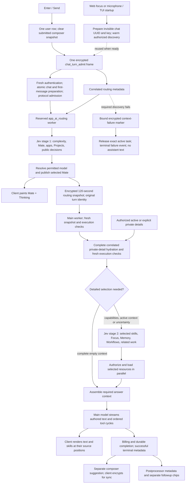
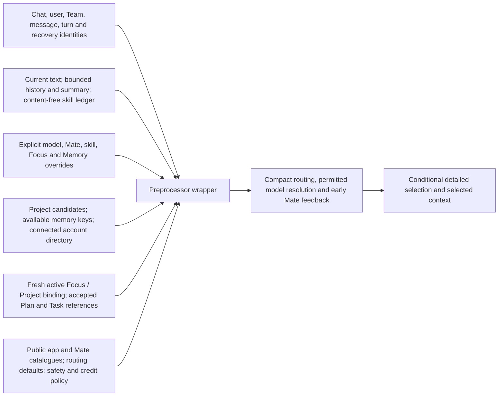
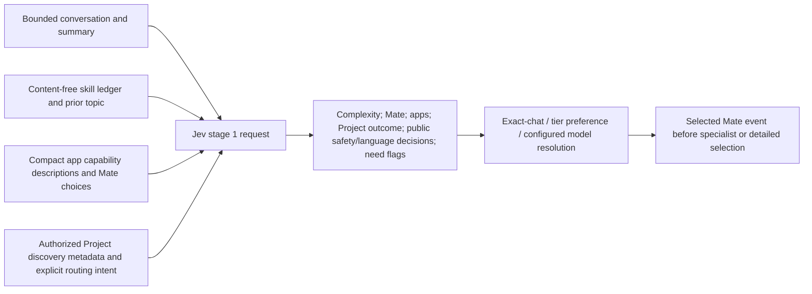
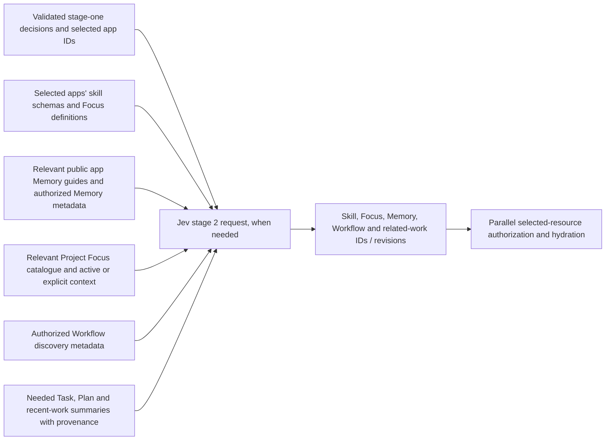
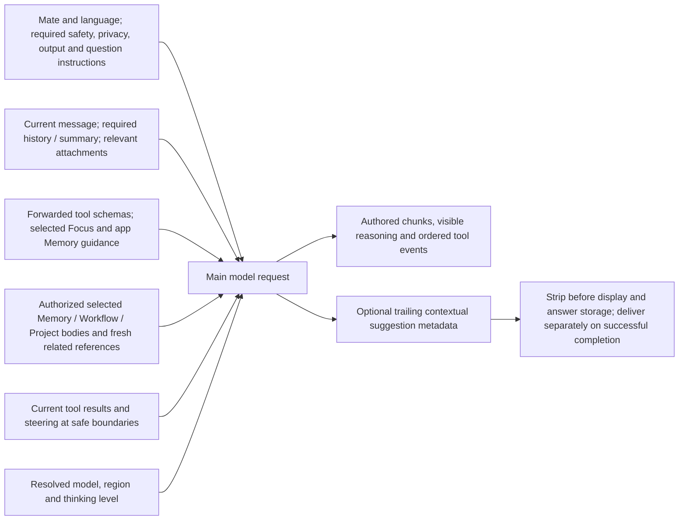
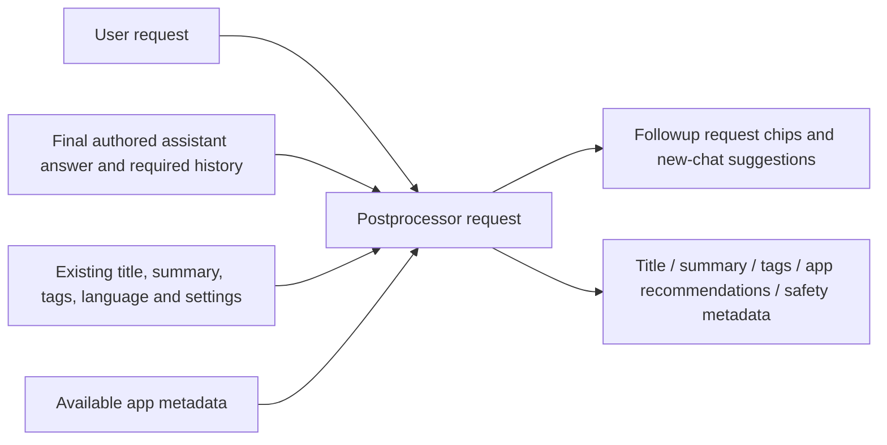

# Chat processing architecture

The architecture revision (`fa6b90c`), Google transport repair (`e71c72b8`), immediate admission changes (`2453d85d`), first measured SDK/auth/simple-turn fixes (`7a250696`), composer focus repair (`df30b916`), and idle authenticated TUI connection / bounded Project projection changes (`ab78d61b`) are deployed to development. Actual TUI measurements still miss the latency targets; no successful timing acceptance is claimed yet. Timing targets are 1.5 seconds from Enter/Send to selected-Mate paint, and 2–3 seconds to authored text for an ordinary factual request. The interactive TUI is measured first, then web. Tool progress, final response, persistence and command exit are separate measurements.

Prepared identity does not create an unwanted visible empty chat. With the durable protocol enabled, a cold request creates the chat and commits its message in the same admission. When the recovery cutover epoch is zero, first-frame admission atomically prepares the new chat and first encrypted user message before acknowledging `LEGACY`; subsequent inference follows the established dispatch path. Existing chats and human-only Team conversations keep their existing gates. The latency changes do not enable a global recovery cutover. Capability negotiation retains the established protocol for older APIs. Deferred routing/private-detail frames currently apply to first ordinary Personal turns; existing-chat, Team, explicit-Project and attachment paths retain their complete context and established gates. This avoids expiring a queued turn's required context while it waits behind a long response.

With `chat_turn_context_selection_details_v2`, the routing continuation needs only the completed authorized Project candidate list. Task candidates, accepted Plan context, Project Focus discovery and the connected-account directory arrive in the separately correlated details continuation. These reads run concurrently and must complete before detailed selection or main-context assembly; they do not delay stage-one Mate feedback. Failed or incomplete Project discovery retains the complete path. Older APIs receive the established full routing payload.

The preprocessor wrapper receives the authenticated request and server configuration. Cached discovery is data; access, source revision, consent, credit and execution checks remain authoritative.

Jev's first request excludes unrelated private bodies and full tool schemas. Its validated public decisions can authorize skipping the detailed pass only when the fresh active-context snapshot is complete and empty.

Jev's detailed request sees the relevant catalogue. Required active or explicitly supplied context can load while routing runs; resources whose IDs are chosen by this pass load afterward. Main revalidates selected related-work snapshots rather than issuing a third selector inference.

Minimal main context retains the instructions needed to answer correctly. It omits unrelated private Project/Task/Workflow bodies and unused selected app guidance; it preserves mandatory safety, privacy, formatting, questions, model policy and selected context. A confirmed objective English factual first turn with complete empty context omits the empty Task runtime and its create tool. Unknown intent, actions, explicit Task dependencies and incomplete context retain the full path. The last qualified main prompt contained 7,163 tokens. The next candidate also omits only code, document and plot formatting sections for a positively proved objective factual first turn with zero final tools and no selected private or artifact context. Discovery metadata alone does not force artifact instructions back into the prompt. Unknown intent, selected context, relevant history, attachments and actions retain those sections; mandatory answer and composer-suggestion guidance remains. Token and timing savings are not yet measured.

Postprocessing remains separate from answer streaming and the main-generated composer suggestion.

| Data | Preparation and retention | Freshness boundary |
| --- | --- | --- |
| Shipped skill, Focus and app Memory definitions | Process RAM at startup, keyed by configuration revision | New deployment / process |
| Workflow discovery | Vault-encrypted Dragonfly, two sliding hours | Nonexpiring mutation generation plus fresh access |
| Encrypted Project summaries | Dragonfly, two sliding hours | Fresh owner/Team ID/version/time watermark; keys and wrappers remain live |
| Project Focus discovery | Opaque item IDs and revisions, two sliding hours | Fresh scoped listing; private bodies remain live |
| Team Memory discovery | Key metadata only, two sliding hours | Fresh Team role and source versions; no cached item body |
| Personal available Memory keys | Device-local index warmed on focus | Current keys reread for Send |
| Selected private details and routing handoff | Existing authorized transport; new phase/snapshot payloads Vault-encrypted for 120 seconds | Exact owner, Team, device/turn, source revision and consent |
| Approved user Memory content | Existing consent-bound chat-specific encrypted retention, default 24 hours | Scope, revision, revocation and chat eviction |

Project/Focus/Team-memory cache hits still require a small fresh Directus watermark read. These indexes reduce repeated full metadata reads; they are not permission caches. No warm-up sends draft text or invokes an AI model. The TUI also prepares a separate one-use authenticated send connection with a 45-second lifetime. Borrowing requires the same account, session, refresh-cookie authority, device key, Team/key scope and socket options, plus a fresh persisted-state recheck. A foreground send cancels an unfinished optional connection before required preparation; a ready matching connection can be borrowed once. Token expiry renewal under the same refresh-cookie authority does not discard an already-authenticated live connection.

## Measured TUI timing before the next optimization

These are actual PTY Enter-to-paint measurements of “What’s the capital of Spain?”, with the same successful Google Gemini 3.8 Flash model and LOW thinking verified against the exact task and chat in server logs. Every sample completed without app skill calls. The two warmed samples after `7a250696` used a 20-second idle before Enter; the first also followed worker restart. They are individual observations, not a representative percentile or an apples-to-apples improvement claim.

| Runtime / condition | Optimistic user row and composer clear | Selected Mate | First authored text | Provider request → authored paint | Acceptance |
| --- | ---: | ---: | ---: | ---: | --- |
| `2453d85d`, cold composer | 28 ms | 11,088 ms | 15,829 ms | 2,776 ms | Missed |
| `2453d85d`, warmed | 28 ms | 3,168 ms | 5,634 ms | 1,578 ms | Missed |
| `7a250696`, warmed after restart | 28 ms | 5,353 ms | 8,939 ms | 2,076 ms | Missed |
| `7a250696`, warmed, subsequent request | 29 ms | 2,992 ms | 5,740 ms | 1,976 ms | Missed |

The last sample spends 2,992 ms before selected-Mate paint, then 772 ms before the main provider request and 1,976 ms from that request to authored paint. The main worker reused the original validated no-Project decision and skipped the second Jev phase. Fresh credit verification took about 53 ms in that worker and 67 ms in routing; the first post-restart sample took about 506 and 527 ms respectively. The delay preceding its first credit-check substep is not separately instrumented.

The deployed `ab78d61b` changes remove two discarded Project-focus reads, parallelize fresh Project key-wrapper projections with a bound of eight, and prepare a separately owned one-shot authenticated TUI send connection while idle. They retain current access/credit checks. Their timing benefit remains unverified: the first actual warmed run admitted the message but failed before any model request. Command completion and postprocessing are recorded separately from first answer paint.

In that failed run, the user row painted at 30 ms and the admission frame left the client at approximately 935 ms. Required Project discovery returned HTTP 503 at approximately 1,345 ms. Admission completed at 1,484 ms; the SDK closed the socket about 24 ms afterward when the pending Project promise rejected. Routing then waited 20 seconds for client context and main repeated that wait, terminating approximately 42.6 seconds after Enter. These are failure timings, not inference latency.

The source of the observed authentication churn was a shared profile cache validator treating an explicitly null email-encryption field on legacy/paired accounts as an incomplete profile. It evicted valid cached profiles; concurrent cache-miss requests refreshed credentials, and successful refresh results were visible before their successor security rows were durably published. The next candidate distinguishes a known null field from a missing field, waits for an existing refresh publication using the existing bounded coordination window, and preserves fresh source/successor and passkey checks. It also reports required-context failure through a sealed, exact-turn marker and a matching terminal event, preventing the two silent waits and clearing pending UI state without creating an empty assistant response. The profile and refresh repairs do not establish a positive authorization cache.

The Personal Memory row and account-settings reads remain sequential in this revision. Both can rotate a shared refresh-cookie jar, and account settings supply a one-use auth receipt for the exact Memory snapshot. Parallelizing them requires coordinated response ownership; a plain concurrent call is not safe. The measured warmed preparation cost is about 588 ms (241 ms rows, 14 ms decryption, 333 ms settings/auth).
