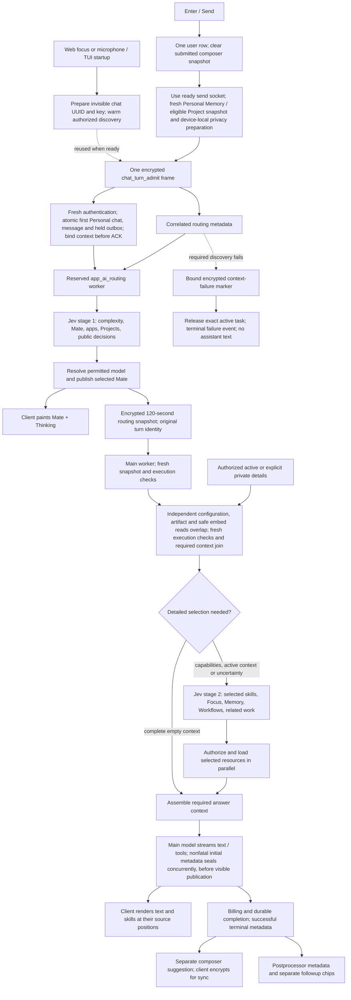
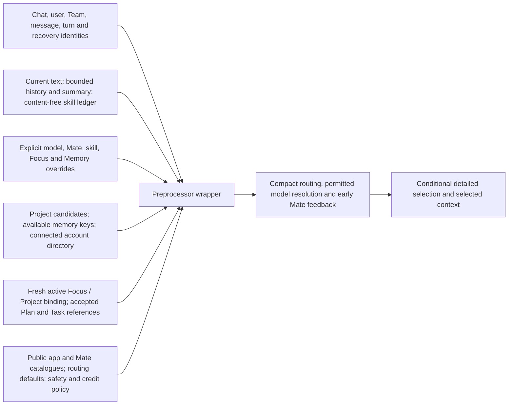
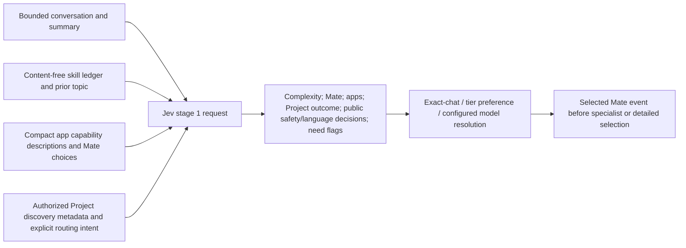
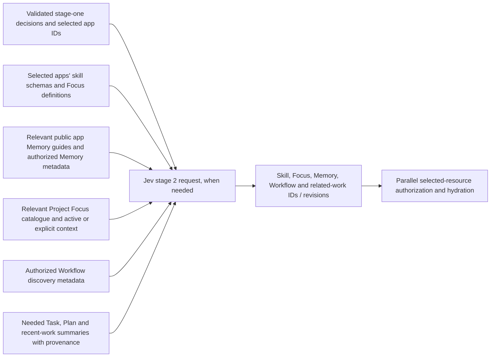
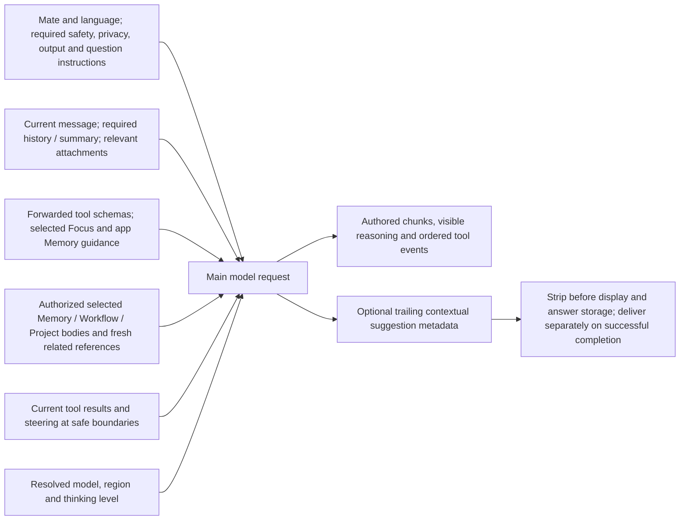
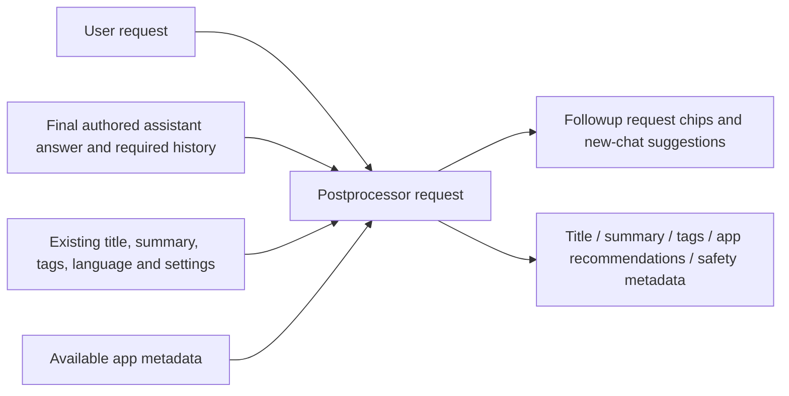

# Chat processing architecture

The architecture revision (`fa6b90c`), Google transport repair (`e71c72b8`), immediate admission changes (`2453d85d`), first measured SDK/auth/simple-turn fixes (`7a250696`), composer focus repair (`df30b916`), idle authenticated TUI connection / bounded Project projection changes (`ab78d61b`), and profile/refresh/context-failure repairs (`94d03b1a`) are deployed to development. Revision `3d64cfe1` adds fresh Personal Memory batching, first-turn preference overlap, strict-frame tracing preservation and legacy-context identity repair. Revision `58a36dee` also consolidates first Personal admission reads, overlaps independent main setup, fetches fresh Personal ciphertext over the prepared send socket, and releases the first safe prose fragment before paragraph completion. Its actual TUI measurements are included below. Actual TUI measurements still miss the latency targets; no successful timing acceptance is claimed yet. Timing targets are 1.5 seconds from Enter/Send to selected-Mate paint, and 2–3 seconds to authored text for an ordinary factual request. The interactive TUI is measured first, then web. Tool progress, final response, persistence and command exit are separate measurements.

Prepared identity does not create an unwanted visible empty chat. With the durable protocol enabled, a cold request creates the chat and commits its message in the same admission. When the recovery cutover epoch is zero, first-frame admission atomically prepares the new chat and first encrypted user message before acknowledging `LEGACY`; subsequent inference follows the established dispatch path. Existing chats and human-only Team conversations keep their existing gates. The latency changes do not enable a global recovery cutover. Capability negotiation retains the established protocol for older APIs. Deferred routing/private-detail frames currently apply to first ordinary Personal turns; existing-chat, Team, explicit-Project and attachment paths retain their complete context and established gates. This avoids expiring a queued turn's required context while it waits behind a long response.

With `chat_turn_context_selection_details_v2`, the routing continuation needs only the completed authorized Project candidate list. Task candidates, accepted Plan context, Project Focus discovery and the connected-account directory arrive in the separately correlated details continuation. These reads run concurrently and must complete before detailed selection or main-context assembly; they do not delay stage-one Mate feedback. Failed or incomplete Project discovery retains the complete path. Older APIs receive the established full routing payload.

The preprocessor wrapper receives the authenticated request and server configuration. Cached discovery is data; access, source revision, consent, credit and execution checks remain authoritative.

Jev's first request excludes unrelated private bodies and full tool schemas. Its validated public decisions can authorize skipping the detailed pass only when the fresh active-context snapshot is complete and empty.

Jev's detailed request sees the relevant catalogue. Required active or explicitly supplied context can load while routing runs; resources whose IDs are chosen by this pass load afterward. Main revalidates selected related-work snapshots rather than issuing a third selector inference.

Minimal main context retains the instructions needed to answer correctly. It omits unrelated private Project/Task/Workflow bodies and unused selected app guidance; it preserves mandatory safety, privacy, formatting, questions, model policy and selected context. A confirmed objective English factual first turn with complete empty context omits the empty Task runtime and its create tool. Unknown intent, actions, explicit Task dependencies and incomplete context retain the full path. The measured Core7 factual main prompt contained 3,818 tokens, compared with 4,950 in Core5 and 7,163 in Core4. Core7 additionally omits available-app capabilities and app/settings deep-link guidance only when the same proven factual turn has no product, capability or link intent. It omits code, document and plot formatting sections for a positively proved objective factual first turn with zero final tools and no selected private or artifact context. Discovery metadata alone does not force artifact instructions back into the prompt. Unknown intent, selected context, relevant history, attachments and actions retain those sections; mandatory answer and composer-suggestion guidance remains. The token reduction is measured; the end-to-end timing targets are still missed.

Postprocessing remains separate from answer streaming and the main-generated composer suggestion.

| Data | Preparation and retention | Freshness boundary |
| --- | --- | --- |
| Shipped skill, Focus and app Memory definitions | Process RAM at startup, keyed by configuration revision | New deployment / process |
| Workflow discovery | Vault-encrypted Dragonfly, two sliding hours | Nonexpiring mutation generation plus fresh access |
| Encrypted Project summaries | Dragonfly, two sliding hours | Fresh owner/Team ID/version/time watermark; keys and wrappers remain live |
| Project Focus discovery | Opaque item IDs and revisions, two sliding hours | Fresh scoped listing; private bodies remain live |
| Team Memory discovery | Key metadata only, two sliding hours | Fresh Team role and source versions; no cached item body |
| Personal available Memory keys | Device-local index warmed on focus | Current keys reread for Send |
| Selected private details and routing handoff | Existing authorized transport; new phase/snapshot payloads Vault-encrypted for 120 seconds | Exact owner, Team, device/turn, source revision and consent |
| Approved user Memory content | Existing consent-bound chat-specific encrypted retention, default 24 hours | Scope, revision, revocation and chat eviction |

Project/Focus/Team-memory cache hits still require a small fresh Directus watermark read. These indexes reduce repeated full metadata reads; they are not permission caches. No warm-up sends draft text or invokes an AI model. The TUI also prepares a separate one-use authenticated send connection with a 45-second lifetime. Borrowing requires the same account, session, refresh-cookie authority, device key, Team/key scope and socket options, plus a fresh persisted-state recheck. A foreground send cancels an unfinished optional connection before required preparation; a ready matching connection can be borrowed once. Token expiry renewal under the same refresh-cookie authority does not discard an already-authenticated live connection.

## Measured TUI timing and remaining critical path

Actual PTY Enter-to-paint samples below use the successful Google Gemini 3.8 Flash model with LOW thinking, verified against each exact task/chat in server logs. The Spain question used zero app skills. Warm runs idle for 20 seconds before Enter. These observations are not percentile estimates or matched revision-wide improvement claims; worker restart and cache temperature differ.

| Runtime / condition | User row and composer clear | Selected Mate | First authored text | Final completion | Acceptance |
| --- | ---: | ---: | ---: | ---: | --- |
| `2453d85d`, cold | 28 ms | 11,088 ms | 15,829 ms | 22,498 ms | Missed |
| `2453d85d`, warm | 28 ms | 3,168 ms | 5,634 ms | 10,751 ms | Missed |
| `7a250696`, warm after restart | 28 ms | 5,353 ms | 8,939 ms | 14,161 ms | Missed |
| `7a250696`, subsequent warm run | 29 ms | 2,992 ms | 5,740 ms | 10,948 ms | Missed |
| `94d03b1a`, warm after restart | 28 ms | 4,267 ms | 7,570 ms | 12,675 ms | Missed |
| `94d03b1a`, subsequent warm run | 30 ms | 2,694 ms | 5,066 ms | 13,186 ms | Missed |
| `3d64cfe1`, warm after restart | 30 ms | 2,827 ms | 5,744 ms | 10,589 ms | Missed |
| `3d64cfe1`, subsequent warm run | 30 ms | 2,436 ms | 4,724 ms | 9,821 ms | Missed |
| `58a36dee`, first run after restart | 29 ms | 2,647 ms | 5,839 ms | 11,356 ms | Missed |
| `58a36dee`, subsequent warm run | 30 ms | 2,488 ms | 4,921 ms | 11,326 ms | Missed |

The earlier Core4 hot sample has this cumulative timeline; overlapping work must not be added twice:

```mermaid
flowchart LR
  Enter[Enter 0 ms] --> Row[User row / clear 30 ms]
  Row --> Memory[Fresh Memory preparation ends 778 ms]
  Memory --> Frame[Admission frame leaves about 815 ms]
  Frame --> Ack[Atomic preparation / admission ACK 1303 ms]
  Ack --> Dispatch[Handler dispatch 1815 ms]
  Dispatch --> Jev[Jev planned 2212 ms / decision 2571 ms]
  Jev --> Mate[Selected Mate paint 2694 ms]
  Mate --> Provider[Main Google HTTP begins 3483 ms]
  Provider --> Text[First authored paint 5066 ms]
  Text --> Final[Final completion paint 13186 ms]
```

Memory preparation costs 778 ms; API preflight/admission spans about 466 ms, handler setup before dispatch 486 ms, router startup 211 ms, routing credit check 62 ms, Project eligibility 61 ms, and the observed Jev plan-to-decision interval 359 ms. Those intervals do not cover every gap. Concurrent context preparation lasts 1,143 ms and overlaps admission; it is not an additional serial cost. Main task start to provider HTTP is 790 ms; HTTP to authored paint is 1,583 ms. In that Core4 sample, the main prompt was still 7,163 tokens: the code/document/plot omission guard did not activate because the schema represents disabled Learning Mode as `{enabled: false}`. The candidate recognizes only that exact disabled state, keeps unknown/active policy on the full path, and has not yet measured its token or timing benefit.

Final completion is a distinct 8,120-ms tail after authored paint in this sample. Authored paint to final marker is 1,272 ms, marker to postprocessor result 3,146 ms, postprocessor result to the API encrypted-metadata request 2,937 ms, API request to persistence 730 ms and persistence to final paint 35 ms. The 2,937-ms interval is not yet attributed to a particular client or transport operation. It is not first-answer latency and no fixed SDK timeout is inferred from it.

The preceding `ab78d61b` failed run admitted its user row but made no AI call. Required Project discovery returned HTTP 503 around 1,345 ms, admission ACK arrived at 1,484 ms and the SDK closed the socket about 24 ms later. Routing and main then each waited 20 seconds for context. `94d03b1a` fixes valid legacy-profile eviction and the credential-publication race, and adds a sealed exact-turn failure marker plus matching terminal task cleanup. Successful hot Core4 runs show no request-session refresh storm or Project 503. This does not establish a positive authorization cache. A legitimate incomplete-profile miss still refetches its source.

## Current candidate context and transport repairs

Personal Memory rows and encrypted account settings now share one opt-in, cookie-authenticated `/v1/auth/session` request. Fresh session ledger, risk, rotation and device checks finish before two independent owner-scoped Directus reads run concurrently. The response contains typed encrypted Personal rows and actual encrypted account settings, with no owner hashes or Team metadata. Decryption remains on the device. The SDK binds the existing five-second one-use auth handoff to that exact completed Memory array and current owner, device, cookie, master-key and Team scope. This consolidates reads; it does not cache positive authorization or plaintext Memory content. Team and API-key Memory routes retain their existing behavior. Only a successful response with the batch field absent permits the older-server serial fallback; authentication errors and malformed present batches do not. Nullable legacy row ciphertext remains supported.

First durably proven ordinary Personal turns start a read-only preference lookup while durable enqueue, encryption, cache and history processing continue. Cache repair still occurs at its original dispatch point. Existing, Team, incognito, fork, explicit Project/Focus, attachment and queued-turn paths retain their established ordering. Active Focus remains freshly checked at dispatch because earlier reads could miss activation or a revision change. Early exit cancels and drains the speculative read.

Context transport uses a dedicated server-supplied admitted-turn identity, independent of durable recovery identity, including epoch-zero legacy dispatch. Clients cannot supply this authority field. The four strict admission/preflight/context frames retain their sealed payloads byte-for-byte; tracing remains local for those frames and continues decorating ordinary messages. Bound failure acknowledgements remain exact-owner/device/Team/chat/turn/message/request scoped and release only the matching active task. These fixes close the previously failed web context-error path; isolated verification is required before claiming it passes.

The 1.5-second Mate and 2–3-second authored-text targets remain open. Actual TUI verification precedes web timing. The candidate is not a successful latency result merely because focused correctness checks pass.

## Core5 hot timing and next scoped repairs

The second actual Core5 TUI run used Google AI Studio Gemini 3.8 Flash LOW, zero tools, and 4,950 input tokens. The factual prompt guard activated. Its Enter-to-paint timeline is 30 ms user row, 2,436 ms selected Mate, 4,724 ms authored text, and 9,821 ms final completion. Compared with the prior hot Core4 sample, Mate improved 258 ms and authored paint 342 ms; these individual samples are not a percentile estimate.

```mermaid
flowchart LR
  Enter[Enter 0] --> Memory[Memory prep ends 608 ms]
  Memory --> Preflight[Cutover 659-765 / atomic prepare 878-1081]
  Preflight --> Handler[Handler 1126 / dispatch 1507]
  Handler --> Route[Router 1510 / Jev 1929-2314]
  Route --> Mate[Mate paint 2436]
  Mate --> Main[Main HTTP 3158]
  Main --> First[Provider authored 4497 / paint 4724]
  First --> Post[Final marker 6047 / post result 8895]
  Post --> Persist[Metadata persisted 9791 / final paint 9821]
```

Client preparation is 614 ms, including 608 ms for the fresh Personal batch. Main task start to provider HTTP is 723 ms; HTTP to authored paint is 1,566 ms. Context preparation overlaps admission and is not added again. Stage one still asks 43 app relevance questions, eight early routing/context questions, 11 public decisions and one Project question (63 total). Safety, language and model-policy decisions remain mandatory; the current complete-result validator also includes output preview/icon/model-topic flags.

The measured `/auth/session` route takes 529.8 ms in this hot run. Fresh risk reads run in parallel for 86 ms. Two device/profile persistence operations remain sequential after that decision and occupy an aggregate interval of about 255 ms. Fresh encrypted Personal settings and row reads run concurrently, about 66–68 ms from their request timestamp to completion. These cache read/modify/write operations cannot be made concurrent as-is without risking lost device or last-online changes. No positive authorization cache, suppressed fresh risk check, or deferred required credential publication is introduced.

The next admission change uses the transaction's current owner-scoped chat projection within the same first ordinary Personal request. Atomic preflight retains account, protocol, deletion, participant, version and ciphertext gates while replacing its preceding duplicate admin chat GET. Durable enqueue validates the exact client/preflight/chat wrapped key and protocol epoch under locks before creating an outbox; it returns a complete typed owner/version/key projection. Unknown or incomplete projections use fresh reads and ordinary enqueue, without partial fast-path outbox mutation. Legacy, Team, direct, existing-chat, attachment, explicit Project and queued paths retain their established gates. Outbox release and worker admission remain fresh.

Core7 overlaps the exact active-summary request with independent configuration/artifact preparation after durable claim and user-key validation, then joins before preprocessing. Optional encrypted debug persistence runs concurrently with sealed initial metadata persistence; metadata references publish after persistence and all work joins or drains before provider dispatch. Additional phase spans distinguish stage-one load, private restore, claim, user cache, configurations, summary and artifact work. The active-summary request writes a Vault-sealed goal and API-owned work Memory after fresh task/turn checks; it is a mutation and must complete before any dependent summary read or main dispatch. This is preparation overlap; main is still queued after Jev completes. Routing requires the durable state to remain `ENQUEUED`, so starting main's claim earlier would invalidate routing authority.

The successful context-failure ACK alone did not settle the legacy web UI: empty-queue recovery atomically cleared the failed task's marker but returned the same result as a follower handoff. Cleanup then suppressed its terminal failure code. The next repair distinguishes owned clear from transfer/superseded ownership in both saved and volatile paths, publishes the bound code only after owned clear, and preserves a newer task's fence. The isolated CLI recovery test explicitly runs protocol epoch one to verify actual durable first-turn admission and wrapper mismatch rejection; web failure cleanup is rechecked separately.

Neither Core5 sample meets the 1.5-second Mate or three-second authored-text target. The next candidate's timing benefit is unmeasured until the real TUI is tested. Web timing continues afterward.

## Deployed Core7: fresh socket context and early prose

For first-party ordinary Personal CLI sends, the SDK borrows a matching ready one-use socket before required Memory preparation; without one it opens the authenticated send socket first. It waits for an actual capabilities frame. An advertised `personal_memory_snapshot_v1` allows a correlation-only request on that exact socket. The backend atomically limits attempts to 30 per session and 60 per owner per minute, then checks the current cache owner link, durable session/risk ledger, pair/session deadlines, current authoritative device list and session-country baseline before loading fresh encrypted account settings and owner-only null-Team Memory rows in parallel. The response returns on the request socket, with no broadcast, raw refresh token, plaintext or positive authorization cache. Device and last-online bookkeeping are outside this snapshot request.

A one-use local receipt binds the resulting decrypted array, encrypted rows, exact live socket, current owner/session/cookie/master-key scope and send options. Snapshot errors, malformed responses, timeout, closed sockets and changed authority fail closed. Only a definitive absent capability permits the established opt-in HTTP batch path. Team and API-key routes retain their existing behavior. The interactive TUI still paints its submitted row before required asynchronous work. Warm-up sends no draft text and performs no AI inference; required fresh context and device-local privacy checks remain on Send.

The protocol guard allows one first ordinary prose fragment once at least eight characters are safe, then retains the established paragraph grouping. Partial tool fences/XML, reasoning markers, errors, normal code, embed references and metadata retain their original boundaries. This reduces paragraph buffering rather than treating tool progress or hidden reasoning as authored text. Client chunk fades apply to authored streaming, with reduced-motion support.

These are implementation details under the already-approved immediate admission, conditional context, session isolation and chat feedback contracts. The exact deployed Core7 TUI was measured first. Both samples missed the targets; web timing follows after the next structural optimization is tested in TUI. CI functional success does not establish latency acceptance.

## Core7 hot cumulative timeline

The second Core7 Spain run was a successful real TUI conversation using Google AI Studio Gemini 3.8 Flash with LOW thinking and zero app skills. The server trace proves protocol epoch one and use of the committed admission projection. No positive authorization cache or suppressed risk check was used. All times below are cumulative from Enter; concurrent intervals must not be added twice.

```mermaid
flowchart LR
  Enter[Enter 0 ms] --> Row[User row and composer clear 30 ms]
  Row --> Snapshot[Fresh socket Memory ready 261 ms]
  Snapshot --> Wire[Encrypted admission sent 316 ms]
  Wire --> Ack[Fresh protocol and preparation ACK 777 ms]
  Ack --> Dispatch[API dispatch 1225 ms]
  Dispatch --> Jev[Jev request 1895 ms; decision 2284 ms]
  Jev --> Mate[Selected Mate paint 2488 ms]
  Mate --> HTTP[Main provider HTTP 3471 ms]
  HTTP --> Text[First authored paint 4921 ms]
  Text --> Final[Final completion 11326 ms]
```

| Measured interval | Time | Interpretation |
| --- | ---: | --- |
| Fresh protocol lookup | 120 ms | Sequential before preparation |
| Atomic first-message preparation | 327 ms | Includes durable chat/message work |
| Durable enqueue | 174 ms | Already returns a usable projection; no duplicate post-enqueue chat lookup |
| Jev request to decision | 389 ms | Actual model routing inference |
| Selected Mate paint to main HTTP | 983 ms | Worker handoff, fresh claim, summary, preprocessing and metadata setup |
| Main HTTP to first authored chunk | 1,420 ms | Almost all before response headers; early prose guard no longer waits for a paragraph |
| Authored chunk to TUI paint | 32 ms | Transport and terminal rendering |

Client context preparation took 1,253 ms and overlapped admission. This contains Project candidate and later detail discovery; no separate Project-candidate duration is attributed without its own measurement. The main active-summary request took 183 ms, preprocessing 251 ms, and debug/initial metadata persistence took approximately 154/150 ms concurrently. These intervals are components of the measured setup path, not additional waits on top of the 983 ms.

The next implementation consolidates narrowly eligible first Personal preparation and enqueue into one transaction, registers required client context before its ACK, joins independent routing checks in parallel, and moves independent read work earlier in main setup. Fresh ownership, risk, protocol, credit, source-version and execution gates remain required. Timing acceptance remains open until this exact next source is deployed and measured in TUI first, then web.

## Next candidate implementation details

A narrowly eligible first ordinary Personal one-frame admission uses one Directus transaction for fresh account/protocol, immutable key, new chat, encrypted user message, canonical preflight and held outbox. Context registration runs after that durable commit and before the public `ENQUEUED` ACK. Binding failure leaves the held outbox unclaimable; exact replay reuses the same message, task, billing and outbox identities, while bounded expiry prevents an abandoned turn from billing. The dispatch step releases the held outbox only after its existing gates. Existing, Team, Project, attachment, fork and unsupported protocol paths retain established admission.

The optional `personal_send_context_snapshot_v1` capability returns fresh Personal Memory and a bounded eligible Personal Project routing directory on the same authenticated send socket. Project rows are owner-only, non-Team and unarchived; current batch settings filter disabled auto-selection before client decryption/exposure to Jev. Only encrypted key/name/description and required routing policy are returned, never Project files or bodies. This removes client per-Project settings requests. The old Memory-only capability remains supported; advertised failure is fatal, and absence permits the established older path. One-use and rate limits are shared across both snapshot types. Warm-up prepares encrypted discovery indexes and public configuration without draft text or AI inference; Send still checks current authority and source state.

Routing overlaps independent public configuration/key reads and joins current credit and Project eligibility before Jev. Main overlaps active-summary mutation with complete-empty preprocessing, but any invalidated proof or related-summary read first awaits that mutation. Safe embed prefetch preserves the established history/artifact/cache checks and fresh lookup; changed task ownership discards its result. Optional debug persistence and nonfatal sealed initial metadata may overlap provider dispatch. The first visible stream chunk and no-chunk terminal path await the metadata barrier; recovery references are published only after sealing and a current-task check. All spawned tasks join or drain on failure/cancellation.

Google transport diagnostics record request-scoped DNS, connection creation, connection-pool waits, reuse, headers sent and response headers. They log duration and safe model/task correlation only, never URLs, keys, request headers, bodies or exception messages. Diagnostic failures do not fail inference. Connection creation contains DNS/TCP/TLS; its interval overlaps DNS, and TLS alone is not separately measured.

Queued followups can advance the chat's message version while the admitted active turn remains unchanged. A separate internal per-chat routing proof now tracks authorized queued mutations without changing the original preflight commit version. New preflights carry a normalized ciphertext fingerprint; proof reuse requires the exact active owner, task, preflight, outbox, message digest and current chat version, plus fresh protocol/expiry/deletion checks. An unrelated edit leaves the proof stale. The proof covers the pre-claim Stage1 window; after main claims the turn, existing fresh execution checks apply. Older schema/rows retain the strict version comparison and full-routing fallback. Schema capability probes add an unmeasured transaction cost and must be included in the next timing result.
