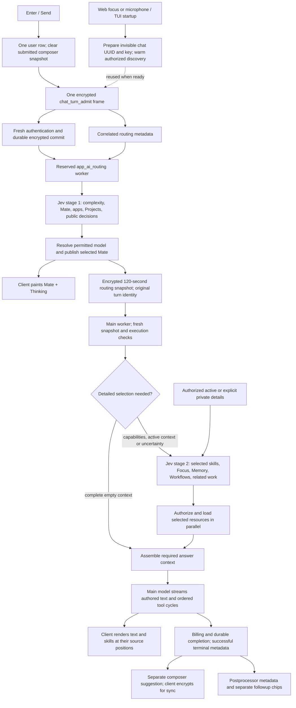
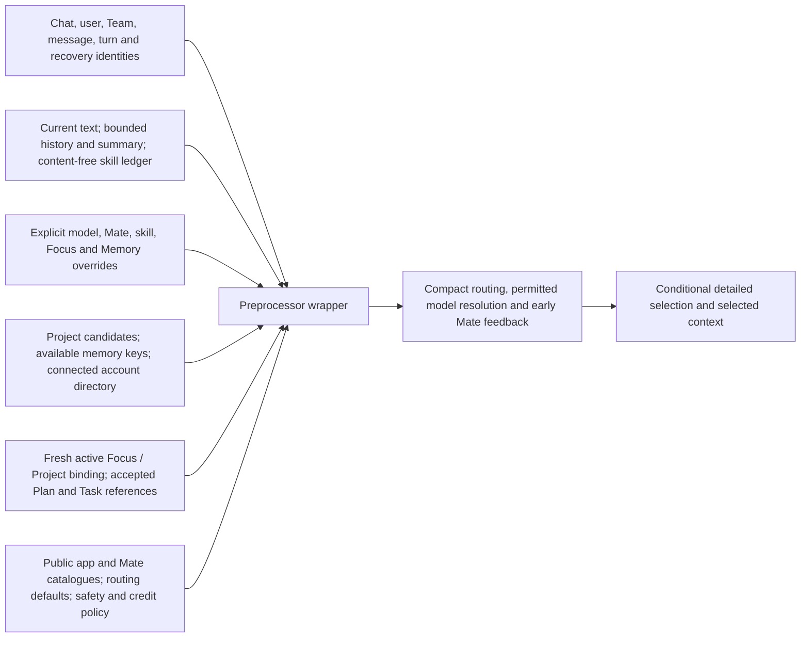
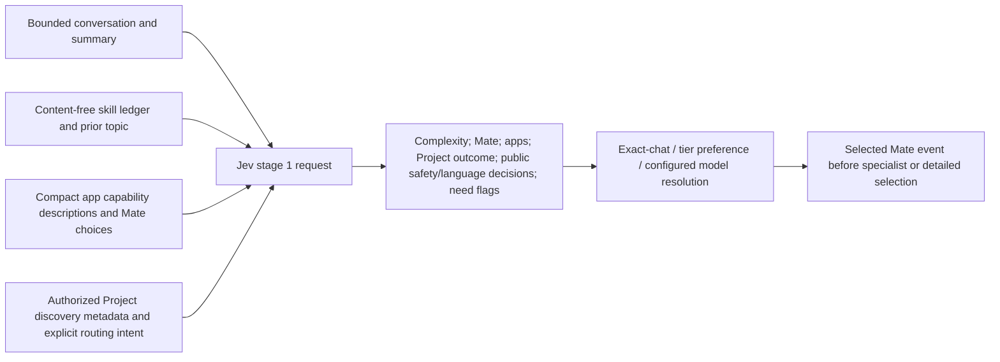
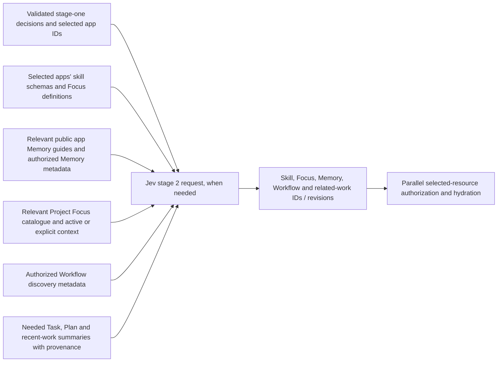
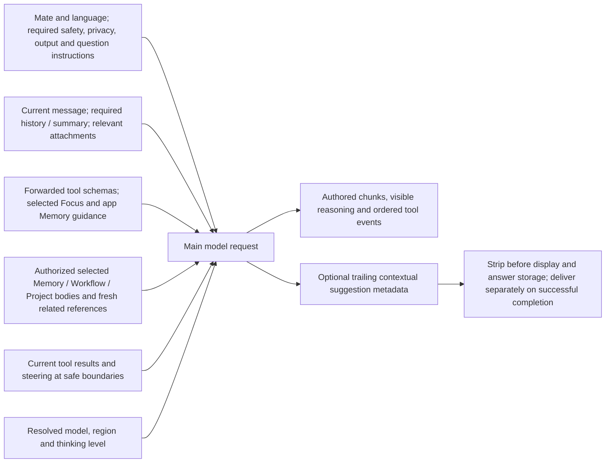
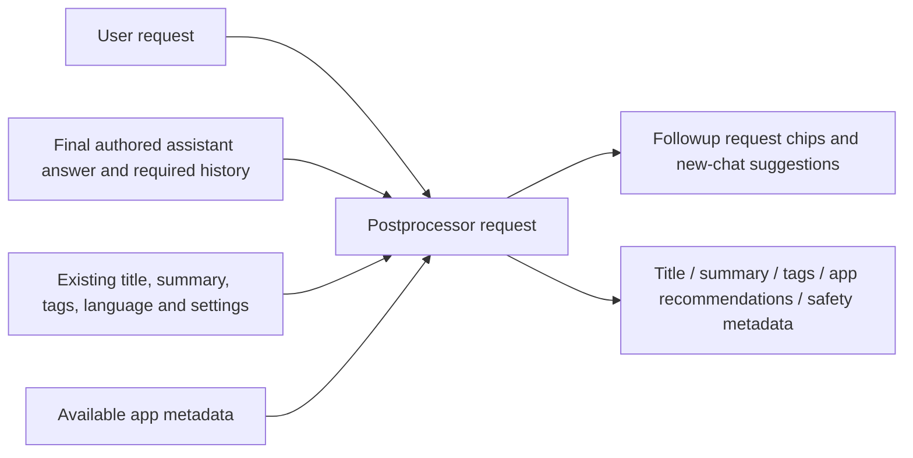

# Chat processing architecture

Implementation candidate; isolated checks and live latency measurements are still pending. Timing targets are 1.5 seconds from Enter/Send to selected-Mate paint, and 2–3 seconds to authored text for an ordinary factual request. The interactive TUI is measured first, then web. Tool progress, final response, persistence and command exit are separate measurements.

Prepared identity does not create an unwanted visible empty chat. A cold request creates the chat and commits its message in the same admission. Capability negotiation retains the established protocol for older APIs. Deferred routing/private-detail frames currently apply to first ordinary Personal turns; existing-chat, Team, explicit-Project and attachment paths retain their complete context and established gates. This avoids expiring a queued turn's required context while it waits behind a long response.

The preprocessor wrapper receives the authenticated request and server configuration. Cached discovery is data; access, source revision, consent, credit and execution checks remain authoritative.

Jev's first request excludes unrelated private bodies and full tool schemas. Its validated public decisions can authorize skipping the detailed pass only when the fresh active-context snapshot is complete and empty.

Jev's detailed request sees the relevant catalogue. Required active or explicitly supplied context can load while routing runs; resources whose IDs are chosen by this pass load afterward. Main revalidates selected related-work snapshots rather than issuing a third selector inference.

Minimal main context retains the instructions needed to answer correctly. It omits unrelated Project/Task/Workflow discovery, unused app guidance and unavailable tool-only instructions; it preserves mandatory safety, privacy, formatting, questions, model policy and selected context.

Postprocessing remains separate from answer streaming and the main-generated composer suggestion.

| Data | Preparation and retention | Freshness boundary |
| --- | --- | --- |
| Shipped skill, Focus and app Memory definitions | Process RAM at startup, keyed by configuration revision | New deployment / process |
| Workflow discovery | Vault-encrypted Dragonfly, two sliding hours | Nonexpiring mutation generation plus fresh access |
| Encrypted Project summaries | Dragonfly, two sliding hours | Fresh owner/Team ID/version/time watermark; keys and wrappers remain live |
| Project Focus discovery | Opaque item IDs and revisions, two sliding hours | Fresh scoped listing; private bodies remain live |
| Team Memory discovery | Key metadata only, two sliding hours | Fresh Team role and source versions; no cached item body |
| Personal available Memory keys | Device-local index warmed on focus | Current keys reread for Send |
| Selected private details and routing handoff | Existing authorized transport; new phase/snapshot payloads Vault-encrypted for 120 seconds | Exact owner, Team, device/turn, source revision and consent |
| Approved user Memory content | Existing consent-bound chat-specific encrypted retention, default 24 hours | Scope, revision, revocation and chat eviction |

Project/Focus/Team-memory cache hits still require a small fresh Directus watermark read. These indexes reduce repeated full metadata reads; they are not permission caches. No warm-up sends draft text or invokes an AI model.
