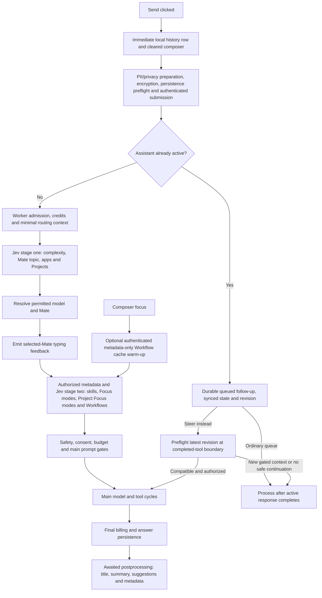

# Chat latency investigation and implementation

Updated 2026-10-11. Diagnosis Task: `12fb2012-be42-46f1-958c-babc378f1d02`. The implementation and focused/isolated checks are complete in session `6d3f`; the revised processing-feedback Specification was explicitly approved on October 11. Product revision `8fff53e54ceae234f3643814b69e561e8390b2a6` was deployed to dev web, API and workers, with the Directus queue schema installed. The original matched AFTER benchmark and separate ordinary-chat measurements are complete. The additional Send-readiness repair was published as `23319f80fc1792bd483df322debb69d78829f0f8`; exact-source browser readiness 2/2 and composer regression 10/10 passed without retries. Its backend/config diff is empty, preserving the deployed API and worker source. The ordinary and zero-Workflow web samples used the repaired web source; the earlier ten-Workflow web samples used `8fff53e`. The AF3 and AF4 ordinary-chat retests each completed 12 actual turns. AF4 deployed as `9bd203923b684f7e7606026840ed6a07239a2d40` with pinned CLI `0.27.0-alpha.61`; its first-answer medians regressed from AF3, and the requested 2–3-second simple target remains unmet.

The accepted changes are immediate web composer handoff, first-stage model/Mate resolution and typing feedback, bounded saved Workflow discovery, and metadata-only warm-up on composer focus. Typing-time AI requests were explicitly rejected and are excluded. Queued follow-up editing and safe steering are tracked in the [queued-follow-up Plan](../chat-queued-followups/plan.yml).

## Findings and implementation

| Finding in the original flow | Accepted change | Scope |
| --- | --- | --- |
| Web added the pending row before it cleared the composer, waiting for asynchronous preparation and sender acceptance. | Snapshot and clear synchronously; insert one provisional sending row with a stable ID. Sanitize/prepare asynchronously, replace that same row, and retain disconnected sends for reconnect. Failed preparation restores the submitted draft only if no newer draft or chat switch intervened. | Web |
| First Jev stage shortlisted apps/Projects; complexity and Mate selection waited for detailed preprocessing. | Stage one decides complexity, task area, sensitivity flags, Mate topic/shift, apps and Projects. Application code immediately resolves the permitted model/Mate and emits typing feedback. Detailed stage two reuses those decisions. | Shared backend for web, authenticated CLI and Apple |
| Saved Workflow discovery built every UI summary before applying the candidate cap, including individual blob reads and Vault decryptions. | Select up to 20 candidates using the existing ordering, retrieve routing title/description blobs in a batch and batch-decrypt them. Cache bounded metadata encrypted with the user's Vault key, now with two-hour sliding retention and scope/revision invalidation (the initial pass used 30 seconds); reauthorize selected graphs fresh. | Shared first-party path |
| Workflow data was cold when the user submitted a request. | Authenticated composer focus and TUI startup, later login, Team changes and reconnects send only the scope and tracing hint. A rate-limited background request warms eligible metadata without draft text or inference. Failure leaves normal cold discovery available. | Web/TUI hints; shared backend cache |
| Skill cards always appear together above assistant text. | The approved web redesign places cards at their canonical placeholder positions, grouping adjacent calls and collapsing completed groups into expandable summaries. | Web; [evaluation report](interleaved-skills-evaluation.md) and [implementation Plan](../assistant-response-ui/plan.yml) |
| Editing a queued message could change rendered history while its old queue payload still executed. | Same-ID revision compare-and-swap across client ciphertext, durable history and encrypted inference cache, with authoritative acknowledgements and claimed-message fencing. | Shared queue and web edit UI |

The focused composer shows the labeled Send button. A blurred nonempty draft shows only a round orange up-arrow button. The focused translucent gray background is removed. Web mic recordings now insert the corrected transcript as editable composer text, preserving surrounding notes and the mapped insertion point; they no longer create new audio embeds or upload permanent recording files. Historical audio embeds, uploaded audio and speech output remain compatible. Native Apple recording is a separate path and is unchanged in this web increment.

## Processing flow after the changes

Typing feedback is presentation readiness, not permission to execute tools. Explicit model/Mate overrides retain precedence; Project access, Focus consent, credits, safety and billing checks still apply before main execution. Stage two does not silently change the already resolved model. Failed or rejected turns terminate the early indicator.

A steer keeps completed tool results and the current assistant message. It does not cancel a running tool. The latest exact queued revision must pass the existing preprocessing gates and be compatible with the active model/tool/Focus/Project context before it is consumed once. Incompatible context remains an ordinary follow-up with a visible deferred status.

## Controlled BEFORE measurements

A separate disposable dev account and Project ran the same simple and complex prompts through authenticated CLI and web, using Gemini 3.8 Flash with auto routing. These are newly collected benchmark cohorts, separate from the original mixed diagnostic traces. Each cell contains three successful turns.

| Cohort | CLI median first visible text | Web median first visible text |
| --- | ---: | ---: |
| Zero saved Workflows, simple | 13.69 s | 15.12 s |
| Zero saved Workflows, complex | 20.09 s | Excluded: original probe timed visible reasoning |
| Ten disabled blank Workflow drafts, simple | 16.31 s | 16.78 s |

The old web composer cleared 3.0–4.4 seconds after Send. Matched backend logs measured preprocessing medians of 2.370 seconds for the zero-Workflow cohort (12 turns) and 4.328 seconds for the ten-Workflow cohort (6 turns). Client-separated medians were 1.982 versus 3.638 seconds for CLI and 2.645 versus 4.381 seconds for web.

A bounded retained-video audit verified that all six simple web turns timed authored answer text. All three complex web turns timed the visible reasoning section and are excluded from first-answer comparisons. The CLI and backend measurements are unaffected. Original raw metrics remain in the data with explicit eligibility annotations; visual frame intervals are not substituted as precise send-to-answer timings. The AFTER probe explicitly excludes thinking and skill activity editors.

The [BEFORE data](benchmark-before.json) contains sanitized aggregates. Account/chat IDs, private CLI state and raw logs remain local. All retained CLI and browser recordings, including failed attempts, were uploaded. AFTER used the same fixtures, prompts, model and client definitions: it first measured the ten-Workflow cohort, then removed only those benchmark drafts and measured zero Workflows after cache expiry.

Three samples per cell support a directional comparison, not a population p95 or provider-independent guarantee. Provider generation dominates first-visible-text time and can vary between runs. Backend phase durations and immediate composer paint measure the structural change more directly.

## Deployed AFTER measurements

These measurements used backend revision `8fff53e`, Gemini 3.8 Flash with auto routing and CLI `0.27.0-alpha.54`. The backend consumers were rebuilt from the explicit coordinated runtime target and passed their managed health checks. The ten-Workflow web calls used web revision `8fff53e`; the zero-Workflow web calls used the later Send-readiness revision `23319f8`, whose backend/config diff was empty. The matched AFTER sample contains nine successful CLI turns, nine successful web turns and 18 owned backend phase joins. Each client cell below contains three successful turns.

| Matched cohort | BEFORE first answer | AFTER first answer | Observed difference |
| --- | ---: | ---: | ---: |
| CLI, zero Workflows, simple | 13.686 s | 14.123 s | 3.2% slower |
| CLI, zero Workflows, complex | 20.087 s | 17.053 s | 15.1% faster |
| CLI, ten Workflows, simple | 16.311 s | 13.599 s | 16.6% faster |
| Web, zero Workflows, simple | 15.119 s | 13.712 s | 9.3% faster |
| Web, zero Workflows, complex | Excluded: original probe timed visible reasoning | 21.209 s | No authored-answer comparison |
| Web, ten Workflows, simple | 16.776 s | 11.440 s | 31.8% faster |

The ten-Workflow web composer cleared 13–27 milliseconds after Send and the user row painted 107–314 milliseconds after Send. In the zero-Workflow web cohort, the simple composer cleared at a 15-millisecond median and the user row painted at a 185-millisecond median. Matched backend preprocessing fell from 4.328 to 2.370 seconds for the ten-Workflow cohort, a 45.2% reduction across six completed calls; the zero-Workflow AFTER backend median was 2.175 seconds across 12 calls. The empty-Workflow complex CLI typing feedback fell from 12.559 to 7.980 seconds. The empty simple CLI first answer was 3.2% slower; these small samples do not support claiming every chat became faster.

The ten owned Workflow fixtures were removed only after all six ten-Workflow AFTER calls succeeded; the empty list was then verified after cache expiry. Two earlier empty-Workflow web attempts stopped before submission with the model-selection loading guard. Their recordings and partial timing records are retained, and neither attempt counts as a completed inference call. The repaired probe checked readiness in the same composer as the unique Send control and retained its readiness at the click; all six zero-Workflow web calls then passed on the first attempt. Authored first-answer timing is separate from completed UI attribution. The original ten-Workflow probe could briefly label completion while the active status later remained visible, so its final-status measurement is marked `completion_status_not_validated`. The newer zero-Workflow probe validated completed UI state for all six web turns.

The general routing changes apply without a Project or saved Workflows. Separate AFTER-only cohorts used the exact ordinary questions “Find AI events in Berlin” and “What's the capital of Spain?” through authenticated CLI and web, with no Project flag or mention, no forced model and an empty saved-Workflow list. The event question includes real skill execution; the capital question exercises a short factual answer. Six CLI turns, six first-attempt web turns and 12 owned backend phase joins completed. These newly requested prompts have no matched BEFORE baseline, so their measured times must not be reported as speedup percentages. The web turns used revision `23319f8`; the backend remained at `8fff53e`.

| Ordinary CLI question, three successful turns each | First authored answer | Selected-Mate typing | Command finished | Backend preprocessing |
| --- | ---: | ---: | ---: | ---: |
| Find AI events in Berlin | 19.83 s | 4.52 s | 51.84 s | 1.649 s |
| What's the capital of Spain? | 7.96 s | 4.56 s | 14.29 s | 1.621 s |

| Ordinary web question, three successful turns each | First authored answer | Completed UI state | Backend preprocessing |
| --- | ---: | ---: | ---: |
| Find AI events in Berlin | 23.235 s | 32.981 s | 1.372 s |
| What's the capital of Spain? | 11.238 s | 14.197 s | 1.288 s |

The exact owned-chat log join verifies no Project target in all six requests. Each Berlin request completed one tool cycle and rendered an `events/search` result; routing preselected `events-search`, `news-search` and `web-search`. Each capital answer identified Madrid, with zero selected apps or tools. Stage-one/stage-two medians were 483/1,011 milliseconds for events and 493/980 milliseconds for the capital. Main-stream medians were 18.026 and 3.022 seconds respectively. These phase medians are measured separately and must not be added to explain a client median; first prose also does not imply the tool-backed response or terminal command is finished. The [ordinary-chat data](ordinary-chats-after.json) records sanitized results and limits. Event listing usefulness and live scheduling were not independently reviewed.

The earlier ordinary web attempts revealed an enabled-Send race while a new draft's exact model preference restored. One retained click recorded model readiness false at dispatch and no optimistic row; the loading guard rejected it. The focused and minimized Send controls were aligned with the same readiness gate. All six subsequent ordinary web turns passed on the first attempt with a fresh two-message context, a ready model selector and one visible composer. Browser Send-click timing and CLI accepted-command timing start at different boundaries, so their ordinary medians are descriptive rather than a client-to-client speedup claim. The completed UI state is distinct from the last authored text change. The [matched AFTER data](benchmark-after.json) and [comparison](benchmark-comparison.json) preserve source identities, eligibility and sample limits.

## Original diagnostic evidence

Before implementation, retained traces showed preprocessing median 3.87 seconds (40 spans), main phase 18.61 seconds (45), final billing 681 ms (39) and postprocessing 2.97 seconds (42). These unpaired observations include different request types and terminal paths; their medians must not be added.

A separate 250-span query contained 37 completed first-token records, with median worker-start-to-first-token 12.38 seconds. That excludes client preparation and may count a non-prose token. Four matched worker-log turns took 3.25–3.76 seconds before Jev, versus 0.433–0.534 seconds across the two Jev stages. Their Workflow preparation intervals contained 38 reads and 35 Vault decryptions. The source independently confirmed hydration before the 20-candidate cap.

Read-only diagnosis began at `64c9ff539162308ce50ee0d03c1f7d438f7f0770`; runtime checkout reported `1ec68002178408634781ff9fd653c12694ac91e2`; the initial workspace base was `faae158b110cc1b20aa2861ea35c7fec3305e990`. Suspect files matched byte-for-byte, but historical traces are not proven to use those exact loaded revisions. Sanitized diagnostic aggregates remain in [baseline-summary.json](baseline-summary.json).

## Remaining performance opportunities

Web rendering still deserves separate profiling. Normal private history loads 30-message pages and prunes its decrypted window toward 60 rows, with a 90-row cap and exceptions for preserved context. A 500-row TUI measurement therefore cannot be applied directly to a typical private web chat. Within each loaded window, streaming updates still rebuild cumulative PII mappings and call `messages.find` for every incoming row; unchanged documents are reused, but row lookup remains quadratic. Histories above the 160-row virtualization threshold disable virtualization while any message streams. An ID index, narrower row updates and pinned streaming-row virtualization are candidates for larger or expanded histories, with scroll, embed, privacy-window and final-content convergence evidence required before implementation. These are source findings, not measured web speedups.

The independent TypeScript TUI work in Task `TASK-8491`, session `8a64`, reports a synthetic 500-message layout improvement from 300.2 to 17.3 milliseconds at 160×50 and a task draft redraw improvement from 124.5 to 29.0 milliseconds. It was published to dev as `117b9fd9ba7377c0352353d7f624a72b49f7d415` and npm `0.27.0-alpha.53`, using an optimistic sent row, a transient assistant row and an animation timer that paints one cached row without parsing history. Its caption-only follow-up is `aa2839f576bdb1ba3024a5ca42ceb5ff541ca74b`. These peer-reported local rendering results support profiling similar web update costs; they measure neither server processing nor deployed web latency. Its isolated streaming and authenticated workspace checks passed; a saved-chat check failed before rendering on service availability and pairing. The TUI owns its separate verification and publication. The BEFORE server benchmark used global CLI `0.27.0`; the matched AFTER benchmark used `0.27.0-alpha.54`. That client-version change limits attribution of CLI elapsed-time differences to backend changes.

Shared API history reconstruction performs sequential decryption/re-encryption and awaited WebSocket handlers can delay later control frames. Batch authorized history reads and ordered asynchronous admission are candidates for later work. Another active Task owns catalogue deduplication and telemetry; that work is excluded here.

Main-provider reasoning delay, tool-first responses and SDK output behavior need separate cohorts. API-key CLI/SDK sends currently wait for complete responses; faster backend preprocessing does not make that API emit partial text. Apple benefits from the shared backend changes, but native composer handoff and queued edit/steer controls are separate client work. The native backend event fields retain compatibility.

Ordinary-chat measurements also expose a completion tail: the capital CLI first-answer median is 7.96 seconds while command completion is 14.29 seconds; event-search medians are 19.83 and 51.84 seconds. Source shows that finalization awaits billing, encrypted recovery preparation and AI cache persistence before the final response marker. Queue ownership can clear before postprocessing, but postprocessing still runs as an awaited step in the same worker task. The CLI waits up to 12 seconds for its postprocessing event after the final frame, then waits for encrypted recovery and metadata persistence acknowledgements. These are separate response-ready and command-complete boundaries. The medians alone do not identify which step caused each observed tail. Timestamping final-marker reception, postprocessing arrival, collector resolution and persistence acknowledgements is the next bounded investigation; optional suggestions, inspiration and debug work should leave the terminal critical path only after durable enqueue and without weakening billing, queue ownership or metadata convergence.

## Verification and rollout

The accepted permanent Specifications cover immediate handoff, focused/minimized actions, early routing, typing lifecycle, metadata-only warm-up and queued revision/steering semantics. Focused local unit and syntax/lint checks run in the worktree. Rendered component checks precede broader authenticated browser/WebSocket/CLI checks through isolated GitHub CI. Real inference comparisons run only on dev with disposable state.

The [verification status](verification.md) maps accepted outcomes to actual evidence and remaining checks; passing local helper tests alone do not imply passing product or deployed checks.

Deployment must use the managed session integration and explicit runtime coordinator lease. The Directus queue metadata schema and transaction extension must be installed before API/AI consumers use the new durable revision APIs. Record immutable CI source, deployed source, failures and all video links; complete implementation Tasks only after verification and deployed AFTER measurements.

## Source references

References below are pinned to the initial review commit. The suspect files were also compared with the runtime and Plan workspace.

- [Web optimistic history dispatch and later composer clear](https://github.com/glowingkitty/OpenMates/blob/64c9ff539162308ce50ee0d03c1f7d438f7f0770/frontend/packages/ui/src/components/enter_message/handlers/sendHandlers.ts#L2088)
- [Web durable preflight acknowledgement](https://github.com/glowingkitty/OpenMates/blob/64c9ff539162308ce50ee0d03c1f7d438f7f0770/frontend/packages/ui/src/services/sendersChatMessages.ts#L2312)
- [Apple accepted-send composer clearing](https://github.com/glowingkitty/OpenMates/blob/64c9ff539162308ce50ee0d03c1f7d438f7f0770/apple/OpenMates/Sources/Features/Chat/Views/ChatView.swift#L4580)
- [Apple send pipeline](https://github.com/glowingkitty/OpenMates/blob/64c9ff539162308ce50ee0d03c1f7d438f7f0770/apple/OpenMates/Sources/Features/Chat/ViewModels/ChatViewModel.swift#L5973)
- [Jev stage-one app/Project routing](https://github.com/glowingkitty/OpenMates/blob/64c9ff539162308ce50ee0d03c1f7d438f7f0770/backend/apps/ai/processing/jev_preprocessing.py#L361)
- [Detailed Jev decisions](https://github.com/glowingkitty/OpenMates/blob/64c9ff539162308ce50ee0d03c1f7d438f7f0770/backend/apps/ai/processing/jev_preprocessing.py#L404)
- [Blocking saved Workflow discovery](https://github.com/glowingkitty/OpenMates/blob/64c9ff539162308ce50ee0d03c1f7d438f7f0770/backend/apps/ai/processing/preprocessor.py#L2414)
- [Workflow discovery service construction](https://github.com/glowingkitty/OpenMates/blob/64c9ff539162308ce50ee0d03c1f7d438f7f0770/backend/apps/ai/processing/context_preselection.py#L76)
- [Candidate cap applied after summary hydration](https://github.com/glowingkitty/OpenMates/blob/64c9ff539162308ce50ee0d03c1f7d438f7f0770/backend/apps/workflows/skills/saved_workflow_context.py#L31)
- [Unbounded persisted Workflow list](https://github.com/glowingkitty/OpenMates/blob/64c9ff539162308ce50ee0d03c1f7d438f7f0770/backend/core/api/app/services/workflow_service.py#L719)
- [Workflow summary decryption](https://github.com/glowingkitty/OpenMates/blob/64c9ff539162308ce50ee0d03c1f7d438f7f0770/backend/core/api/app/services/workflow_service.py#L2610)
- [Existing Vault batch decryption utility](https://github.com/glowingkitty/OpenMates/blob/64c9ff539162308ce50ee0d03c1f7d438f7f0770/backend/core/api/app/utils/encryption.py#L999)
- [Tier defaults and thinking levels](https://github.com/glowingkitty/OpenMates/blob/64c9ff539162308ce50ee0d03c1f7d438f7f0770/backend/apps/ai/processing/model_routing.py#L28)
- [History reconstruction on the API critical path](https://github.com/glowingkitty/OpenMates/blob/64c9ff539162308ce50ee0d03c1f7d438f7f0770/backend/core/api/app/routes/handlers/websocket_handlers/message_received_handler.py#L1645)
- [History rendering and streaming virtualization](https://github.com/glowingkitty/OpenMates/blob/64c9ff539162308ce50ee0d03c1f7d438f7f0770/frontend/packages/ui/src/components/ChatHistory.svelte#L913)
- [Authenticated CLI sender](https://github.com/glowingkitty/OpenMates/blob/64c9ff539162308ce50ee0d03c1f7d438f7f0770/frontend/packages/openmates-cli/src/client.ts#L8181)
- [TypeScript SDK full-response path](https://github.com/glowingkitty/OpenMates/blob/64c9ff539162308ce50ee0d03c1f7d438f7f0770/frontend/packages/openmates-cli/src/sdk.ts#L2208)
- [Python SDK full-response path](https://github.com/glowingkitty/OpenMates/blob/64c9ff539162308ce50ee0d03c1f7d438f7f0770/packages/openmates-python/openmates/sdk.py#L3176)

## Further ordinary-chat optimization

The user requires authored streaming to start within 2–3 seconds for a simple no-skill request. The 7.957-second CLI and 11.238-second web capital medians miss that target. An additional ordinary web diagnostic found roughly 2.9 seconds of client preparation before persistence preflight, including redundant active-focus reads. It is a separate single CPU-profiled run, not part of the comparison samples. Worker logs show two Jev calls even with no app or Project candidates; the capital's stage-two median was 980 milliseconds. Main agentic-context preparation took roughly 0.7–0.8 seconds before provider admission. The previous CLI terminal setup and backend wall clocks were not synchronized precisely enough to attribute their remaining gap; no exact provider time-to-first-token or network-ingress duration is inferred from those clocks.

The current local increment moves the required independent public safety/language/model/presentation decisions into the first routing response, validates them and reuses them. The detailed stage still discovers authorized candidates and runs its own Jev request when any exist or discovery is uncertain. Only a confirmed empty inventory with complete valid public decisions omits that second request. Default model/thinking settings, safety and consent stay in effect.

A draft-free warm-up now uses web composer focus and the TUI's existing authenticated activity connection; saved CLI sends also hint on their existing request connection. Encrypted Workflow routing metadata receives sliding two-hour Dragonfly retention and a persistent scoped mutation generation. Browser Project/Task prefetch uses existing bounded, mutation-invalidated tab caches. Project access, active Focus and accepted Plan checks stay fresh: broad two-hour server caching of those records would miss mutation paths and authorization changes. This increment deployed as `a6231ae528ff5910c23249aba84c8800424bd8b3`; managed operation `docker-c659b3ff` rebuilt all 16 backend consumers and verified health. CLI `0.27.0-alpha.59` has that exact npm `gitHead`. The new probes capture submission wall time after terminal setup and distinguish authored text, reasoning, tool activity and final metadata.

### General-chat retest on a6231ae

All six ordinary CLI and six web turns passed, with three trials per prompt and no active Project target or saved Workflow. The account can still have eligible Projects; these calls do not claim an empty Project catalogue. The web document ETag was `"79f9c271369658c121a1ef0e5a036de8"`.

| Ordinary request | Earlier CLI first answer | Updated CLI first answer | Earlier web first answer | Updated web first answer |
| --- | ---: | ---: | ---: | ---: |
| Capital of Spain | 7.957 s | 8.805 s | 11.238 s | 8.882 s |
| AI events in Berlin | 19.830 s | 22.510 s | 23.235 s | 21.897 s |

These descriptive samples include provider variability and a CLI version change; the CLI results regressed, and the 2–3-second target remains unmet. All recordings are retained and uploaded. The new capital web samples took 1.960–2.177 seconds before the persistence-preflight frame, whose round trip was 123–171 milliseconds. Provider first-chunk time was 2.40–3.57 seconds, with no forwarded tools and 7,580–7,860 uncached input tokens. Related-reference preparation took 0.534–0.909 seconds. These spans are per-request observations and must not be added as independent medians.

The first web capital trace makes the critical path concrete: Send → preflight frame 2.071 s; worker start 2.611 s; preprocessing 2.994–3.964 s; main start 4.726 s; related/context work finishes 5.874 s; provider connection 5.898 s; first chunk 8.638 s; first published text 8.848 s; authored DOM text 8.882 s. Connected-account and fresh Focus/Plan reads occur in the client preparation path; overlapping old-chat recovery traffic alone does not prove it blocks Send. CLI accepted-launch to API preflight cutover was 3.037–3.912 seconds for capital requests; terminal setup is excluded from that clock. CLI first text and command completion remain separate.

The next bounded repair overlaps an empty connected-account lookup with local persistence, removes the repeated late typing-key lookup, discovers related summaries directly from the already-authorized API index, and prunes unavailable tool-call guidance when the forwarded tool list is empty. Fresh authority, expiry/revision checks, independent interactive questions and the approved default model/thinking settings remain unchanged. This repair was subsequently deployed and retimed in the AF3 cohort below. A narrower tool-provenance predicate and same-chat uncertain queued-snapshot deferral were later published in AF4; neither was represented by the AF3 measurements, and AF4 did not exercise the deferral branch on its active sends.

A separate fresh-chat SDK optimization deployed as `0f67bdefa1f3cbac9fe635570e829cff21d81f68` and npm `0.27.0-alpha.60`. Only IDs minted inside the SDK skip empty active-Focus and accepted-Plan reads; saved or caller-supplied IDs and explicit Project requests keep them. Exact-source context and client checks passed 12 and 18 cases, respectively, and ESM/DTS builds passed. Isolated recovery discovery run `38139267932` passed all three cases, including the new real preflight boundary case. The publication workflow passed 1,162 CLI tests. Three subsequent automatic-model capital requests started authored text at 7.376, 9.387 and 6.835 seconds (median 7.376). API preflight started at 3.313, 4.931 and 2.912 seconds; provider first-chunk times were 2.00, 1.38 and 1.40 seconds. The faster overall median cannot be attributed to the SDK change: preflight did not measurably improve and provider times varied. The target remains unmet.

### Bounded model comparison and further client preparation

A valid, explicit `@gemini-3.5-flash-lite` comparison returned Madrid in all three CLI requests. Worker billing and usage records confirm the selected main model in every case. First authored text appeared at 7.028, 7.067 and 17.058 seconds. The first two had no tool iterations, reached API preflight after 3.930/3.769 seconds, and received a first provider chunk after 0.763/0.743 seconds of provider streaming. The third performed web search, attempted an unavailable image skill and entered answer-only recovery; it is a different workload and is excluded from a no-skill comparison. These tiny, non-randomized samples do not establish a causal model speed advantage. The automatic model and thinking defaults are unchanged.

Two preceding attempts are explicitly invalid model comparisons and retain their recordings: an unsupported `--model` flag left the main model at its default, and direct backend-wire model mentions produced `Unknown mention` without reaching the AI worker. Neither contributes valid model-comparison samples.

Source review found two serial personal session-validation calls around the memory snapshot and WebSocket setup. The released repair lets only the exact array returned by a successful personal `listMemories()` carry its validated authentication receipt into one send, for at most five seconds. It rechecks API, owner/session identity, master key, Team context, token and complete cookies under the existing cross-process refresh lock. Stale or arbitrary snapshots use normal refresh; other sockets and Team sends keep their existing path, and the server still validates the WebSocket handshake. Independent review found no remaining blocking issue; 28 focused cases, build and lint pass. Isolated real-API recovery discovery passed all four cases without retries, flakes or skips on the exact reviewed source (`38143370928`); all six recordings were uploaded. The change was published as CLI `0.27.0-alpha.61`. AF3 retimed the released client, but its retained transcript did not instrument the client auth-reuse branch, so the cohort cannot quantify that branch's latency effect. Opt-in CLI diagnostics report durations for memory loading, local privacy preparation and pre-SDK setup without message or credential data.

The new browser overlap check exposed three distinct CI setup omissions. The first attempt hit the public unconfigured-model gate; the next lacked an AI worker. The following attempt had an AI worker but used the legacy chat epoch, which rejected inference admission with the retained saved-chat pause notification. Its actual delayed directory GET, local handoff, preflight acknowledgement and synced user row all passed. The corrected candidate added the spec to the existing isolated marker-chat epoch setup; 30 exact-source activation cases passed. Assistant response assertions and timeouts remained unchanged. After the harness correction described below, refreshed source `c0ac2383` passed both browser cases in run `38145814200` without retries, skips or flakes; both recordings were uploaded.

The fourth warmup browser attempt (`38143842057`) retained the same server admission rejection despite the candidate activation change. The CI receipt identifies product source `fde20e74` and tooling harness `0f67bdef`: Actions runs `ci_run_tests.py` from the older harness checkout, so the candidate marker-list addition never executed. The AI-worker manifest is separately merged from candidate source. This explains the worker being present while protocol admission remained inactive. The existing auth/Team/rate case passed; the new send case failed both attempts at the unchanged assistant assertion. All three videos and four images were uploaded. The narrowly tested harness entry must be published before retrying the product candidate; no directory deadlock or additional product regression is established by this run.

Personal authentication reuse was published on dev as `f42ae96f2d3f48da646a13beca17b097150722c6` after its exact-source API coverage passed. The warmup CI protocol-list entry and focused activation case were published separately as `42f4da7ed8c5fe3565b9cc55e9ff163a9c3363ce`; 30 activation unit cases passed. Refreshed source `c0ac2383` then passed the focused assistant-response browser check on that published harness. The backend and web speed repairs were subsequently deployed in `d59e93d` and measured below.

The authentication optimization is released as `openmates@0.27.0-alpha.61`, npm `gitHead=f42ae96f2d3f48da646a13beca17b097150722c6`. Official publisher `38144920471` passed 1,167 CLI tests and six versioning tests; the exact Node 24 global installation was verified. This is a publication and correctness result, not a measured latency improvement.

Warm-up boundaries: the focus/TUI hint fills encrypted saved-Workflow metadata in Dragonfly for two hours with sliding renewal. Browser Project/Task list prefetch fills a bounded tab-local cache. Authentication already supplies the profile cache under its existing lifetime. The legacy app-memory login warmer is disabled for encryption lifecycle reasons and has not been reactivated. Fresh Focus, Project, Plan and related-work authorization stays on the send path. A future bounded overlap of independent private-Focus and Workflow metadata discovery could remove a serial wait, but its benefit has not been measured or implemented in this increment. No inference is triggered while typing or on warm-up.

### AF3 stable-source live retest on d59e93d

Managed restart `docker-eb046e19` health-checked all 16 backend consumers on product source `d59e93d482f1c16c44b501c9e3d338a6103771c6` and backend tree `ef610454dc64898f5d9d183c167d8ba0569d2a5b`. Both Vercel contexts reported success; the measured web document ETag was `W/"cc72187628e185fe6d4171efee45f0cc"`. The benchmark invoked pinned CLI `0.27.0-alpha.61` (`gitHead=f42ae96f2d3f48da646a13beca17b097150722c6`); a later package update was not installed for these calls. Container identities remained stable through capture. All six CLI and six web requests passed, three per prompt per client, with no active Project target and zero saved Workflows. This does not establish an empty eligible Project catalogue.

| Ordinary request | Prior CLI first authored text | AF3 CLI first authored text | Prior web first authored text | AF3 web first authored text |
| --- | ---: | ---: | ---: | ---: |
| Capital of Spain | 8.805 s | 7.208 s | 8.882 s | 8.344 s |
| AI events in Berlin | 22.510 s | 31.009 s | 21.897 s | 21.435 s |

The capital improved directionally in both clients but still missed the 2–3-second target. Berlin CLI worsened by 8.499 seconds; its three first-answer times were 31.009, 31.101 and 22.087 seconds. Each Berlin CLI turn forwarded four tools, called `events-search` once and used two Gemini 3.8 Flash main-provider iterations. The three skill start-to-finished intervals were 11.596, 10.957 and 5.606 seconds. Each web Berlin turn forwarded three tools, called `events-search` once and used two provider iterations; its skill intervals were 13.326, 8.079 and 8.969 seconds. No actual provider fallback or retry occurred in these 12 turns; prepared fallback lists are not retries. All three CLI capital turns forwarded the personal `task_create` runtime tool but did not call it; all three web capital turns forwarded zero tools. The no-forwarded-tools prompt-pruning predicate therefore did not apply to those CLI capital calls. Reported cumulative event input was about 39.6–40.0 thousand tokens per turn; provider cache-read input was unreported (`null`), which is not evidence of zero cache hits.

AF3 web composer clear took 13–60 milliseconds after Send and the user row appeared in 16–406 milliseconds, after subtracting each trial's `send_ms` origin from the raw browser timestamps. The capital CLI API preflight began 2.458–2.959 seconds after accepted command; worker main-provider connection was at 4.817–5.124 seconds, and first authored text at 7.155–8.349 seconds. The client auth-snapshot reuse branch was not directly timed in these retained transcripts, so correctness/release evidence does not measure its latency contribution. Browser Send and CLI accepted-command are different clock boundaries. These are six small, concurrent local captures per client, three per question, with provider variability; neither a population p95 nor a causal improvement estimate follows.

The second web capital turn took 12.262 seconds to first authored text. Its Send-to-preflight-frame time was 1.406 seconds; the wire acknowledgement arrived at 2.470 seconds, and the API message handler began at 4.804 seconds, leaving a 2.333-second post-message/pre-handler interval. A bounded API log places the queued batch query at timestamp seconds `:13.029`–`:14.815`, followed by the chat handler at `:14.823`; that sequential loop accounts for 1.786 seconds within the interval. Attributing the batch to the current chat is a source-backed inference because the sanitized batch payload omits chat ID. The remaining interval is not assigned to server queueing or another cause. This observation motivated the later published queued-snapshot deferral, but AF3 did not test it and AF4 had no same-chat uncertain snapshot during an active send.

The [sanitized AF3 aggregate](ordinary-chats-after.json) retains each client's authored-answer results and phase limits beside the earlier cohorts. All seven new CLI/browser recordings were uploaded; signed links and exact source/log joins remain in private session receipts. The original matched BEFORE/AFTER benchmark, original UI completion evidence, and Apple native-client boundary remain as stated above.

### AF4 live retest on 9bd2039: first-answer regression

AF4 deployed as `9bd203923b684f7e7606026840ed6a07239a2d40`, backend tree `c88b9d5db73dc2717792a8b2519bb229639c8d65`. Managed operation `docker-9f81bac8` health-checked all 16 backend consumers and both Vercel contexts succeeded. The measured web document ETag was `W/"6cf9269246462f3f53dce2a09f8ab1f5"`. The API and AI-worker container IDs remained stable across capture. The CLI package stayed pinned to `0.27.0-alpha.61`, npm `gitHead=f42ae96f2d3f48da646a13beca17b097150722c6`, under Node 24. The prompts, auto model choice, empty saved-Workflow list, no active Project target, six cases per client and authored-text clocks match AF3. This account still had two eligible Project catalogue candidates for every capital turn; no empty-Project routing path was measured.

| Ordinary request, three turns per cell | AF3 CLI first authored text | AF4 CLI first authored text | AF3 web first authored text | AF4 web first authored text |
| --- | ---: | ---: | ---: | ---: |
| Capital of Spain | 7.208 s | 17.836 s | 8.344 s | 15.201 s |
| AI events in Berlin | 31.009 s | 41.392 s | 21.435 s | 33.452 s |

All 12 actual inference turns passed, but both prompts regressed on both clients. The 2–3-second simple-answer target remains unmet. The three capital first-answer times were 22.112/17.836/12.111 seconds CLI and 15.575/15.201/7.245 seconds web. CLI command-complete medians were 24.627 seconds for the capital and 94.636 seconds for Berlin; those later boundaries must not replace the authored-first measurements. AF4 web composer clear remained fast at 13–36 milliseconds after Send, and user rows appeared at 36–250 milliseconds after Send, using each trial's `send_ms` origin.

The capital regressions have distinct observed critical paths. CLI capital 1 reached API preflight at +2.503 seconds and first provider connection at +4.889 seconds; its first provider attempt produced no chunk for 15 seconds, timed out, and the second provider attempt succeeded with a 1.970-second first-chunk time before authored text at +22.112 seconds. CLI capital 2 connected at +5.975 seconds and its single provider attempt took 11.540 seconds to first chunk; authored text arrived at +17.836 seconds. CLI capital 3 had longer admission/preprocessing, connecting at +10.741 seconds, but the first chunk took 1.210 seconds and authored text arrived at +12.111 seconds. The declining three-sample series is not evidence of a warm-cache speedup.

Web capital 1 sent preflight at +1.444 seconds, received its acknowledgement and sent the user frame at +2.996 seconds, and reached the API message handler at +4.931 seconds. A sequential `request_chat_content_batch` handler occupied +2.998–4.739 seconds, explaining 1.741 seconds of the 1.935-second post-message/pre-handler interval. The server batch log omits chat ID; the passive browser wire record shows three pre-answer batch requests with hashes for other chats, so an exact request-to-server-batch join is unavailable. Its AI task was announced at +6.878 seconds but reached the worker `task_prerun` hook at +10.404 seconds, 32 milliseconds after the preceding owned Berlin task finished. The task body logged entry five milliseconds later. The worker has two prefork children, yet the retained log has no consumer-level `Task ... received` record for this task, child PID, or child initialization/recycle record in the interval. Its lifecycle records show only that Berlin task active during the 3.526-second announcement-to-prerun gap. Broker receipt, any second-child occupancy and the gap cause remain unknown; these records do not establish global serialization. Preprocessing then ran +10.879–12.095, the main provider connected at +13.511, its first chunk took 1.900 seconds, and authored text arrived at +15.575. Web capital 2 connected at +4.496 but took 10.350 seconds for its first provider chunk, reaching authored text at +15.201. Web capital 3 connected at +5.662, received a first chunk in 1.540 seconds, and authored text appeared at +7.245. During CLI capital 3's late main/provider entry, the web Berlin task was concurrently active, confirming overlapping task execution but not explaining that CLI delay or establishing provider quota pressure. These intervals explain particular turns; separately measured phase medians must not be added.

All six capital turns had one stage-one and one stage-two Jev pass because two eligible Project catalogue candidates required authorized discovery, despite zero selected apps and no active Project target. Each CLI capital forwarded only the personal `task_create` runtime tool and called no tool; each web capital forwarded zero tools and called none. AF4's published tool-provenance predicate can omit app-skill-only guidance for the CLI case while keeping guidance for the actual Task tool, but the cohort does not isolate its latency effect. Main-model input was 7.1–7.6 thousand tokens per capital turn. Capital cache-read token fields were unreported (`null`), not confirmed zero.

Every Berlin turn executed `events-search` once before final prose. CLI Berlin 1 took 69.466 seconds and encountered multiple real 15-second provider first-chunk timeouts, fallback attempts and a recovery iteration; web Berlin 2 took 47.746 seconds and also had a 15-second primary-stream timeout before fallback. The other event turns still required two main-provider iterations. One web Berlin usage bucket reported 11,696 cache-read input tokens; other cache-read fields were unreported. A provider cache-hit explanation for the cohort is therefore unsupported.

AF4's same-chat uncertain queued-snapshot deferral was published, but this live cohort did not exercise it during an active send: the enhanced passive wire record saw zero `uncertain: true` snapshots for the current chat before first authored text in all six web turns. One uncertain snapshot concerned another chat after its turn's first text. Five pre-answer browser batch requests in the early cases hashed to other chats; none contained the active chat. The web capital 1 server batch association remains a bounded inference rather than a proved current-chat batch. No reduction in batch head-of-line delay can be credited to deferral from these samples.

The first web launch failed before creating a browser because the local Playwright headless shell was absent. It made zero inference calls and produced no video. The matching local shell was installed and the same six-case probe ran successfully in a new retained retry directory, without changing prompts or measurement code. All six CLI terminal recordings and the successful web recording were uploaded; the failed startup log and zero-run metrics remain private. The retry shifted web capture later: only its beginning overlapped the end of CLI capture, unlike AF3's concurrent local run. With three non-randomized trials per cell, this load difference and provider variability prevent causal attribution to the AF4 code changes. The [sanitized ordinary data](ordinary-chats-after.json) preserves individual authored timings and limits; signed media links and exact chat/log joins remain in private receipts. Original composer, response UI, queued follow-up, microphone and matched Workflow evidence remains valid. Native Apple presentation was not separately verified in AF4.
