# Actual TUI request timing, October 12

These are diagnostic real-inference samples, not successful acceptance evidence. The backend ran revision `59a0897a5b1bd058c508ecd247ddca988042eb06`, which includes the first architecture deployment `fa6b90c`. The terminal used patched candidate build v1, executable SHA-256 `2275db08f4b566c010e88d458d1bf313ee840ef9f610245de4891e7e9bfb1f73`. The prompt was “What’s the capital of Spain?” in a disposable Personal account. The cold case sent on the first composer paint; the warm case waited 20 seconds after that paint. Neither deletes server caches.

| Visible milestone from Enter | Cold | Warm |
| --- | ---: | ---: |
| Optimistic user row and cleared composer | 27 ms | 29 ms |
| Selected Mate | 9,279 ms | 3,209 ms |
| First authored text | 12,706 ms | 5,605 ms |
| Completed response paint | 20,296 ms | 8,082 ms |

The configured and painted model was Gemini 3.8 Flash LOW. The actual answer came from Anthropic Sonnet 5.5: both Google attempts failed inside SDK 1.58.0 before making an HTTP request. Passing a custom `aiohttp_client` bypassed initialization of `_async_client_session_request_args`. Consequently, a check of the painted model name alone incorrectly reported a model match. Qualified follow-up measurements must correlate the provider's actual successful model and policy, not just the initial label.

```mermaid
flowchart LR
  Enter[Enter: 0.000 s] --> Local[API cutover begins: 5.635 s]
  Local --> Commit[Preflight ACK: 6.086 s]
  Commit --> Route[Routing dispatch: 7.460 s]
  Route --> Mate[Selected Mate paint: 9.279 s]
  Mate --> Model[Main provider call: 11.162 s]
  Model --> Fallback[Google fails locally; Anthropic starts: 11.314 s]
  Fallback --> Text[Authored paint: 12.706 s]
  Text --> Final[Completed paint: 20.296 s]
```

The cold routing worker began about 3 ms after dispatch; it completed in 1.847 seconds. The main worker began about 1 ms after handoff and reused the stage-one snapshot. Its 1.071-second preprocessing interval was a set of fresh checks and context work, not another paid Jev stage-one request.

In the warm sample, the remaining path from client context readiness to Mate paint was 1.726 seconds: 79 ms before cutover, 321 ms for preflight, 475 ms from ACK to routing dispatch, 824 ms in routing, and 26 ms to paint. Within routing, approximately 145 ms went to setup/authority/context, 78 ms to credit checks, 103 ms to Project eligibility, 402 ms to Jev planning and response, 27 ms to model/Mate resolution, and 64 ms to publication. These subdivisions are rounded and are not a promise about later samples.

The warm client reported Memory preparation at 622 ms, privacy scanning at 7 ms, authenticated socket opening at 107 ms, recovery discovery at 785 ms, and context preparation at 1,483 ms. Those counters overlap; they must not be summed as sequential wall time. New Personal chat IDs cannot have prior recovery output, and stage one does not consume Task, Plan, Project Focus or connected-account selection catalogues. The next implementation removes those waits from admission/routing while retaining saved-chat recovery, fresh authorization, consent and the stage-two context barrier.

The API handler took 1,353 ms cold and 455 ms warm before routing dispatch. Durable enqueue accounted for 800/76 ms. A Directus admin authentication refresh overlapped the cold interval, but the available logs do not prove that it caused that request's delay. The handler also repeated an exact-chat metadata read during ownership checking (112/93 ms); the scoped repair reuses the same-call authoritative row and overlaps independent epoch and metadata reads.

Completion has its own tail. In the cold sample, the first chunk to stream consumption took 1.592 seconds, billing 1.986 seconds, metadata/cache work 0.373 seconds, and recent-work completion 0.837 seconds. The final marker preceded TUI completion paint by another 2.620 seconds that the retained client instrumentation cannot assign. Completion is not the authored-streaming metric.

Raw terminal output, credentials, chat/turn identifiers and correlated logs remain in private task artifacts. Later acceptance results must retain missed samples and verify the actual Google transport and LOW policy.
