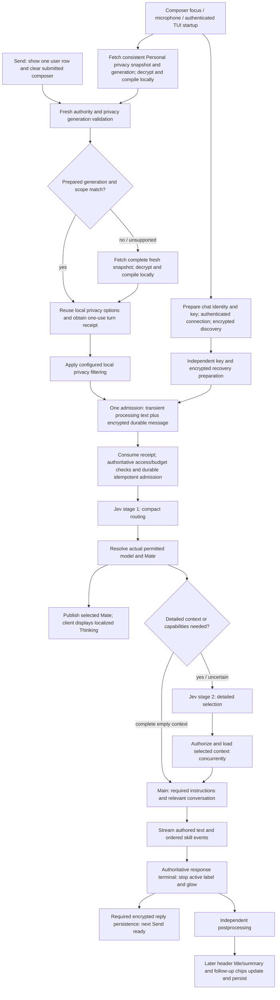
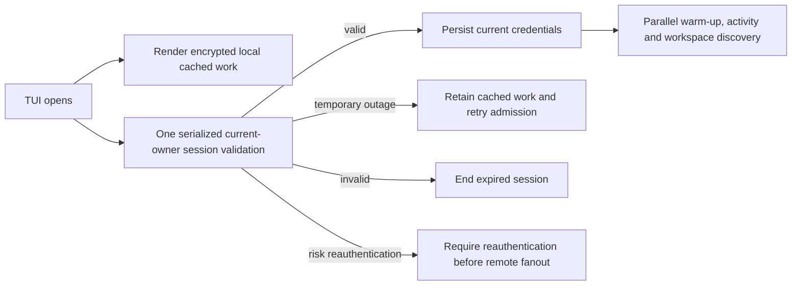
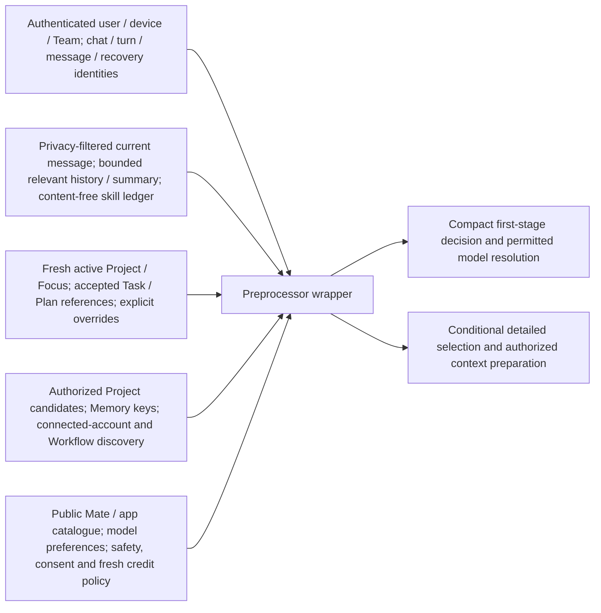
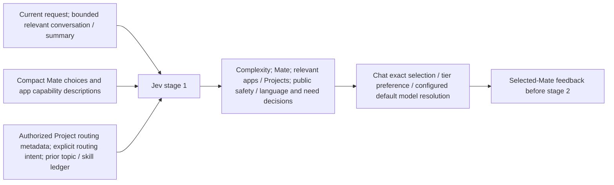
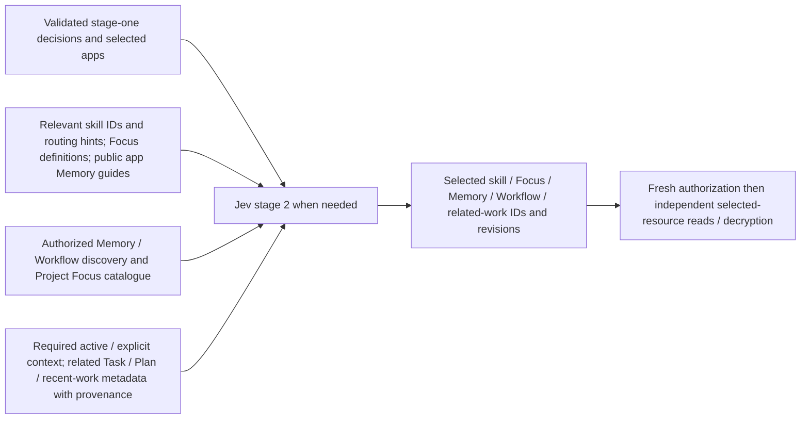
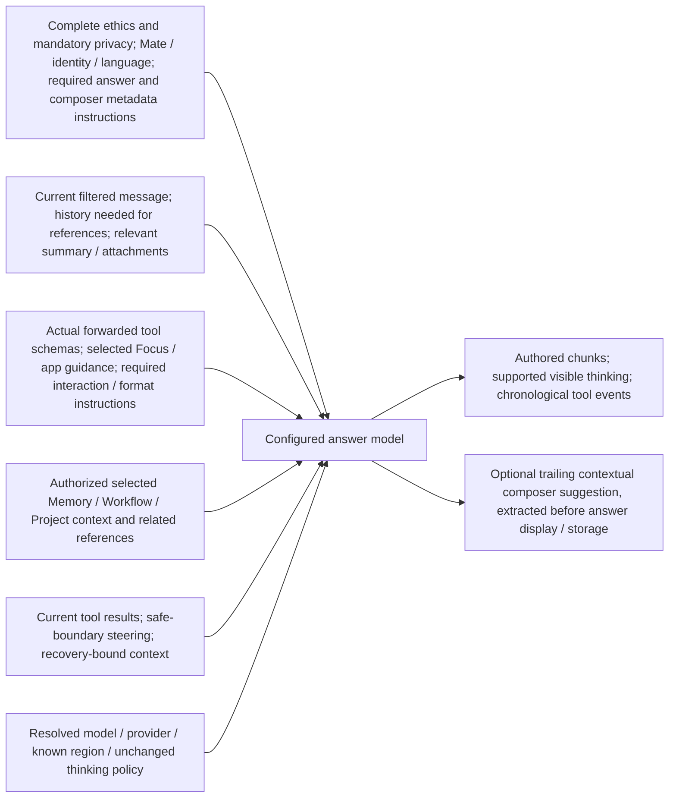
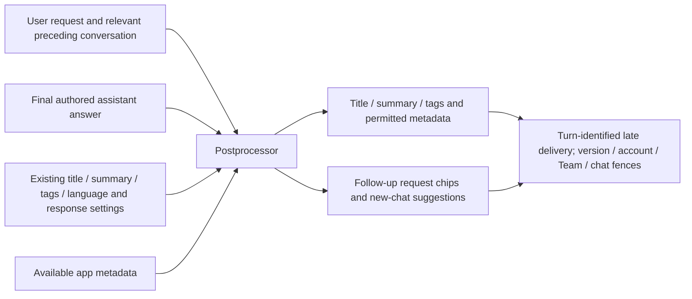

```mermaid
flowchart LR
  Results[Safety-checked skill results] --> Prepare[Prepare ordered children and parent]
  Prepare --> Classify[Fresh Project classification and recovery pin]
  Classify --> Probe[Bounded lookup of existing sealed receipts]
  Probe --> Seal[Seal absent records with current recovery public key]
  Seal --> Commit[Bounded atomic inline write transactions]
  Commit --> Children[Cache and publish children in source order]
  Children --> Parent[Cache and publish parent]
  Parent --> Continue[Model continuation and client rendering]
```

# Prepared privacy and independent chat completion

This increment implements the user-approved Plan in `plan.yml`. Its latency acceptance is separate from correctness: deployment and measured automatically routed TUI results precede equivalent web measurements. Selected-Mate feedback has a hard 2-second maximum for both new chats and same-chat follow-ups, with 1.5 seconds as the aim and faster preferred. The retained baseline misses the feedback aim and 2–3-second factual authored-stream target; candidate code is not evidence that those targets are met.

## Processing flow

Warm-up sends neither draft text nor inference. Protected information is filtered locally before request content is transmitted. The paired cleartext-processing/encrypted-durability admission already existed; this increment removes avoidable preparation and completion dependencies rather than introducing unencrypted durable storage.

TUI startup publishes cached encrypted work independently, then validates the current account/session/Team before optional remote workspace reads and warm-up. Rotated cookies are persisted before fanout. Invalid credentials end the session; temporary outages retain cached work, and risk reauthentication stays distinct. Ordinary Send keeps its immediate optimistic row/composer clear and existing SDK authority checks, including when startup validation is still pending.

## Preprocessor wrapper input

The wrapper owns authenticated source binding and gates. Discovery caches are data, not permission or positive-balance caches. Client privacy configuration is not indiscriminately forwarded to the model.

## Jev stage 1

This request excludes unrelated private bodies and full tool schemas. Only complete authoritative context can justify skipping detailed selection. A short message or a particular question word cannot establish that context.

## Jev stage 2

Selected-resource hydration means loading the specific authorized resource bodies chosen by this stage. Independent loads overlap; selection must precede any load whose resource identity is not known yet. Already active or explicitly selected resources may prepare earlier, while their required authority remains current.

## Main model request

Unused tool, artifact-format and product-capability guidance may be omitted only when complete response requirements justify that omission. Initial factual requests and factual follow-ups use the same eligibility rules; necessary referential history stays. Missing ethics or mandatory privacy causes a reload and then prevents inference if still unavailable. Compactness does not change the configured Gemini or thinking policy. The compact assembly is currently verified for English, French and German; other languages keep the complete instruction path.

## Postprocessor request and independent delivery

The main-generated composer suggestion is distinct from postprocessor chips. Completion ends the active response presentation; required encrypted persistence controls Send readiness. Metadata arrival remains observable through bounded owned subscriptions, continues updating headers and suggestions, and cannot revive a terminal response or overwrite a newer turn's suggestion. Ordinary Jev routing returns no authored title; postprocessing supplies it. Compatibility paths may still emit an early initial title. Later versioned title/summary updates may still apply during the next turn; follow-up chips and composer suggestions stay bound to their source turn. Unversioned initial generated titles use the existing guard against replacing an already stored title.

## Cache and authority boundaries

| Data | Preparation / retention | Freshness requirement |
| --- | --- | --- |
| Shipped Mate, app, skill, Focus and Memory definitions | Process cache by deployment/configuration revision | Valid required instruction sections; reload invalid bundles |
| Encrypted owner/Team discovery | Existing scoped Dragonfly cache, two sliding hours | Mutation generation/source revisions plus fresh selected access |
| Personal privacy source and compiled options | Device-local RAM, at most two sliding hours | Durable aggregate generation and fresh session/device/scope validation on Send |
| Selected private context | Existing authorized transient transport and consent-bound retention | Exact source revision, owner/Team, turn and current authority |
| Access, consent, spending and execution permission | Checked at required boundaries | No two-hour positive permission or balance cache |
| Late answer metadata | Client-encrypted persistence and bounded delivery | Exact source turn, metadata versions and current account/chat/Team |

Directus development schema freezing removes repeated schema cloning while preserving supported schema and permission invalidation. Out-of-band generation schema setup requires explicit cache clearing or CMS recreation. Performance claims must use correlated deployed request phases, not the process-wide profiler's percentage alone.

## Verification status

The measured deployed checkpoint is `ba8654432f0a4476e6c71b7c9b4bfd5b10ddbe8c`, with CLI alpha79. It includes synchronous admission completeness for well-typed unselected discovery hints, independent fresh current-chat preparation, pending viewer/auth ownership cleanup and offloaded Workflow pending-delivery repository work. Mandatory ethics/privacy, model/provider/thinking policy and selected-resource authorization remain unchanged. Later CLI overlap candidate `e7e60` is unpublished with an isolated CI failure under diagnosis; a further web guard correction is in progress and is not measured here.

Actual TUI v6 selected-Mate observations are 1,417/2,395/2,704 ms for initial factual and two same-chat follow-up turns; first authored text is 3,988/4,502/5,018 ms. Web v7 observations are 1,925/4,545/2,489 ms for Mate and4,191/7,697/5,784 ms for authored paint. Both clients miss follow-up Mate targets and every simple authored-text target. TUI factual and web raw error audits fail; web v7 also overflows its 2,000-record capture and fails the Events follow-up visible-row assertion. Correct answers, provider-free CI and initial Mate passes do not complete acceptance. Focus and remote Project summary real-inference scenarios remain pending because ordinary targets failed.

The initial Events TUI answer paints at 12,514 ms. Events search/enrichment contributes 3,160 ms; two main-provider request-to-useful-chunk waits contribute approximately 3,913 ms; other setup, safety, durable batching, continuation and paint fill the remaining critical path without double-counting concurrent branches. Terminal at 18,606 ms precedes required persistence 29,564 ms: an approximately 11-second serial client result recovery tail, including 11 output verify/ACK cycles and 32 canonical embed reads. CMS batching is deployed and uses two recovery RPCs for ten children plus parent; it does not remove the client durability checks. The Events follow-up executes no new search and retains automatically selected MEDIUM thinking.

Retained isolated correctness evidence includes CLI privacy/terminal streaming [run 38736188315](https://github.com/glowingkitty/OpenMates/actions/runs/38736188315), composite recovery [run 38734294283](https://github.com/glowingkitty/OpenMates/actions/runs/38734294283), foreground notifications [run 38728559354](https://github.com/glowingkitty/OpenMates/actions/runs/38728559354), and five corrected-transcript audio cases [run 38738168927](https://github.com/glowingkitty/OpenMates/actions/runs/38738168927). These establish their bounded contracts, not real latency targets or exact-source coverage for later candidates.

The development test-account credit fixture was restored before web v7; this is dev-only setup, not an exemption from spending or authority checks. Historical duplicate client-encrypted wrappers exposed by recovery must not be autohealed or arbitrarily selected; the current-chat pre-admission message-window404 is a separate issue. See [validation-2026-10-15.md](validation-2026-10-15.md) for timings, error scope and unresolved work. **Task acceptance remains incomplete.** No Apple application code is changed.

## Shared app-skill result recovery

The approved CMS optimization uses the existing shared composite lifecycle rather than app-specific persistence implementations. The 28 metadata-declared composite skills include Events, Web, News, Travel, Shopping, Maps, Images, Hosting, Tasks and Workflows. Ordinary chat outputs prepare their children and parent in order, perform fresh grouped Project classification, probe their existing sealed receipts in bounded transactions, seal only absent records, and commit inline outputs in bounded transactions before finished cache entries or client events are published.

Each request contains at most 32 outputs and 512 KiB; individual inline envelopes remain limited to 256 KiB. Larger result sets use multiple bounded transactions, and dependent publication waits for all required transactions. A failed transaction rolls back its own entries; prior committed chunks remain recoverable and reusable. Ten small children plus their parent require two recovery RPCs instead of the retained trace's 33. This is a call-count improvement, not a new measured inference-latency claim.

Every record retains its existing authority, owner/Team, deletion, preflight, identity and commitment checks. Inline single-output persistence also omits the repeated pre-create lookup, with current authorization and committed-state checks required on idempotent replies. Registered producers, volatile output, version diffs and large regional-S3 outputs retain their specialized lifecycles. Ordinary chat children retain UUIDv4 identities; UUIDv5 child identities remain reserved for durably registered producers. Retries of the same prepared payload reuse its child identities, fallback references and first sealed receipts. Reexecuting a builder allocates new ordinary children and cannot replace an already-sealed parent with changed child references.

No client wire-format change is introduced by storage batching: web, CLI/TUI and Apple receive the existing ordered embed events and recovery receipts. Architecture assertions, especially `storage.background.complete-sealed-recovery`, continue to define the required durability semantics.

## Apple processing handoff and web targets

The client targets remain immediate optimistic user-message placement and composer clearing; selected-Mate feedback within a hard maximum of 2,000 ms from Send for both new chats and same-chat follow-ups, measured first on TUI and then web, with 1,500 ms as the aim and faster preferred; and first authored streaming text within 2–3 seconds for simple initial and contextual follow-up requests. Tool requests retain the same selected-Mate target, while provider work, durable results and answer generation are measured separately. Completion stops the active presentation on the authoritative terminal event; required ciphertext persistence and late header/follow-up metadata have independent milestones.

Native adoption should mirror composer/microphone warm-up, fresh scoped privacy-generation validation, immediate durable/transient admission handoff, selected-Mate-only Thinking feedback before stage two, deterministic Researching/Working tool states, chronological tool/text ordering, terminal completion and late metadata updates. Warm-up performs no inference and carries no draft text. Actual OpenMates inference always uses its existing automatic routing with no model/provider override. Deployment readiness and real-inference target acceptance must be reported separately; no target is certified by mocked or historical timing alone.

## Foreground preparation and notifications

Current-turn TUI preparation uses fresh authorized metadata and bounded message windows for that chat, including privacy mappings, current encrypted key wrappers and canonical message version. Required recovery for that turn still finishes before its persistence milestone; unrelated account recovery remains available through normal browsing and reconnect without holding Send or response finalization.

Fresh per-connection presence from a foreground web tab or open interactive TUI suppresses both chat email and push across that user's chats, including new chats before active-chat selection. Both channels check before enqueue and at delivery. Headless/background/closed/expired sessions do not claim foreground human presence. Apple client implementation is unchanged.

A narrowly typed transient recovery failure can retry once after matching authoritative terminal hydration. A child with a valid durable store receipt whose canonical read is blocked by its known parent instead waits for that exact parent to verify and acknowledge, then retries once; terminal hydration alone cannot consume this dependency retry. Pending retries and recent bookkeeping are bounded, owner/session/Team/key/turn fences remain authoritative, and no ACK is sent until the canonical stored output verifies. Authorization, identity and cryptographic failures are never treated as transient. Explicit discovery remains the durable recovery route after exhaustion.

The user deployment/testing freeze is 15 October 2026 at 17:00 Europe/Berlin (15:00 UTC). Deployments and runtime mutations must finish before that cutoff; subsequent manual web testing requires a stable development revision.
