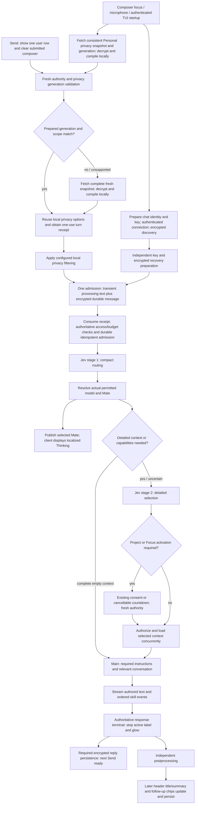
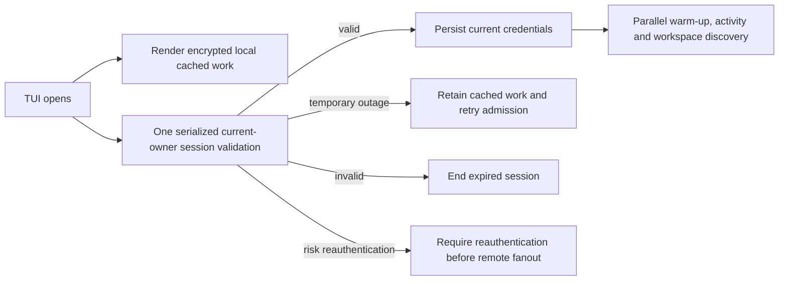
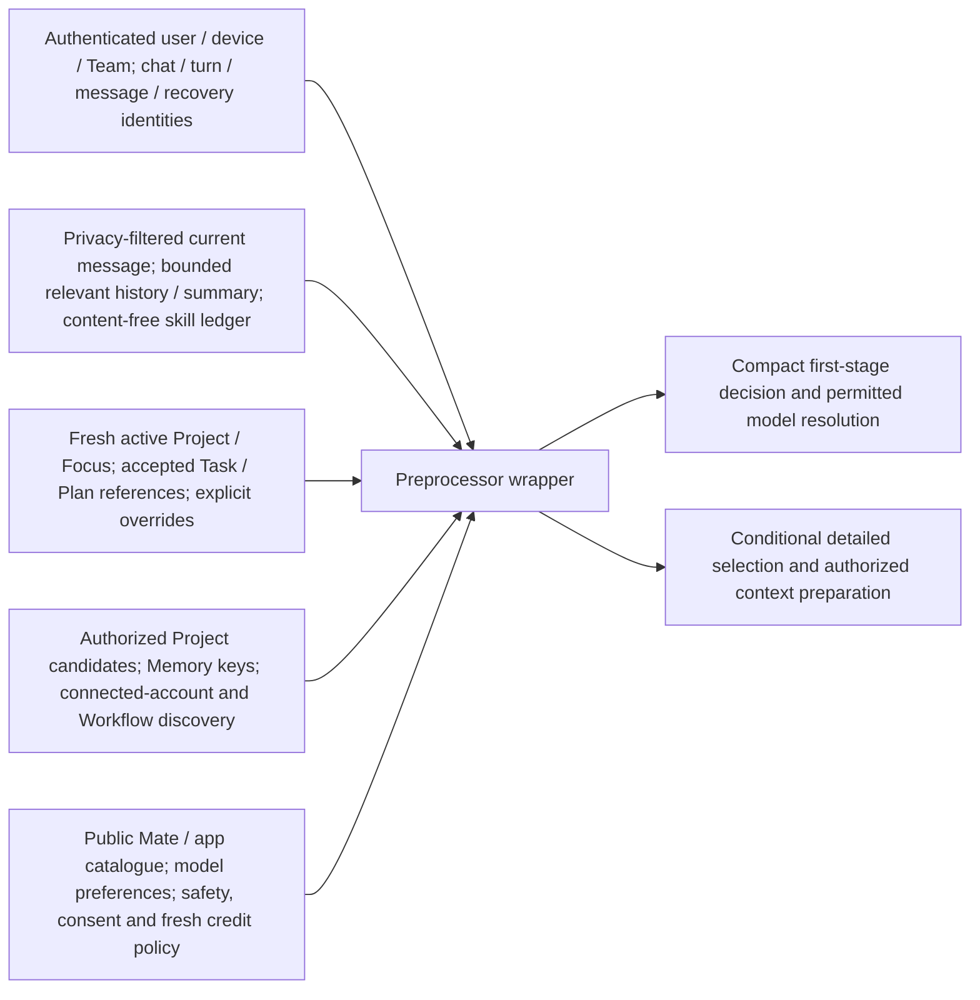
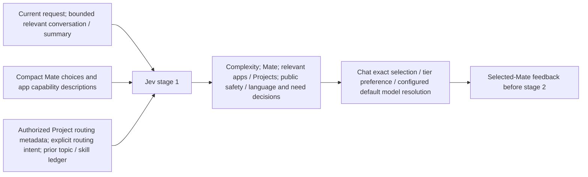
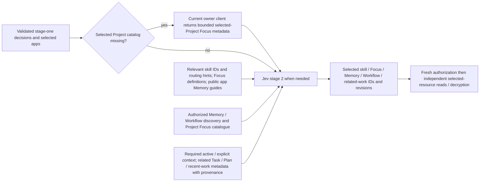
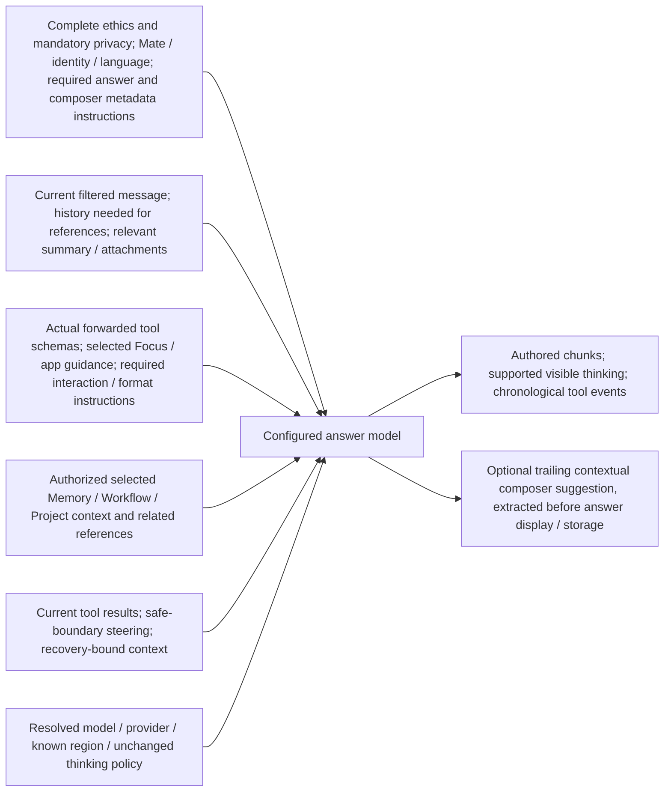
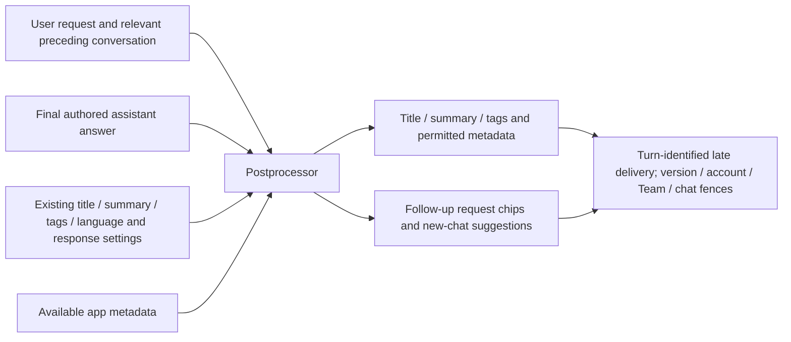

> Deployment status: the final recovery candidate described here remains undeployed after two failed integration cases. This publication only fixes metadata-only inspiration previews and documents the reviewed design. Earlier deployed timing measurements and staged fixes are identified separately in the validation document.

# Prepared privacy and independent chat completion

This describes the reviewed processing design. The latest user direction accepts observed timings and prioritizes completed answers with no request-related client or backend errors. The diagrams describe implementation and do not certify deployment or a passing run; scenario results, raw errors, and historical timing checkpoints live in [validation-2026-10-15.md](validation-2026-10-15.md).

## Processing flow

Composer or microphone focus prepares identity, encrypted discovery, keys and a scoped privacy snapshot without sending draft text or starting inference. Send places one optimistic user row and clears only the submitted composer. Fresh authority, privacy generation, access and spending checks precede durable admission. The existing paired processing text and encrypted durable message do not make plaintext durable. Jev routing selects the Mate before detailed context work; the client can show Thinking while selected resources load. Only the authoritative terminal event ends the active response presentation. Required encrypted reply and output persistence controls the next Send. Header metadata and follow-up suggestions can arrive later through owned, versioned delivery.

## Client preparation and foreground state

The TUI renders locally cached encrypted work independently of session validation. Current account, session and Team credentials are serialized and refreshed before remote fanout; rotated cookies are stored first. Invalid credentials end the session, temporary outages preserve cached work, and risk reauthentication remains separate. The current turn prepares bounded saved history, key wrappers and recovery receipts; unrelated account recovery does not block Send. Foreground presence is per live connection and suppresses email and push only while a real web tab or interactive TUI is present, with delivery rechecking presence. Warm-up performs no inference and carries no draft text.

## Preprocessor wrapper input

The authenticated wrapper binds user, device, Team, chat, turn, message and recovery identities. It receives locally privacy-filtered current text, bounded relevant history or summary, and a content-free skill ledger; active Project or Focus and accepted Task or Plan references; authorized discovery metadata; and public catalog, safety, consent and fresh credit policy. Client privacy configuration is not forwarded wholesale. Discovery data is not permission: selected private bodies require a fresh owner/Team, source-revision and consent check.

## Jev stage 1

Stage one sees the current request, bounded context, public Mate and app descriptions, and authorized routing metadata. It chooses complexity, Mate and relevant capabilities, then resolves the actual configured model through exact chat selection, tier preference and default routing. Selected-Mate feedback precedes stage two. It does not receive unrelated private bodies or full tool schemas. Detailed selection may be skipped only when authoritative context is complete; message length or a question word alone cannot justify omission.

## Jev stage 2 and selected Project catalog

Stage two uses selected skill IDs, Focus definitions, public app Memory guides, authorized Memory/Workflow discovery, Project Focus catalog metadata, and related Task/Plan provenance. If the selected Project catalog is missing, the current owner client returns bounded metadata over its authenticated live socket; an empty catalog and unavailable catalog are distinct outcomes. The response contains no file bodies or full Focus instructions and grants no access. Account, session, Team, chat, socket, turn and offered-Project checks fence the reply; the backend revalidates current owner, source turn and Project access before resuming. Selected-resource bodies are then independently loaded only after their identities and authority are known. Explicit permission to read with a prohibition on edits may enter the read flow; refusal to read, access or use files prevents implicit activation.

## Main model request

The main request retains complete ethics and mandatory privacy instructions, Mate identity, language, answer and composer-metadata requirements, the filtered request, referential history, relevant summary and attachments, actual forwarded tool schemas, selected Focus/app guidance, authorized selected bodies, and current tool results or safe-boundary steering. Missing required ethics or privacy sections trigger a reload and then fail closed. Unused tool or format guidance may be omitted only when complete response requirements justify it; initial facts and contextual follow-ups obey the same rule. OpenMates keeps its existing automatic routing and configured Gemini default with no model, provider or thinking override. The model can emit authored chunks, supported visible thinking and chronological tool events; a trailing contextual composer suggestion is extracted before answer display or storage.

## Postprocessor and delivery

Postprocessing receives the user request, relevant preceding conversation, final authored answer, existing title/summary/tags/language settings and available app metadata. It produces permitted title, summary and tags plus follow-up chips or new-chat suggestions. The main-generated composer suggestion is separate from these chips. Terminal completion stops the active label and glow; the next Send still waits for required encrypted persistence. Later title/summary versions can update the header, while chips and composer suggestions stay bound to their source turn. A stale optional suggestion write returns a source-correlated not-stored result, while malformed source, access, key and storage failures remain errors. Late metadata cannot revive a terminal response or overwrite a newer turn.

## Cache and authority boundaries

| Data | Retention | Boundary that remains fresh |
| --- | --- | --- |
| Shipped Mate, app, skill, Focus and Memory definitions | Process cache by deployment or configuration revision | Validate required instruction sections; reload invalid bundles |
| Encrypted owner/Team discovery | Scoped Dragonfly cache, two sliding hours | Mutation generation, source revisions and selected-resource access |
| Personal privacy source and compiled options | Device RAM, at most two sliding hours | Durable aggregate generation and session, device and scope on each Send |
| Selected private context | Authorized transient transport and consent-bound retention | Exact owner/Team, source revision and turn authority |
| Access, consent, spending and execution permission | Checked at required boundaries | Never a two-hour positive permission or balance cache |
| Late answer metadata | Client-encrypted storage and bounded delivery | Exact source turn, metadata version and account/chat/Team |

## Shared result recovery

```mermaid
flowchart LR
  Results[Safety-checked skill results] --> Prepare[Prepare ordered children and parent]
  Prepare --> Classify[Fresh Project classification and recovery pin]
  Classify --> Probe[Bounded lookup of existing sealed receipts]
  Probe --> Seal[Seal absent records with current recovery public key]
  Seal --> Commit[Bounded atomic inline write transactions]
  Commit --> Children[Cache and publish children in source order]
  Children --> Parent[Cache and publish parent]
  Parent --> Continue[Model continuation and client rendering]
```

The shared composite lifecycle prepares ordered children and parent, performs fresh grouped Project classification, probes existing sealed receipts, seals absent records, and commits bounded inline transactions before publishing finished cache entries or events. Each transaction accepts at most 32 outputs and 512 KiB; each inline envelope stays at most 256 KiB. A failed transaction rolls back its entries while earlier committed chunks remain recoverable. Registered producers, volatile output, version diffs and large regional-S3 outputs keep their separate lifecycle. Every path retains owner/Team, preflight, deletion, identity, key and commitment checks. A durable ACK follows verified canonical storage and successful required local handling; a queued old discovery page may skip only an identical acknowledged output. Changed identity, failed ACK or local handling, unknown output and new session remain eligible for recovery. The reviewed implementation includes the CMS recovery and embed-version transaction changes. Exact publication, runtime activation and captured results are recorded separately in the validation document; the diagram alone does not prove deployment or a measured speedup.
## Turn authority and client lifecycle

A Focus activation pauses the admitted user turn. Its internal answer execution has a distinct execution ID but retains the authenticated ROOT chat and source-turn authority through a trusted server mapping. Completion, Stop and failure release or hand off only that ROOT; they cannot erase a newer owner or accepted queued followers. A pending pause has a generation-specific 35-second watchdog that cannot expire a running child or later pause. A matching `already_started` queue result is handled within the same admitted turn rather than granting a new authority. Recent-work reads and writes still require owner, active-task, source-turn and completion-permit checks.

The web sender uses the latest acknowledged canonical message version after the active-turn barrier settles. A saved follow-up remains an existing-chat request even if the local optimistic counter is stale; fresh saved history, privacy generation, immutable retry transport and backend metadata checks still apply. Batched history encryption validates every row before replacing cached history and preserves chronological and empty-string semantics. A missing or unreadable history never becomes an empty conversation.

Completion conflict recovery reads the authoritative version through the existing archive-aware fetch wrapper, including its required storage capability header. It preserves owner/Team scope, credentials, the five-second transport budget and strict chat/revision validation. A denied or failed refresh keeps the original completion conflict visible; it cannot manufacture a replacement version.

Active-chat header and message-window refreshes recheck selection after every awaited read. ChatHistory's delayed new-user scroll keeps its original connected container and message identity; clearing, navigation and component teardown cancel stale work so an old timer cannot query a null container or scroll a newer chat. Strictly identified personal draft-only shells may remain encrypted and keyless. Message-bearing, shared, Team, direct and unreadable-key cases retain their missing-key guards; sync never creates a replacement chat key.

## Recovery and final-candidate boundary

CLI recovery runs a bounded number of independent output jobs but preserves same-output order, parent dependencies, canonical identity, digest, key, authority and durable ACK checks. Web discovery skips only an immutable output already acknowledged by the server and successfully handled locally in this session; a changed identity, failed ACK or local write, unknown failure or lifecycle reset remains eligible for recovery. Genuine recovery errors remain visible. Optional stale composer-suggestion writes use a source-correlated not-stored result; authorization and storage failures remain errors.

An acknowledged root's next-version advance requires the exact authorized sealed output, preserved current-version history and wrappers, and authenticated canonical type reuse. Only N→N+1 can advance; version gaps and same-version ciphertext replacement remain denied. Unsealed streamed updates cannot overwrite the acknowledged head or recipher immutable history. A queued canonical write can settle on verified equivalent stored content; this is separate from acknowledging its typed recovery record.

Reply terminal receipts and artifact acknowledgments are independent. The scoped reference-availability API accepts an optional bounded map of required recovery versions and returns a proof only for a matching acknowledged root whose current canonical version and digest verify under fresh owner/chat/Team authority. Legacy availability requests keep their existing response. The CLI's terminal reconciliation of an updated artifact requires that durable proof, including after reconnect or another device's acknowledgment; a stored head alone cannot substitute for it. This does not turn every reply terminal receipt into a claim that all artifacts were acknowledged.

CMS transaction repairs, the client queue correction and the navigation timer guard are implementation details; their publication and exact-source verification status is recorded separately. Real factual, Events, Focus, Project and web completion/error results are recorded only in the validation document and performance report.

The queued worker compares its original submitted text with the admitted inference request, which is bound by the existing HMAC commitment. Server-resolved embed text may differ from that original text; its canonical digest must still match, and the worker checks the immutable admission commitment using its existing state read before acknowledging the queue prefix. This preserves changed-request rejection without adding a CMS round trip.
