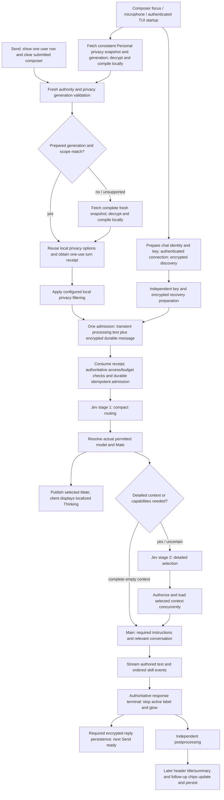
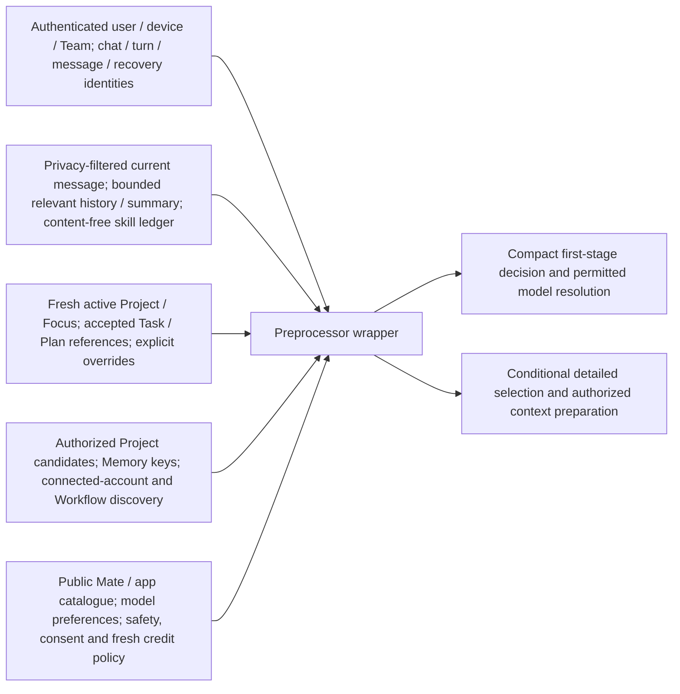
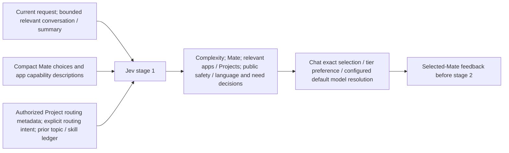
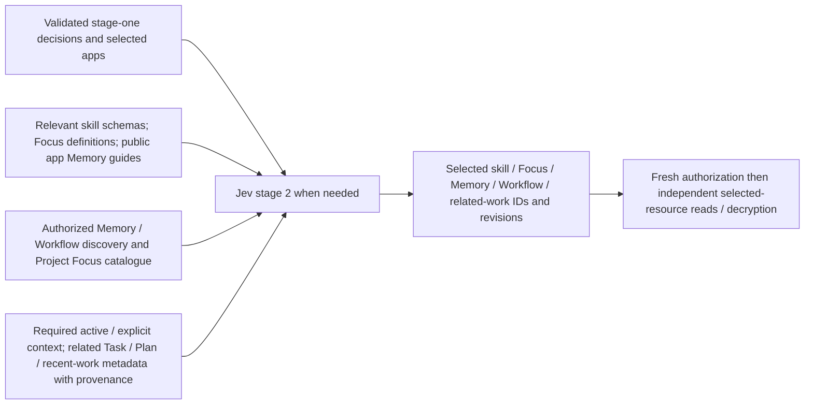
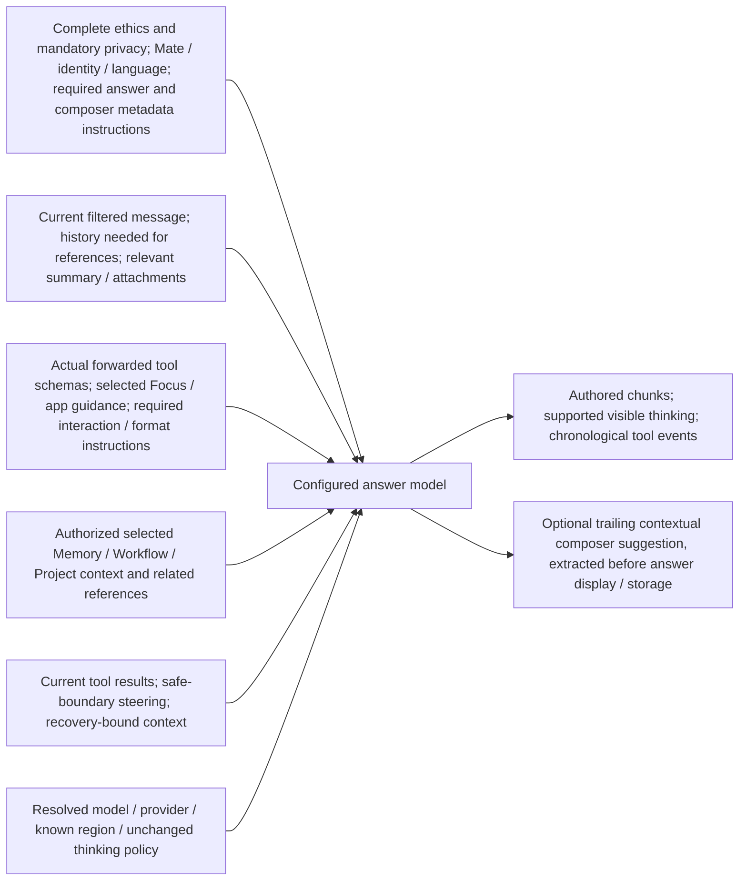
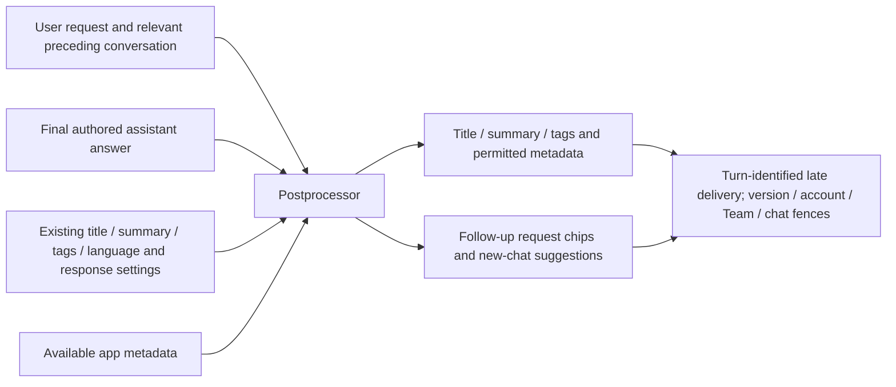

# Prepared privacy and independent chat completion

This increment implements the user-approved Plan in `plan.yml`. Its latency acceptance is separate from correctness: deployment and measured default-Gemini TUI results precede equivalent web measurements. The retained baseline misses the 1.5-second selected-Mate and 2–3-second factual authored-stream targets; candidate code is not evidence that those targets are met.

## Processing flow

Warm-up sends neither draft text nor inference. Protected information is filtered locally before request content is transmitted. The paired cleartext-processing/encrypted-durability admission already existed; this increment removes avoidable preparation and completion dependencies rather than introducing unencrypted durable storage.

## Preprocessor wrapper input

The wrapper owns authenticated source binding and gates. Discovery caches are data, not permission or positive-balance caches. Client privacy configuration is not indiscriminately forwarded to the model.

## Jev stage 1

This request excludes unrelated private bodies and full tool schemas. Only complete authoritative context can justify skipping detailed selection. A short message or a particular question word cannot establish that context.

## Jev stage 2

Selected-resource hydration means loading the specific authorized resource bodies chosen by this stage. Independent loads overlap; selection must precede any load whose resource identity is not known yet. Already active or explicitly selected resources may prepare earlier, while their required authority remains current.

## Main model request

Unused tool, artifact-format and product-capability guidance may be omitted only when complete response requirements justify that omission. Initial factual requests and factual follow-ups use the same eligibility rules; necessary referential history stays. Missing ethics or mandatory privacy causes a reload and then prevents inference if still unavailable. Compactness does not change the configured Gemini or thinking policy. The compact assembly is currently verified for English, French and German; other languages keep the complete instruction path.

## Postprocessor request and independent delivery

The main-generated composer suggestion is distinct from postprocessor chips. Completion ends the active response presentation; required encrypted persistence controls Send readiness. Metadata arrival remains observable through bounded owned subscriptions, continues updating headers and suggestions, and cannot revive a terminal response or overwrite a newer turn's suggestion. The stage-one initial title has its own early delivery path. Later versioned title/summary updates may still apply during the next turn; follow-up chips and composer suggestions stay bound to their source turn. Unversioned initial generated titles use the existing guard against replacing an already stored title.

## Cache and authority boundaries

| Data | Preparation / retention | Freshness requirement |
| --- | --- | --- |
| Shipped Mate, app, skill, Focus and Memory definitions | Process cache by deployment/configuration revision | Valid required instruction sections; reload invalid bundles |
| Encrypted owner/Team discovery | Existing scoped Dragonfly cache, two sliding hours | Mutation generation/source revisions plus fresh selected access |
| Personal privacy source and compiled options | Device-local RAM, at most two sliding hours | Durable aggregate generation and fresh session/device/scope validation on Send |
| Selected private context | Existing authorized transient transport and consent-bound retention | Exact source revision, owner/Team, turn and current authority |
| Access, consent, spending and execution permission | Checked at required boundaries | No two-hour positive permission or balance cache |
| Late answer metadata | Client-encrypted persistence and bounded delivery | Exact source turn, metadata versions and current account/chat/Team |

Directus development schema freezing removes repeated schema cloning while preserving supported schema and permission invalidation. Out-of-band generation schema setup requires explicit cache clearing or CMS recreation. Performance claims must use correlated deployed request phases, not the process-wide profiler's percentage alone.

## Verification status

Focused backend, CLI and web correctness checks pass. The scoped CLI privacy/terminal-streaming and web processing/PII integration checks pass; matching auth and first-admission recovery results are retained. Later annotation/formatting fixes preserve executable test logic, and the merged CLI passes focused units and its configured build. Deployment and new real-Gemini latency/error acceptance are pending. The WebSocket delivery-state repair is held separately for its owner and is excluded from this timing candidate. The reported CMS transport retries and signed-out activity requests are not established as one shared cause.
