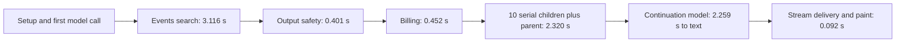

# Chat performance validation, 14 October 2026

The main increment was published at `b946173b492c564c37bb7608ef13ddfb68a8930a`. Development runtime activation of its descendant `d8bef5a14b7a8b3a7fe4ff601d4683a7ffb70f98` completed, and both web deployments passed. All 17 selected backend test files passed. Existing isolated privacy, recovery, streaming and web-processing receipts remain correctness evidence for their recorded source inputs. These results do not establish the real-inference latency targets.

## First current-runtime probe

The warmed Spain TUI probe painted the optimistic user message in 39 ms, then ended the expired persisted session. It dispatched no inference. Selected-Mate and first-answer timings are therefore unavailable. Complete service-log capture showed eight workspace 401s starting before session invalidation. The client observer initially missed HTTP events; its corrected hook subsequently passed a local probe using the compiled SDK, including HTTP, WebSocket, correlation, redaction and bounded-capture checks. The failed probe remains incomplete evidence, rather than an error-free inference pass.

A startup-order repair gates optional remote workspace reads, Team identity, activity observation and warm-up behind one current-owner session validation. Cached encrypted work remains available while validation is pending or temporarily unavailable. Invalid credentials end the session; risk reauthentication remains distinct. Ordinary Send retains immediate optimistic rendering and its existing SDK authority checks. A completed startup authentication handoff avoids duplicate immediate socket validation; it is not a cache of permissions, credit or privacy-generation authority.

Live testing currently needs a valid disposable dev account. Read-only account checks found deleted configured accounts and a suspended remaining account. No suspended account was reactivated, no credentials were reset, and the personal engineering Tasks account was not used for inference. The locally configured Gmail test-inbox credentials required for fresh signup are absent. The next decisive check is a successful disposable-account login, followed by one warmed Spain TUI request under the native runtime lease.

## Historical Berlin attribution

The retained Core16 `62549591a0` observation reached the first visible answer at 13.716 seconds. This is answer arrival, not events-provider duration. It is historical evidence; independent source/runtime changes prevent treating older runs as a controlled before/after comparison.

| Boundary after Return | Seconds | Interval since preceding boundary |
| --- | ---: | ---: |
| First main-model request | 2.700 | 2.700 |
| Model requests events tool | 4.596 | 1.896 |
| Events search completes | 7.712 | 3.116 |
| Output safety completes | 8.115 | 0.403 |
| Skill billing completes | 8.630 | 0.515 |
| Ten child embeds and parent finish | 10.951 | 2.321 |
| Continuation model request | 11.365 | 0.414 |
| First authored server text | 13.624 | 2.259 |
| TUI paints authored text | 13.716 | 0.092 |

The explicit safety marker reports 401 ms. Billing itself spans 452 ms; the wider table interval includes result normalization and preparation. Embed work spans 2.320 seconds, including 2.100 seconds for ten serial child embeds, followed by the parent. Eleven embeds perform three CMS recovery transactions each: 33 POSTs. Observed stage-boundary envelopes across those embeds total 162 ms through Vault encryption completion, 389 ms through fresh Project classification reads, 1.592 seconds through recovery-transaction completion, and 125 ms for remaining publication/boundary work. These envelopes are not exclusive CPU or network measurements.

The providers already run concurrently. Within the 3.116-second tool-selection-to-completion interval, dispatch adds 37 ms and provider setup adds 52 ms. Luma reports 1.022 seconds, Meetup 1.567 seconds and Eventbrite 2.271 seconds. The fanout completes 2.289 seconds after routing; the remaining 738 ms contains filtering and finalist-detail hydration, including two Luma detail responses. Exact exclusive hydration time is unavailable. No separate ranking-model request is observed in this interval, but a dedicated ranking boundary was not logged. Calling the full 13.716 seconds "events search time" would therefore misattribute most of the delay.

Potential improvements require a current-source measurement before their gains can be claimed:

| Candidate | Reason and constraint | Expected benefit hypothesis |
| --- | --- | --- |
| Bounded concurrent child recovery writes | Ten independent children are currently serial; seal every required child before publishing the parent and preserve idempotence, classification and replay | Roughly 1–2 seconds in this historical trace; not yet measured |
| Batch atomic recovery operations | Reduce the 33 CMS POSTs without losing transactional or crash-recovery guarantees; coordinate with the durable-output owner | Potential additional reduction; no defensible millisecond estimate yet |
| Public event detail cache | Reuse provider details by stable event ID with expiry and freshness controls; never cache user authority | Can reduce the observed 738 ms filter/detail envelope on repeated events; cold requests do not benefit |
| Provider and model timing optimization | Initial providers overlap already; the slowest provider takes 2.271 seconds, while first-model/tool selection and continuation also consume time | Evaluate provider tail latency separately; do not trade required coverage for an unapproved early cutoff |

Event-provider improvements alone cannot eliminate the setup, recovery-write and second-model delays. Already-approved general processing changes must be measured first, then the largest remaining correlated boundary should determine the next patch.

Core14's larger 6.649-second search-to-parent interval similarly contains 391 ms safety, 2.396 seconds billing and 3.790 seconds embed work. Neither observation supports blaming output safety for the multi-second gap. The primary evidence is the retained per-run `server-logs/app-ai-worker.private.log`, including the plain-text safety marker; a JSON-only parser omits it.

## Remaining verification and optimization order

1. Complete focused startup admission verification and publish its scoped repair. Retain passing checks whose relevant source and dependencies are unchanged.
2. Restore valid disposable test-account access. Run actual configured-default Gemini in TUI first: warmed Spain, same-chat France/Germany follow-ups, shorthand wording, then the small cold/warm cohort. Inspect a missed request's phases before another paid reproduction.
3. Verify selected Mate within 1.5 seconds, simple authored streaming within 2–3 seconds, prompt safety and actual model/provider/thinking policy. Audit request-related client and backend errors; incomplete capture blocks acceptance. Measure response terminal, required encrypted persistence and later title/chips/composer suggestion separately.
4. Trace current Berlin and its contextual follow-up. First evaluate bounded concurrency of independent child durability operations, preserving output safety and publishing the parent only after every required child seals. Coordinate the durable-output owner before editing. Batch atomic recovery operations are a subsequent option; no durability guarantee may be removed to improve a timing result. Provider work belongs with the existing events-search owner.
5. Once ordinary TUI acceptance passes, repeat the ordinary/follow-up checks on deployed web, then verify Focus-mode and remote-access Project requests. These scenarios have not yet received current-source latency acceptance.

The architecture and request contents are documented in [implemented-flow.md](implemented-flow.md). Main completion remains independent of optional postprocessor title/summary and follow-up suggestions, which continue updating when they arrive. Full required ethics and mandatory privacy instructions remain enforced on every answer-producing request.
