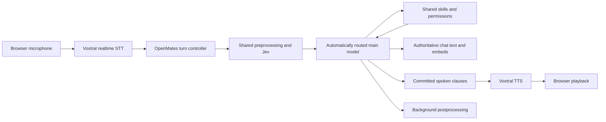

# Voxtral 3 implementation proposal

Researched 2026-10-22 for TASK-6487. This is a proposal; no product code, provider
settings or defaults changed. No new provider benchmark was run. Source links
describe the public launch state and need rechecking at implementation time.

## Recommendation

Use **Small Transcribe 3 for compatible finished recordings**, **Mini Transcribe
Realtime 3 for live transcription**, and **TTS 3 for web message listening**.
Prototype modular calls using those speech components around the existing
OpenMates AI pipeline. Retain one authoritative answer, tool execution path and
encrypted conversation history. Qualify interruptions before replacing Gemini Live.

| Use | Proposed model | Published provider price | Reason |
| --- | --- | --- | --- |
| Finished recordings without word-timing requirements | `voxtral-small-transcribe-3-0` | $0.004/min | Quality-first candidate; benchmark against Mini before rollout. |
| Cost-sensitive batch alternative | `voxtral-mini-transcribe-3-0` | $0.0035/min | Only $0.0005/min cheaper; use if measured quality is equivalent. |
| Live composer input and call input | `voxtral-mini-transcribe-realtime-3-0` | $0.008/min | Streaming transcription and explicit turn events. |
| Web assistant-message listening | `voxtral-mini-tts-3-0` | $13/M characters | Complete text fits our existing encrypted segment generation. |
| Independent streaming call output | Evaluate `voxtral-mini-tts-realtime-3-0`; initially streamed clauses through TTS 3 | Verify realtime price separately | Realtime model is listed, but independent integration is not fully documented. |

Prices: [Small](https://docs.mistral.ai/models/voxtral-small-transcribe-3-0),
[Mini](https://docs.mistral.ai/models/voxtral-mini-transcribe-3-0),
[Realtime](https://docs.mistral.ai/models/voxtral-mini-transcribe-realtime-3-0),
[TTS](https://docs.mistral.ai/models/voxtral-mini-tts-3-0).
These model cards mark the release **Public Preview**. Quality rankings are
vendor claims; they do not establish OpenMates quality or latency.

The Small premium is about 14% over Mini, or $0.03 per hour of recording.
That makes Small the sensible quality-first candidate here. Mistral's general
[selection guide](https://docs.mistral.ai/studio/audio/speech-to-text/overview)
instead recommends starting with Mini and escalating when errors remain.
Our recommendation depends on a small paired evaluation, especially German,
English, mixed-language speech, names, dates and self-corrections.

## What exists in the repository

Paths below are repository-relative.

| Surface | Current source and behavior | Proposed change |
| --- | --- | --- |
| Recorded audio | `backend/apps/audio/skills/transcribe_skill.py`: `voxtral-mini-2602`, encrypted-file unwrap, waveform, optional correction and timings | Shared capability-aware STT configuration; protect word-timing callers. |
| Live recording input | `backend/core/api/app/routes/audio_realtime.py`: first-party authenticated proxy, `voxtral-mini-transcribe-realtime-2602`, 16 kHz PCM, usage settlement, optional correction | Upgrade the session configuration and event parser, preserving the client contract. |
| Message listening | `backend/apps/audio/assistant_speech/{voice_profiles,segment_task,billing_task}.py`, `backend/apps/audio/pricing.py` | Replace ElevenLabs-specific provider requests and settlement attribution behind a shared synthesis boundary. |
| Calling | `backend/core/api/app/routes/voice_call.py`, `backend/shared/providers/{live_voice,gemini_live_voice}.py` | Preserve admission, chat binding and lifecycle; replace Gemini wire assumptions with normalized turn/audio events. |
| Call tools | `backend/apps/ai/processing/voice_call_broker{,_runtime}.py` | Reuse authorization, sealed worker transport, cancellation and embeds; avoid parallel assistant reasoning paths. |
| Microphone / playback | `frontend/packages/ui/src/services/voiceCall{,AudioGate,Detector}.ts`, `frontend/packages/ui/src/components/videocall/callAudio.ts` | Reuse capture, local detection, buffers and playback-stop primitives; add local barge-in coordination. |
| Chat routing | `backend/apps/ai/processing/model_routing.py`, `preprocessor.py`, `main_processor.py`, `postprocessor.py` | Add voice adaptations around the existing processing path. |

Current assistant playback uses **Eleven v4 Turbo**, from
`ASSISTANT_RESPONSE_SPEECH_MODEL`, despite older Specification text naming v3
Conversational. This pre-existing drift must be reconciled explicitly in the
provider migration review. The explicit `audio.speak` skill remains separate.

The prior voice pipeline research at
`vaults/memory/Resources/research/openmates-voice-calling-pipeline-research.md`
(in the canonical checkout; the local vault is excluded from this worktree)
already recommends OpenMates-owned STT → orchestrator → LLM → TTS and identifies
turn detection, barge-in, buffering and tool continuations as its main burden.
Its May model choices and latency measurements are historical, not current benchmarks.
TASK-4951 tracks the earlier reconsideration and remains attached to its original chat.

## Transcription migration requires compatibility work

[Mistral's migration guide](https://docs.mistral.ai/studio/audio/migrate-from-voxtral-2)
documents removal of word timestamps and settings becoming immutable after the
first realtime audio chunk. A new model ID alone would break existing consumers.

Our transcription contract supports `none`, `segment` and `word`; contract v1
defaults to word timestamps. The owning approved requirement is
`videos.transcript.audio-timestamps-and-correction` in
`specifications/features/app-skills/videos-get-transcript/specification.yml`.
Speech-input clients explicitly request no timestamps and can migrate separately.

Proposed implementation:

- Move untimed recordings and supported segment-timed requests to Small 3 after
  protocol and quality checks. Upgrade realtime composer input independently.
- Keep v1 word requests on the currently configured compatible provider model
  while available. Do not silently downgrade them, fabricate words from segments,
  or align corrected text to raw-ASR timings.
- Before migrating those consumers, choose either a separately evaluated forced
  aligner or an explicit new segment-only contract. Check the old model's actual
  lifecycle; the current migration page supplies no usable retirement deadline.
- Send format, language, bounded vocabulary, delay and any turn settings before
  audio, and await the configured-session acknowledgement. Reconnect deliberately
  if configuration must change. Preserve overlapping diarized segments.
- Preserve correction/title behavior and feature flags during the provider change.
  Assess whether richer context bias reduces correction needs separately; calls
  should not add a second generative transcript-cleanup pass to every turn.

## Web message listening

Introduce a small shared speech-synthesis provider interface rather than exposing
Mistral parameters in components. Keep deterministic speech projection, safety
checks, lazy paragraph generation, source revisions, encryption, ownership,
retries and successful-generation-only settlement. Update model/provider metadata,
cache identity and billing together.

For the first playback migration, generate the complete requested segment and
publish its encrypted asset exactly as today. The current approved speech contract
excludes partial provider audio being relayed before the encrypted segment is ready.
Provider streaming therefore does not automatically improve this path's first
audible latency; measure whole first-segment readiness.

Use a new version of each curated Mate profile and a server-only mapping to
Mistral preset voices. Existing cached assets retain their original provider and
version; new requests must not accidentally reuse audio under an incompatible
profile. Listen to English/German samples, names, numbers, dates and longer prose
before choosing the palette. [The voice library](https://docs.mistral.ai/studio/audio/text-to-speech/voices)
currently lists one German preset, so preserving every Mate's distinct character
across languages needs evaluation. Do not clone existing provider voices implicitly.
Prerecorded acknowledgements may need separate regeneration for a consistent voice.

The [language reference](https://docs.mistral.ai/studio/audio/specs-and-limits/languages)
lists 35 TTS languages and 50+ dialects, while the TTS model card still says nine
languages. The launch article advertises style instructions, while the
[TTS guide](https://docs.mistral.ai/studio/audio/text-to-speech/overview) marks them
unavailable at launch. Treat these as documentation conflicts; verify needed
voice/language combinations and API fields instead of promising either description.

Default scope is the shared backend used by manual web listening; auto-speech and
CLI consumers must be checked for collateral changes. Keep the explicit
`audio.speak` skill, sound effects and Apple local-speech route outside this migration.
No silent provider fallback; a rollback must have deliberate configuration and
matching disclosure.

## Reusing the normal pre / main / post pipeline for calls

**Yes: reuse the processors and policies, with a voice turn/output mode.** Avoid
recreating their routing, tools, focus, memory permissions or history inside a
second voice agent. Reuse of the processors does not imply that the entire
current Celery request lifecycle can meet call latency unchanged; profile queue
and worker transport latency before deciding whether to extract a thinner runner.

The current automatic profiles already select Mercury 3 for **low** complexity,
Gemini 3.8 Flash for **medium/high**, and Gemini 4 Argon for **max**, with preference,
capability and fallback handling in `model_routing.py`. Reuse that resolver;
Jev is the bounded decision model, not the conversational reply generator.
Mercury is text-only, so actual camera/images and non-text tool results retain
capability-aware routing. No model/provider overrides in OpenMates validation chats.

Adaptations:

1. Admit each complete transcript once through existing request safety, credit,
   permissions, focus, memory, compression and model-selection logic. Reuse
   context only while its authorization and relevant revisions remain valid.
2. Add concise spoken-response guidance to the shared main prompt. Preserve rich
   chat artifacts, citations and tool outcomes; speak a deterministic safe
   projection of committed clauses. Never speak reasoning, protocol tokens,
   raw tool arguments or intermediate diffusion revisions. A tool result is
   available before speaking an outcome that depends on it.
3. Tee authoritative answer events to chat and call synthesis. One owner persists
   messages/embeds and one owner settles each usage item. Do not enable ordinary
   auto-speech simultaneously or run Gemini Live to generate a second answer.
4. Run noncritical metadata/follow-up work asynchronously, bounded to the finalized
   turn revision. Retain completed-turn summaries and compression in the normal
   history. A metadata-only voice helper already exists in `postprocessor.py`;
   do not run it and full text postprocessing for the same result.
5. Carry call, user-turn, assistant-message and generation identities through
   queues, provider events, skills, synthesis and playback. Local stop, new speech,
   typed input, hangup and account changes fence stale output at every boundary.

[Mercury's streaming docs](https://docs.inceptionlabs.ai/capabilities/streaming)
distinguish refined streaming blocks from optional revisable diffusion output.
Only stable output belongs in speech. The
[voice guide](https://docs.inceptionlabs.ai/usecases/voice) exposes `realtime=true`
and low reasoning for first-answer latency. Investigate a voice-scoped adapter
option; the current request schema does not expose `realtime`. Preserve automatic
model selection and existing safety/quality behavior while evaluating it.
[Mercury Voice](https://www.inceptionlabs.ai/blog/introducing-mercury-voice) is a
separate enterprise-access model; it is an optional later comparison, not a
prerequisite or a substitute for Mercury 3 in this proposal.

### Speech transport choice

[Documented TTS streaming](https://docs.mistral.ai/studio/audio/text-to-speech/stream-speech)
accepts a complete text input and streams audio back through SSE. It does not
document an incremental text WebSocket for an independently controlled LLM.
The TTS overview lists `voxtral-mini-tts-realtime-3-0`, but its custom integration
path needs a capability probe before committing to it.

Prototype with complete short clauses submitted to standard TTS 3, decode returned
audio incrementally, maintain ordering and bound lookahead. Verify PCM format/rate
against our playback engine instead of assuming Gemini's 24 kHz output.
Evaluate prosody across clause boundaries and cancellation wastage. If this is too
slow or disjointed, qualify the independent realtime TTS route before rollout.

Mistral's [Voice Agents SDK](https://docs.mistral.ai/studio/audio/voice-agents/overview)
uses LiveKit and manages the full answer/tool pipeline. The public configuration
does not establish an arbitrary OpenMates/Mercury LLM adapter. Use it as a benchmark
or a replaceable transport only after proving custom model and ownership control.
Do not place another conversational brain around our existing one by default.

## Interruption and turn completion

Separate **user speech starting**, **the user finishing**, and **assistant output
being cancelled**. None of these implies the other two. The existing local gate
loads its detector in the background, retains 400 ms of prespeech, and pauses
uploads after five seconds of verified silence. Its speaking state currently only
updates UI; playback interruption normally follows the server's Gemini event.
It is not yet a complete local barge-in controller.

[Voxtral turn events](https://docs.mistral.ai/studio/audio/speech-to-text/turn-detection)
are `turn.start`, `turn.eager_end`, `turn.resume` and `turn.end`. Defaults include
500 ms minimum silence and a 3 s timeout. Text deltas can trail `turn.end` and have
no timestamps; retain them until the configured streaming delay has elapsed, or
the next turn starts. Never submit a truncated request at the event alone.
`eager_end` can start disposable preparation; only a confirmed, complete turn can
authorize action. Turn detection and realtime diarization cannot be combined.

Proposed controller:

- **Fast stop:** echo-cancelled local speech detection ducks or suspends playback
  immediately. Keep listening during assistant speech. Preserve short "stop",
  "no" and "yes"; do not require a long phrase or an LLM decision before stopping.
- **Confirm or recover:** corroborate near-end speech with provider turn-start,
  transcript evidence and bounded acoustic checks. On confirmed speech, advance
  the generation and cancel obsolete inference/TTS/queued work. On a false local
  trigger, recover only current playback from its known cursor, without replaying
  an entire answer. Manual mute always wins. A provider start is not speaker identity.
- **Reject echo:** retain browser echo cancellation/noise suppression; test
  loudspeaker loopback, other people, TV, coughs and double-talk. VAD probability
  and diarization alone cannot prove the account holder spoke. Set a conservative
  policy for ambiguous background speech rather than claiming perfect detection.
- **Preserve audio and state:** keep bounded prespeech and genuine new speech;
  clear pending assistant audio and reject late-generation packets. Apply the same
  interruption path while reasoning, waiting on tools and synthesizing, not just
  while audibly speaking.
- **Respect side effects:** cancel unstarted writes and recheck the generation
  before tool dispatch. An already committed action remains recorded and is not
  undone or retried just because speech stopped. Explicitly accepted long-running
  work can continue only under the existing continuation/cancellation policy.
- **Represent what was heard:** maintain generated text, issued audio and locally
  played chunk receipts separately. Keep useful text in chat with interruption
  state, but give the next call turn only the known heard prefix plus that state.
  Without word alignment, use completed clause boundaries and conservatively mark
  the partly played clause as uncertain. Never infer hearing from bytes sent.

The five-second gate is a billing/input-idle mechanism, not conversational
endpointing. On a new Voxtral stream, configuration precedes replay of buffered
audio. Confirm whether idle can preserve a session without closing it: the current
composer's `input_audio.end` finishes its transcription session, so Gemini's
audio-pause semantics must not be copied unchanged. Do not insert eager-end
speculation in the first implementation; add it only if measured latency needs it.

## Privacy, pricing and parity

Calls remain a first-party authenticated surface, bound to the owner, browser
session and chat. Keys stay server-side; plaintext buffers are ephemeral; durable
messages/artifacts use existing encryption. Update the Google-specific first-call
consent to the actual providers before opening microphone/provider connections.
Mistral processes raw microphone audio; text goes to the selected reasoning and
decision providers. EU speech hosting does not make the whole call EU-only: our
Mercury route is configured in the US. STT loses some acoustic/prosodic context
that a native audio model receives; evaluate names, tone and emotional handling.

Verify training and retention settings independently for STT, TTS, Jev and each
reasoning route. [Mistral's ZDR guide](https://docs.mistral.ai/admin/monitor-comply/zero-data-retention)
lists stateless transcription and speech endpoints, excludes stateful Agents,
and requires account approval. It does not explicitly list the realtime WebSocket;
obtain endpoint-specific confirmation. Do not translate EU hosting or no-training
language into a claim of zero retention. Reuse the Mercury correction opt-in guard.
No whole-call recordings are added for diagnostics.

Provider-cost changes require deliberate pricing work:

- Batch is currently $0.003/min and three credits per started minute. Small's
  $0.004/min would exceed that charge under the current $0.001/credit basis.
- Realtime rises from $0.006 to $0.008/min. Preserving the existing 20% markup
  formula would mean ten credits per started minute, rather than eight.
- Playback's configured provider reference is $40/M characters for v4 Turbo;
  Voxtral's $13/M is 67.5% lower. Pass-through at the existing credit basis would
  be `ceil(total_successful_characters * 0.013)` credits, rounded cumulatively per
  message. This is a candidate, not an approved retail-price change.
- Call cost is metered input STT + generated TTS characters + Jev/LLM/tool usage
  + infrastructure, including provider work already generated when interrupted.
  Verify whether transmitted silence is billable; do not count microphone wall
  time or locally heard audio as equivalent to supplier usage. Track retry and
  interrupted generation spend without charging an item twice.

Preserve typed input, permission prompts, focus, memories, embeds, reconnect,
compression, generated media and camera/screen support. Voxtral is not a drop-in
replacement for Gemini's native visual stream: route required frames through the
existing image pipeline and a capable model. Keep current visual calls available
until parity is proven; show the route explicitly and never silently switch an
active call's provider. Preserve transcript text and ordering on both paths.

## Delivery sequence and evidence

1. **Capability and compatibility check.** Verify model access, actual language/voice
   support, speech formats, independent realtime TTS, session idle/restart and
   supplier usage. Prepare a paired public/consented STT corpus and a voice sample
   shortlist. Resolve timed-client routing before changing defaults.
2. **Message playback.** Add shared synthesis adapter, versioned voices and correct
   attribution/pricing, then move web listening through a bounded rollout. It is
   independently reversible and exercises Voxtral TTS before call complexity.
3. **Transcription.** Upgrade composer realtime and compatible untimed/segment batch
   routes. Retain the word-timestamp compatibility route. Preserve correction,
   waveform, language hints, empty-audio handling, cancellation and billing.
4. **Custom call prototype.** Normalize provider events, reuse shared processing,
   add clause streaming, local interruption and played-chunk tracking. Begin with
   audio-only validation; preserve capability-aware visuals during migration.
5. **Measured call rollout.** Compare with the existing Gemini route on the same
   scenarios and environment. Ship the new default only after quality,
   interruption, cost and current-call-feature parity meet the agreed scope.

Future focused unit coverage: provider event/order/usage parsing; full-transcript
admission after trailing deltas; idle/reconnect; model capability routing; word-timing
compatibility; provider/version cache identity; settlement; epoch cancellation;
played-prefix context; and cancellation of writes before dispatch.

Extend the existing E2E suites rather than replacing them:
`audio-recording-and-speech.spec.ts`, `assistant-speech-player.spec.ts`,
`assistant-speech-availability.spec.ts`, `voice-call.spec.ts`,
`voice-first-preflight-order.spec.ts`, relevant call/audio component specs, and
the timed audio/local-video CLI flow. Preserve assertion/contract metadata.
Use deterministic provider fixtures through isolated GitHub CI for behavior;
use separate bounded real-inference evaluation on dev for actual voices and
acoustic interruption quality, with isolated state and no model override.

Proposed prototype targets, to validate rather than promise: simple no-tool
turn latency p50 ≤ 1.5 s and p95 ≤ 3 s from real speech end to first audible reply;
local output suspension p95 ≤ 200 ms from annotated near-end speech onset. Report
false interruption, premature endpoint, missed interruption and transcript error
rates alongside those timings. Use a paired corpus covering headset/speakerphone,
mobile Safari, background audio, pauses, accents, language switches, short commands,
late provider packets, slow tools, typed interjections and hangup. Do not use
vendor TTFT or tokens/sec as the end-to-end result.

Before implementation, review compact changes to the existing assistant-speech,
video-call and timed-transcription Specifications, with concrete examples for
provider disclosure, cancellation, prices and timestamp compatibility. This
proposal does not change or approve those contracts. The planning task is complete
when the source-backed proposal and its validated Plan are delivered; execution
tracking belongs in OpenMates Tasks when implementation is assigned.

## Implementation increment authorized on 2026-10-22

The user narrowed implementation to **message-input dictation and assistant-message
playback**, explicitly excluding the Audio transcribe app skill. Voice-call changes
remain a recommendation. TASK-887 owns implementation and deployment; TASK-6487
was the earlier planning deliverable.

The composer keeps its one-second preview delay and existing correction pass;
only the realtime speech model/protocol and its supplier-cost metadata change.
New cloud playback uses version-2 curated Voxtral TTS 3 presets. Existing ready
files and queued version-1 work retain their original provider. Public prerecorded
acknowledgements stay prerecorded; their separate generator is pinned to its
original ElevenLabs model instead of inheriting the new runtime default.

A bounded provider probe successfully generated English and German MP3 responses
from Voxtral TTS 3. Paired old/new realtime runs used the same two public synthetic
English fixtures, paced in real time, with a 1,000 ms streaming delay. The short
transcripts were identical. Both models made three normalized word errors on the
193-word longer reference (1.55% WER); individual errors differed. First-delta
latencies were about 2.77/2.84 s on the short clip and 1.84/1.89 s on the long one
(old/new). These two clean English samples do **not** demonstrate a noticeable
quality or latency improvement. Published multilingual gains remain a reason to
trial the upgrade, not an OpenMates quality guarantee. Real accented, German,
code-switched and noisy dictation needs a broader consented corpus before making
that claim. Results are in `artifacts/2026-10-22/provider-probe.json`.

### Correction after the user's voice-mode clarification

The earlier recommendation to exclude Google at every processing stage was an
assistant assumption, not a user requirement, and is withdrawn. The user wants
the ordinary pre/main/post processing architecture, including its automatic
model and thinking-level selection, with minimal voice adaptations. Google
models remain eligible. Mercury 3 is not forced for voice calls.

The user also requires ordinary rich responses with inline links, larger embed
previews and image groups, accompanied by natural spoken prose from that same
response. Waiting acknowledgements must follow the request language. The proposed
non-Mercury acknowledgement condition and interruption details will be clarified
one question per round before the existing voice-call Specification is revised.

Current source-backed research, offline Apple feasibility and the revised
architecture proposal are in [voice-mode-clarification.md](voice-mode-clarification.md).
Neither this research nor the earlier composer/playback approval authorizes
implementation of an unreviewed voice-mode contract.

The subsequent recording-preview correction requires one fully readable newest
wrapped line at desktop, tablet and phone widths. The previous vertical transform
transition exposed fragments of two lines during its 220 ms movement; integer
scrollHeight also lost fractional line geometry. Snap to the last line with exact
layout height, remove the top fade, and observe text-flow reflow. Verify the focused
RecordAudio preview before the broader dictation/playback flow.
