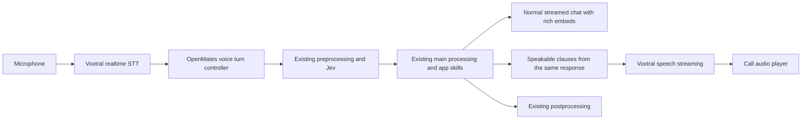

# Shared-pipeline voice mode: research for clarification

Checked 22 October 2026. TASK-6487 owns the follow-up; Tasks remains the status
authority. This is research and a proposal, not an approved product contract.

## Corrected intent

Use the existing preprocessing, main processing and postprocessing architecture
with small voice adapters. Preserve normal automatic model and reasoning-effort
selection, user preferences, Google eligibility, skills, permission continuations,
rich messages and embeds. Do not force Mercury or introduce a non-Google policy.
The earlier all-Google exclusion was an assistant assumption and is withdrawn.

The user proposes a localized waiting acknowledgement for non-Mercury responses.
Precise acknowledgement timing and interruption behavior remain clarification
topics. Ask one question per round, then update the existing voice-call
Specification before implementing the migration.

## Public weights and offline Apple feasibility

| Family/checkpoint | Verified access/license | Implication |
| --- | --- | --- |
| New Voxtral 3 batch STT, realtime STT and TTS | API models; no public generation-3 checkpoint or weight license found in Mistral's model pages or its Hugging Face author inventory. The launch directs private deployments to sales. | Do not promise downloadable/offline Voxtral 3 in our apps. Private server deployment does not establish mobile redistribution rights. |
| `mistralai/Voxtral-Mini-4B-Realtime-2602` | Public BF16 checkpoint, Apache 2.0. | A genuine older offline STT candidate; do not label it generation 3. |
| `mistralai/Voxtral-Mini-4B-Realtime-Arabic` | Public Apache 2.0 Arabic-focused fine-tune of 2602. | Another downloadable checkpoint; it is not a public release of Voxtral 3 weights. |
| `mistralai/Voxtral-Mini-3B-2507` and `Voxtral-Small-24B-2507` | Earlier downloadable Apache 2.0 audio-understanding models. | Different models and runtime requirements, not substitutes for the new API IDs. |
| `mistralai/Voxtral-4B-TTS-2603` | Public weights; Mistral's model card states CC BY-NC 4.0 inherited from the reference voices. | Downloadable is not the same as permissively licensed. Do not assume commercial app distribution is covered. Community runtime licenses do not replace the weight license. |

The [launch](https://mistral.ai/news/voxtral-3/), current
[realtime model](https://docs.mistral.ai/models/voxtral-mini-transcribe-realtime-3-0),
[TTS model](https://docs.mistral.ai/models/voxtral-mini-tts-3-0),
[official model inventory](https://huggingface.co/api/models?author=mistralai&search=Voxtral&full=true&limit=100),
[older realtime card](https://huggingface.co/mistralai/Voxtral-Mini-4B-Realtime-2602)
and [older TTS card](https://huggingface.co/mistralai/Voxtral-4B-TTS-2603)
were checked directly. Absence of a verified public release is a dated finding,
not a claim that weights can never be released. Mistral's label "offline" in its
audio API documentation means complete-input processing; it does not mean
execution without an internet connection.
The [Arabic checkpoint card](https://huggingface.co/mistralai/Voxtral-Mini-4B-Realtime-Arabic)
explicitly identifies its 2602 base and Apache 2.0 license.

There are usable implementation leads for **older** checkpoints:

- [mlx-audio](https://github.com/Blaizzy/mlx-audio) documents quantized 2602
  realtime STT and 2603 TTS on Apple Silicon.
- [voxtral.c](https://github.com/antirez/voxtral.c) implements streaming 2602 STT
  in C with a Metal backend on Apple Silicon Macs. Its published BF16 download
  is about 8.9 GB; those Mac results do not establish iPhone performance.
- [mlx-voxtral-swift](https://github.com/VincentGourbin/mlx-voxtral-swift)
  implements older STT and TTS in native Swift. Its README and Package.swift
  disagree on minimum macOS versions; the checked manifest lists macOS 15 and
  iOS 17. Treat platform declarations as integration leads, not verified support.
- [Mistral-TTS-iOS](https://github.com/lbj96347/Mistral-TTS-iOS) includes an
  on-device MLX Swift app and an iPhone 15 Pro sample for 2603. Its mixed
  quantization retains Q4 for language/acoustic components and uses Q2 for the
  codec; its "q2" label does not mean the entire model is two-bit.

Inference: an optional older STT download on Apple Silicon Mac is a realistic
prototype. iOS needs physical-device peak-memory, sustained-speed, heat and
battery measurements alongside the rest of OpenMates. Quantized weight size is
not peak runtime memory. None of these models was downloaded or benchmarked on
Apple hardware in this research. Integrate any eventual licensed candidate with
our existing local-model registry, verified downloads, explicit local selection
and cancellation interfaces, not a parallel model manager. Local speech alone
does not make cloud reasoning or network-dependent skills work offline.

## Minimal architecture

The added controller admits a completed user transcript through the canonical
chat request path with call/turn binding, rather than running a second answer
model or extending the old live-model skill broker into another general pipeline.
Keep context, compression, Project access, focus/memories, billing and tool
continuations in their existing owners. Supply a small voice delivery context
that encourages concise, speakable prose without suppressing rich output.

The authoritative assistant message still contains prose, inline links, embed
references and image groups. The standard renderer continues to display it.
Speech reads its natural prose and useful link labels; it skips URLs, protocol
syntax and visual payloads. Do not insert a generic "structured data is available"
between already explanatory sentences. Brief descriptions of visual results
should come from the main answer, not another paraphrasing model.

Example: the assistant says "I found these images of the city. Here is a useful
video explaining its history." Chat displays the image group and video preview
between the corresponding prose blocks. TTS speaks those two sentences; it does
not read their embed IDs, serialized metadata or duplicate generated summaries.

Use immutable short sentence/clause boundaries with message/source revisions.
Do not wait for the whole answer, postprocessing or an entire long paragraph
before starting useful audio. Preserve ordering and bounded audio buffering.
The [documented speech streaming API](https://docs.mistral.ai/studio/audio/text-to-speech/stream-speech)
streams output audio for complete input text. Short completed clauses are a
documented first route. The separate realtime TTS model exists, but its public
standalone incremental-input interface remains insufficiently specified to make
it the initial architectural dependency. Benchmark clause continuity and latency.

Use one call playback owner so ordinary auto-speak cannot duplicate call speech.
Separate generated, queued and actually played content. Preserve rich chat
history after interruption while supplying an accurate heard-content boundary to
the next turn. Already committed actions remain committed; interruption cannot
undo or automatically repeat them.

## Speech detection: location and responsibility

No single detector is the universal best choice. Distinguish three decisions:
speech/noise detection, semantic end-of-turn, and interruption of assistant output.

| Candidate | Evidence and fit |
| --- | --- |
| [Silero VAD](https://github.com/snakers4/silero-vad) | Mature MIT-licensed speech activity detector, CPU/ONNX support. Useful on a device or server; its inference speed is not an end-of-turn quality guarantee. |
| [Smart Turn v3.2](https://github.com/pipecat-ai/smart-turn) | BSD-2-Clause audio-native turn-completion model; repository documents a small quantized CPU model and 23 languages. Complements VAD; it does not replace echo cancellation or interruption policy. |
| [Voxtral native turn detection](https://docs.mistral.ai/studio/audio/speech-to-text/turn-detection) | Already inside the planned STT session, combining acoustic and semantic evidence. Best initial integration candidate for minimal additional machinery; test its behavior rather than assuming superiority. |
| [LiveKit turns](https://docs.livekit.io/agents/logic/turns/) and [adaptive interruptions](https://docs.livekit.io/agents/logic/turns/adaptive-interruption-handling/) | Useful reference for pause/resume, backchannels, cancellation and played history. Adaptive interruption inference has LiveKit Cloud authentication requirements even for a self-hosted agent; do not call it a dependency-free local classifier. |

LiveKit's "client-side" turn-taking can mean the server-hosted agent acting as
the client of a model API; it does not necessarily mean inference in the user's
browser. Device versus server is a placement decision, separate from the choice
of VAD or semantic model.

Proposed split: the server owns turn state and final interruption decisions.
Voxtral events supply speech/turn boundaries, not a verified backchannel-intent
verdict. Reuse the web client's existing Silero detector for responsive speaking
feedback. Following clarification round 1, do not pause playback on every VAD
start: that would audibly interrupt ordinary acknowledgements. Any tentative
pause/ducking policy must distinguish uncertain sustained overlap from a brief
listener cue and remains a separate decision. A tentative pause is reversible
and does not cancel tools. Confirmed interruption intent cancels the answer/audio
generation and invalidates late packets using call/turn identities. Server-only
detection remains a valid fallback when a local detector cannot run. Apple
currently uses a simpler energy gate; local feedback there needs a separate
capability decision, not assumed parity.

Keep capture and echo suppression active during playback. Avoid aggressive
speech-only upload gating that removes quiet words or pauses needed by semantic
endpointing. Preserve pre-roll and enough trailing audio; the existing five-second
idle upload optimization is not a turn-end timeout. Never require multiple words
before honoring a short deliberate "stop" or "no".

Voxtral sends `turn.start`, `turn.eager_end`, `turn.resume` and `turn.end`. An eager
end permits only disposable preparation. Do not dispatch side-effect tools there.
The last transcript words can arrive after `turn.end`; the documented collection
rule waits through the configured streaming delay or the next start event.
Revalidate the final request before reusing speculative work. Begin with a
non-speculative path if it is sufficient; speculation is an optimization.

Backchannels, background voices, echo, a real new request, and a deliberate stop
need realistic audio tests. A stock VAD alone cannot settle these distinctions
reliably.

### Clarification round 1: accepted intent

The user explicitly prefers natural listening acknowledgements such as "hmm"
and "okay" to leave the assistant's response uninterrupted. Yield when the user
clearly intends to interrupt. A brief acknowledgement during an explanation is
not a new task or consent to an unrelated action. Existing explicit confirmation
flows still retain their own meaning. Do not buffer an ignored acknowledgement
and later present it to the main model as the next user request.

This is achievable using existing approaches, but reliable intent detection and
safe cancellation need engineering and acoustic validation. Calling a fast text
LLM is not sufficient by itself: the same word can carry different intent,
prosody is lost in plain text, STT may still revise its partial transcript, and
another API request adds a network/failure dependency.

[LiveKit adaptive interruptions](https://docs.livekit.io/agents/logic/turns/adaptive-interruption-handling/)
already uses a streaming acoustic classifier after VAD to distinguish a
backchannel from an intentional interruption without waiting for a transcript.
It provides a concrete evaluation baseline, with the previously noted Cloud
dependency. This does not establish that Mistral's native turn detector offers
the same classification. Smart Turn predicts turn completion, a different task.

Recommend an OpenMates-owned interruption interface that can combine streaming
audio evidence, partial transcription and current conversation state. Evaluate
the dedicated acoustic approach before selecting its provider. A clear stop
request should not wait for a secondary general-purpose LLM. A short word such
as "no" must be interpreted in context; word-count thresholds or global ignore
lists are inadequate. Keep receiving audio after an initial "okay" so "okay, but
please show Berlin instead" is not discarded as a listener cue.

Mercury is a possible bounded classifier for ambiguous **text**, not the default
gate for every microphone frame or overlap. If evaluated, give it only the
necessary partial transcript and recent conversational context, request a typed
intent/uncertainty decision, and make no app-skill calls through that classifier.
Benchmark latency and errors separately from Mercury's role as the automatically
routed answer model. Do not promise timing until measured. Classifier timeouts
must not leave a user unable to take the floor or permit stale speech/actions.

## Waiting acknowledgement and source findings

The preprocessor already supplies model selection, reasoning effort and request
language. Preserve those decisions. The user's suggested rule is one localized
waiting acknowledgement on a non-Mercury route, with no acknowledgement for
ordinary Mercury replies. Resolve the actual attempted model after fallback as
well as initial routing; avoid overlapping an acknowledgement and useful speech.

Current prerecorded assets cover English, German, Spanish and French, and use
the earlier voices. They are reusable infrastructure, not full language/voice
coverage. A missing language must not silently produce an English phrase. The
revised contract should decide how unsupported clips are produced or omitted,
and how Mercury tool waits, longer reasoning or fallback affect the proposed rule.

Source inspected at task commit `54951b6`, with current canonical routing also
checked at `1dfb57acd5`. Routing changed after the task snapshot; the current
Mercury default is MEDIUM rather than the older LOW setting. Voice mode must
consume current routing decisions, not copy this research's model table.

Relevant reusable boundaries:

- `backend/apps/ai/processing/{preprocessor,model_routing,main_processor,postprocessor}.py`
- `backend/apps/ai/tasks/stream_consumer.py` and `skills/ask_skill.py`
- `backend/apps/ai/assistant_speech/{projection,streaming}.py`
- `backend/apps/audio/assistant_speech/{acknowledgements,voice_profiles}.py`
- `backend/core/api/app/routes/voice_call.py` and the existing voice broker
- `frontend/packages/ui/src/services/voiceCall{,AudioGate,Detector,Detector.worker}.ts`
- Apple `Core/VoiceCall` and existing `Core/LocalModels` adapters

The current web Silero worker gates microphone upload and speaking UI; the call
player still stops on the server's `audio.interrupted` event. Connecting local
VAD to playback would therefore be a behavior change, not existing behavior.
The current speech projection also inserts generic visual/code announcements;
the call-specific projection must meet the user's natural narration requirement.

## Contract and implementation sequence after clarification

Extend `specifications/features/video-call` for shared processing, routing,
spoken/rich output, localized acknowledgements, turn admission and interruption.
Reference existing model-routing and assistant-response-speech contracts; change
their shared promises only where necessary. Preserve existing binding, permission,
camera/screen, cancellation and history requirements unless the user explicitly
approves a rollout limitation. Offline model additions would separately extend
the Apple local-model contract after license and device validation.

After one-question-at-a-time clarification, present the concrete revised
Specification with natural examples. Then implement the adapters, preserve
coverage, and run focused unit plus isolated browser/backend CI. Real-provider
and acoustic verification must cover thinking pauses, trailing negations, brief
stops, backchannels, speakerphone echo, resumed speech, slow tools, fallback,
multilingual acknowledgement, rich result groups and interruption with late
packets. Measure useful first speech separately from waiting fillers.
